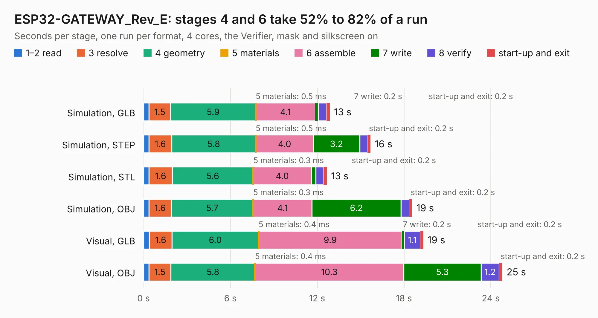

# 1839. ESP32-GATEWAY_Rev_E

Board 1,839 of the 3,122 of [Corpus Testing](../Corpus-Testing.md), on [Corpus Page 18](../CorpusTestingPages/Corpus-Testing-18.md#1839-esp32-gateway_rev_e).

| Mode and format | 1–2 read | 3 resolve | 4 geometry | 5 materials | 6 assemble | 7 write | 8 verify | start-up and exit | Total |
|---|---:|---:|---:|---:|---:|---:|---:|---:|---:|
| Simulation, GLB | 0.4 | 1.5 | 5.9 | 0.5&nbsp;ms | 4.1 | 0.2 | 0.6 | 0.2 | 12.9 |
| Simulation, STEP | 0.4 | 1.6 | 5.8 | 0.5&nbsp;ms | 4.0 | 3.2 | 0.5 | 0.2 | 15.7 |
| Simulation, STL | 0.4 | 1.6 | 5.6 | 0.3&nbsp;ms | 4.0 | 0.3 | 0.5 | 0.2 | 12.7 |
| Simulation, OBJ | 0.4 | 1.6 | 5.7 | 0.3&nbsp;ms | 4.1 | 6.2 | 0.6 | 0.2 | 18.6 |
| Visual, GLB | 0.4 | 1.6 | 6.0 | 0.4&nbsp;ms | 9.9 | 0.2 | 1.1 | 0.2 | 19.3 |
| Visual, OBJ | 0.4 | 1.5 | 5.8 | 0.4&nbsp;ms | 10.3 | 5.3 | 1.2 | 0.2 | 24.8 |

<table align="center"><tr><td valign="top">

| Board | Repo: [OLIMEX/ESP32-GATEWAY](https://github.com/OLIMEX/ESP32-GATEWAY) Board: `ESP32-GATEWAY_Rev_E.kicad_pcb` |
|---|---|
| Folder | HARDWARE / Hardware revision E |
| Complexity | 288&nbsp;/&nbsp;1000 (size&nbsp;233, features&nbsp;55) |
| KESE&nbsp;features | through vias, slotted holes, filled zones, copper text |
| Tested | 9th November 2026 |
| Copper&nbsp;layers | 2 |
| File&nbsp;format | KiCad 5 (20171130) |
| Parts,&nbsp;tracks,&nbsp;vias | 82, 1,795, 226 |
| Triangles,&nbsp;simulation | 1,276,018 in 103 parts |
| Verifier | PASS in all six runs |

</td><td valign="top">

<table>
<tr><th>File type</th><th>File size</th><th>Peak memory used</th></tr>
<tr><th colspan="3" align="left">Simulation</th></tr>
<tr><td>GLB</td><td align="right">45&nbsp;MB</td><td align="right">541&nbsp;MB</td></tr>
<tr><td>STEP</td><td align="right">236&nbsp;MB</td><td align="right">645&nbsp;MB</td></tr>
<tr><td>STL</td><td align="right">64&nbsp;MB</td><td align="right">535&nbsp;MB</td></tr>
<tr><td>OBJ</td><td align="right">134&nbsp;MB</td><td align="right">881&nbsp;MB</td></tr>
<tr><th colspan="3" align="left">Visual</th></tr>
<tr><td>GLB</td><td align="right">37&nbsp;MB</td><td align="right">685&nbsp;MB</td></tr>
<tr><td>OBJ</td><td align="right">111&nbsp;MB</td><td align="right">839&nbsp;MB</td></tr>
</table>

</td></tr></table>

| Previous | Next |
|:---|---:|
| [1838. ESP32-GATEWAY_Rev_D](b1838b_ESP32-GATEWAY_ESP32-GATEWAY-Rev-D.md) | [1840. ESP32-GATEWAY_Rev_F](b1840b_ESP32-GATEWAY_ESP32-GATEWAY-Rev-F.md) |
