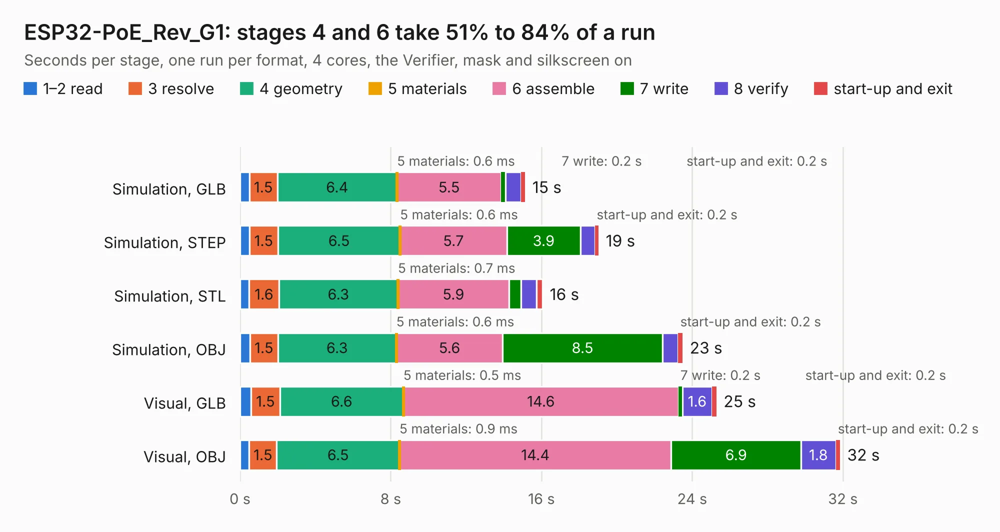

# 1839. ESP32-PoE_Rev_G1

Board 1,839 of the 3,104 of [Corpus Testing](../Corpus-Testing.md), on [Corpus Page 18](../CorpusTestingPages/Corpus-Testing-18.md#1839-esp32-poe_rev_g1).

| Mode and format | 1–2 read | 3 resolve | 4 geometry | 5 materials | 6 assemble | 7 write | 8 verify | start-up and exit | Total |
|---|---:|---:|---:|---:|---:|---:|---:|---:|---:|
| Simulation, GLB | 0.5 | 1.5 | 6.4 | 0.6&nbsp;ms | 5.5 | 0.2 | 0.8 | 0.2 | 15.1 |
| Simulation, STEP | 0.5 | 1.5 | 6.5 | 0.6&nbsp;ms | 5.7 | 3.9 | 0.8 | 0.2 | 19.0 |
| Simulation, STL | 0.5 | 1.6 | 6.3 | 0.7&nbsp;ms | 5.9 | 0.6 | 0.8 | 0.3 | 16.1 |
| Simulation, OBJ | 0.5 | 1.5 | 6.3 | 0.6&nbsp;ms | 5.6 | 8.5 | 0.8 | 0.2 | 23.5 |
| Visual, GLB | 0.6 | 1.5 | 6.6 | 0.5&nbsp;ms | 14.6 | 0.2 | 1.6 | 0.2 | 25.3 |
| Visual, OBJ | 0.5 | 1.5 | 6.5 | 0.9&nbsp;ms | 14.4 | 6.9 | 1.8 | 0.2 | 31.8 |

<table align="center"><tr><td valign="top">

| Board | Repo: [OLIMEX/ESP32-POE](https://github.com/OLIMEX/ESP32-POE) Board: `ESP32-PoE_Rev_G1.kicad_pcb` |
|---|---|
| Folder | HARDWARE / ESP32-PoE-hardware-revision-G1 |
| Complexity | 297&nbsp;/&nbsp;1000 (size&nbsp;242, features&nbsp;55) |
| KESE&nbsp;features | through vias, slotted holes, rounded, trapezoid or chamfered pads, filled zones |
| Tested | 9th November 2026 |
| Copper&nbsp;layers | 2 |
| File&nbsp;format | KiCad 5 (20171130) |
| Parts,&nbsp;tracks,&nbsp;vias | 120, 2,717, 212 |
| Triangles,&nbsp;simulation | 1,477,504 in 135 parts |
| Verifier | PASS in all six runs |

</td><td valign="top">

<table>
<tr><th>File type</th><th>File size</th><th>Peak memory used</th></tr>
<tr><th colspan="3" align="left">Simulation</th></tr>
<tr><td>GLB</td><td align="right">53&nbsp;MB</td><td align="right">634&nbsp;MB</td></tr>
<tr><td>STEP</td><td align="right">287&nbsp;MB</td><td align="right">744&nbsp;MB</td></tr>
<tr><td>STL</td><td align="right">74&nbsp;MB</td><td align="right">642&nbsp;MB</td></tr>
<tr><td>OBJ</td><td align="right">158&nbsp;MB</td><td align="right">1.0&nbsp;GB</td></tr>
<tr><th colspan="3" align="left">Visual</th></tr>
<tr><td>GLB</td><td align="right">45&nbsp;MB</td><td align="right">783&nbsp;MB</td></tr>
<tr><td>OBJ</td><td align="right">137&nbsp;MB</td><td align="right">982&nbsp;MB</td></tr>
</table>

</td></tr></table>

| Previous | Next |
|:---|---:|
| [1838. ESP32-PoE_Rev_E](b1838b_ESP32-POE_ESP32-PoE-Rev-E.md) | [1840. ESP32-PoE_Rev_I](b1840b_ESP32-POE_ESP32-PoE-Rev-I.md) |
