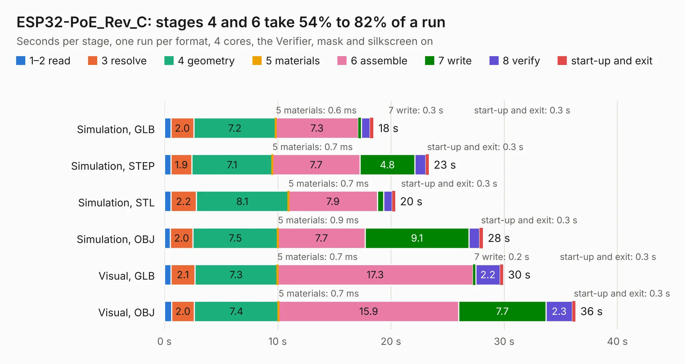

# 1840. ESP32-PoE_Rev_C

Board 1,840 of the 3,108 of [Corpus Testing](../Corpus-Testing.md), on [Corpus Page 18](../CorpusTestingPages/Corpus-Testing-18.md#1840-esp32-poe_rev_c).

| Mode and format | 1–2 read | 3 resolve | 4 geometry | 5 materials | 6 assemble | 7 write | 8 verify | start-up and exit | Total |
|---|---:|---:|---:|---:|---:|---:|---:|---:|---:|
| Simulation, GLB | 0.6 | 2.0 | 7.2 | 0.6&nbsp;ms | 7.3 | 0.3 | 0.7 | 0.3 | 18.5 |
| Simulation, STEP | 0.6 | 1.9 | 7.1 | 0.7&nbsp;ms | 7.7 | 4.8 | 1.0 | 0.3 | 23.3 |
| Simulation, STL | 0.6 | 2.2 | 8.1 | 0.7&nbsp;ms | 7.9 | 0.5 | 0.8 | 0.3 | 20.4 |
| Simulation, OBJ | 0.5 | 2.0 | 7.5 | 0.9&nbsp;ms | 7.7 | 9.1 | 0.9 | 0.3 | 28.1 |
| Visual, GLB | 0.6 | 2.1 | 7.3 | 0.7&nbsp;ms | 17.3 | 0.2 | 2.2 | 0.3 | 29.9 |
| Visual, OBJ | 0.6 | 2.0 | 7.4 | 0.7&nbsp;ms | 15.9 | 7.7 | 2.3 | 0.3 | 36.3 |

<table align="center"><tr><td valign="top">

| Board | Repo: [OLIMEX/ESP32-POE](https://github.com/OLIMEX/ESP32-POE) Board: `ESP32-PoE_Rev_C.kicad_pcb` |
|---|---|
| Folder | HARDWARE / ESP32-PoE-hardware-revision-C1 |
| Complexity | 284&nbsp;/&nbsp;1000 (size&nbsp;239, features&nbsp;45) |
| KESE&nbsp;features | through vias, slotted holes, filled zones |
| Tested | 9th November 2026 |
| Copper&nbsp;layers | 2 |
| File&nbsp;format | KiCad 5 (20171130) |
| Parts,&nbsp;tracks,&nbsp;vias | 111, 2,500, 173 |
| Triangles,&nbsp;simulation | 1,379,052 in 139 parts |
| Verifier | PASS in all six runs |

</td><td valign="top">

<table>
<tr><th>File type</th><th>File size</th><th>Peak memory used</th></tr>
<tr><th colspan="3" align="left">Simulation</th></tr>
<tr><td>GLB</td><td align="right">49&nbsp;MB</td><td align="right">574&nbsp;MB</td></tr>
<tr><td>STEP</td><td align="right">274&nbsp;MB</td><td align="right">672&nbsp;MB</td></tr>
<tr><td>STL</td><td align="right">69&nbsp;MB</td><td align="right">578&nbsp;MB</td></tr>
<tr><td>OBJ</td><td align="right">147&nbsp;MB</td><td align="right">981&nbsp;MB</td></tr>
<tr><th colspan="3" align="left">Visual</th></tr>
<tr><td>GLB</td><td align="right">41&nbsp;MB</td><td align="right">783&nbsp;MB</td></tr>
<tr><td>OBJ</td><td align="right">125&nbsp;MB</td><td align="right">908&nbsp;MB</td></tr>
</table>

</td></tr></table>

| Previous | Next |
|:---|---:|
| [1839. ESP32-PoE_Rev_C](b1839b_ESP32-POE_HARDWARE-ESP32-PoE-hardware-revision-C_ESP32-PoE-Rev-C.md) | [1841. ESP32-PoE_Rev_D](b1841b_ESP32-POE_ESP32-PoE-Rev-D.md) |
