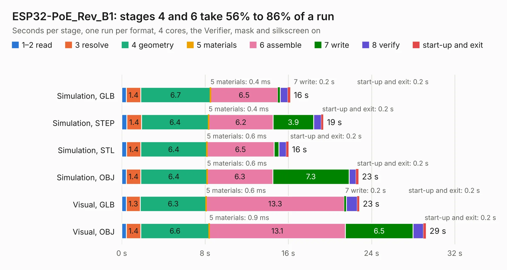

# 1841. ESP32-PoE_Rev_B1

Board 1,841 of the 3,112 of [Corpus Testing](../Corpus-Testing.md), on [Corpus Page 18](../CorpusTestingPages/Corpus-Testing-18.md#1841-esp32-poe_rev_b1).

| Mode and format | 1–2 read | 3 resolve | 4 geometry | 5 materials | 6 assemble | 7 write | 8 verify | start-up and exit | Total |
|---|---:|---:|---:|---:|---:|---:|---:|---:|---:|
| Simulation, GLB | 0.4 | 1.4 | 6.7 | 0.4&nbsp;ms | 6.5 | 0.2 | 0.7 | 0.2 | 16.2 |
| Simulation, STEP | 0.5 | 1.4 | 6.4 | 0.4&nbsp;ms | 6.2 | 3.9 | 0.7 | 0.2 | 19.4 |
| Simulation, STL | 0.5 | 1.4 | 6.4 | 0.6&nbsp;ms | 6.5 | 0.4 | 0.7 | 0.2 | 16.0 |
| Simulation, OBJ | 0.4 | 1.4 | 6.4 | 0.6&nbsp;ms | 6.3 | 7.3 | 0.7 | 0.2 | 22.7 |
| Visual, GLB | 0.4 | 1.3 | 6.3 | 0.6&nbsp;ms | 13.3 | 0.2 | 1.0 | 0.2 | 22.8 |
| Visual, OBJ | 0.4 | 1.4 | 6.6 | 0.9&nbsp;ms | 13.1 | 6.5 | 1.0 | 0.2 | 29.2 |

<table align="center"><tr><td valign="top">

| Board | Repo: [OLIMEX/ESP32-POE](https://github.com/OLIMEX/ESP32-POE) Board: `ESP32-PoE_Rev_B1.kicad_pcb` |
|---|---|
| Folder | HARDWARE / ESP32-PoE-hardware-revision-B1 |
| Complexity | 294&nbsp;/&nbsp;1000 (size&nbsp;239, features&nbsp;55) |
| KESE&nbsp;features | through vias, slotted holes, filled zones, copper text |
| Tested | 9th November 2026 |
| Copper&nbsp;layers | 2 |
| File&nbsp;format | KiCad 5 (20171130) |
| Parts,&nbsp;tracks,&nbsp;vias | 111, 2,429, 176 |
| Triangles,&nbsp;simulation | 1,444,926 in 144 parts |
| Verifier | PASS in all six runs |

</td><td valign="top">

<table>
<tr><th>File type</th><th>File size</th><th>Peak memory used</th></tr>
<tr><th colspan="3" align="left">Simulation</th></tr>
<tr><td>GLB</td><td align="right">52&nbsp;MB</td><td align="right">554&nbsp;MB</td></tr>
<tr><td>STEP</td><td align="right">288&nbsp;MB</td><td align="right">719&nbsp;MB</td></tr>
<tr><td>STL</td><td align="right">72&nbsp;MB</td><td align="right">540&nbsp;MB</td></tr>
<tr><td>OBJ</td><td align="right">154&nbsp;MB</td><td align="right">1.0&nbsp;GB</td></tr>
<tr><th colspan="3" align="left">Visual</th></tr>
<tr><td>GLB</td><td align="right">43&nbsp;MB</td><td align="right">782&nbsp;MB</td></tr>
<tr><td>OBJ</td><td align="right">129&nbsp;MB</td><td align="right">893&nbsp;MB</td></tr>
</table>

</td></tr></table>

| Previous | Next |
|:---|---:|
| [1840. ESP32-P4-PC_Rev_C](b1840b_ESP32-P4-PC_ESP32-P4-PC-Rev-C.md) | [1842. ESP32-PoE_Rev_B2](b1842b_ESP32-POE_ESP32-PoE-Rev-B2.md) |
