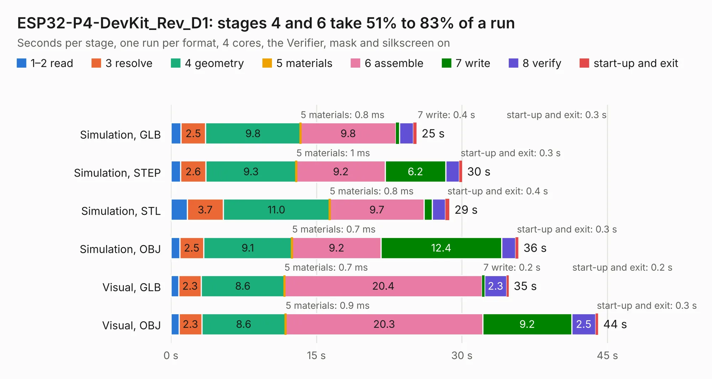

# 1842. ESP32-P4-DevKit_Rev_D1

Board 1,842 of the 3,116 of [Corpus Testing](../Corpus-Testing.md), on [Corpus Page 18](../CorpusTestingPages/Corpus-Testing-18.md#1842-esp32-p4-devkit_rev_d1).

| Mode and format | 1–2 read | 3 resolve | 4 geometry | 5 materials | 6 assemble | 7 write | 8 verify | start-up and exit | Total |
|---|---:|---:|---:|---:|---:|---:|---:|---:|---:|
| Simulation, GLB | 1.0 | 2.5 | 9.8 | 0.8&nbsp;ms | 9.8 | 0.4 | 1.5 | 0.3 | 25.3 |
| Simulation, STEP | 1.0 | 2.6 | 9.3 | 1&nbsp;ms | 9.2 | 6.2 | 1.4 | 0.3 | 30.0 |
| Simulation, STL | 1.7 | 3.7 | 11.0 | 0.8&nbsp;ms | 9.7 | 0.8 | 1.4 | 0.4 | 28.7 |
| Simulation, OBJ | 0.9 | 2.5 | 9.1 | 0.7&nbsp;ms | 9.2 | 12.4 | 1.5 | 0.3 | 35.8 |
| Visual, GLB | 0.8 | 2.3 | 8.6 | 0.7&nbsp;ms | 20.4 | 0.2 | 2.3 | 0.2 | 34.8 |
| Visual, OBJ | 0.8 | 2.3 | 8.6 | 0.9&nbsp;ms | 20.3 | 9.2 | 2.5 | 0.3 | 44.0 |

<table align="center"><tr><td valign="top">

| Board | Repo: [OLIMEX/ESP32-P4-DevKit](https://github.com/OLIMEX/ESP32-P4-DevKit) Board: `ESP32-P4-DevKit_Rev_D1.kicad_pcb` |
|---|---|
| Folder | HARDWARE / ESP32-P4-DevKit-Rev.D1 |
| Complexity | 375&nbsp;/&nbsp;1000 (size&nbsp;270, features&nbsp;105) |
| KESE&nbsp;features | through vias, slotted holes, filled zones, copper text, knockout text, stack-up, dielectric εr and tanδ, mask and silkscreen colours |
| Tested | 9th November 2026 |
| Copper&nbsp;layers | 4 |
| File&nbsp;format | KiCad 7 (20221018) |
| Parts,&nbsp;tracks,&nbsp;vias | 142, 3,494, 216 |
| Triangles,&nbsp;simulation | 2,292,888 in 191 parts |
| Verifier | PASS in all six runs |

</td><td valign="top">

<table>
<tr><th>File type</th><th>File size</th><th>Peak memory used</th></tr>
<tr><th colspan="3" align="left">Simulation</th></tr>
<tr><td>GLB</td><td align="right">82&nbsp;MB</td><td align="right">841&nbsp;MB</td></tr>
<tr><td>STEP</td><td align="right">414&nbsp;MB</td><td align="right">992&nbsp;MB</td></tr>
<tr><td>STL</td><td align="right">115&nbsp;MB</td><td align="right">831&nbsp;MB</td></tr>
<tr><td>OBJ</td><td align="right">249&nbsp;MB</td><td align="right">1.6&nbsp;GB</td></tr>
<tr><th colspan="3" align="left">Visual</th></tr>
<tr><td>GLB</td><td align="right">58&nbsp;MB</td><td align="right">1.0&nbsp;GB</td></tr>
<tr><td>OBJ</td><td align="right">178&nbsp;MB</td><td align="right">1.3&nbsp;GB</td></tr>
</table>

</td></tr></table>

| Previous | Next |
|:---|---:|
| [1841. ESP32-P4-DevKit_Rev_D](b1841b_ESP32-P4-DevKit_ESP32-P4-DevKit-Rev-D.md) | [1843. ESP32-P4-PC_Rev_B](b1843b_ESP32-P4-PC_ESP32-P4-PC-Rev-B.md) |
