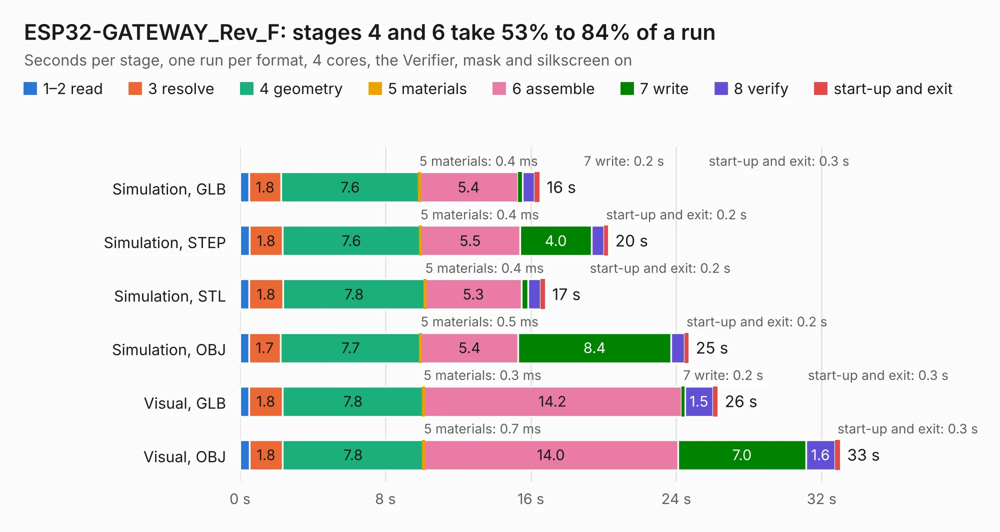

# 1843. ESP32-GATEWAY_Rev_F

Board 1,843 of the 3,127 of [Corpus Testing](../Corpus-Testing.md), on [Corpus Page 18](../CorpusTestingPages/Corpus-Testing-18.md#1843-esp32-gateway_rev_f).

| Mode and format | 1–2 read | 3 resolve | 4 geometry | 5 materials | 6 assemble | 7 write | 8 verify | start-up and exit | Total |
|---|---:|---:|---:|---:|---:|---:|---:|---:|---:|
| Simulation, GLB | 0.5 | 1.8 | 7.6 | 0.4&nbsp;ms | 5.4 | 0.2 | 0.7 | 0.3 | 16.5 |
| Simulation, STEP | 0.5 | 1.8 | 7.6 | 0.4&nbsp;ms | 5.5 | 4.0 | 0.7 | 0.2 | 20.3 |
| Simulation, STL | 0.5 | 1.8 | 7.8 | 0.4&nbsp;ms | 5.3 | 0.4 | 0.7 | 0.2 | 16.8 |
| Simulation, OBJ | 0.5 | 1.7 | 7.7 | 0.5&nbsp;ms | 5.4 | 8.4 | 0.7 | 0.2 | 24.7 |
| Visual, GLB | 0.5 | 1.8 | 7.8 | 0.3&nbsp;ms | 14.2 | 0.2 | 1.5 | 0.3 | 26.3 |
| Visual, OBJ | 0.5 | 1.8 | 7.8 | 0.7&nbsp;ms | 14.0 | 7.0 | 1.6 | 0.3 | 33.0 |

<table align="center"><tr><td valign="top">

| Board | Repo: [OLIMEX/ESP32-GATEWAY](https://github.com/OLIMEX/ESP32-GATEWAY) Board: `ESP32-GATEWAY_Rev_F.kicad_pcb` |
|---|---|
| Folder | HARDWARE / Hardware revision F |
| Complexity | 291&nbsp;/&nbsp;1000 (size&nbsp;236, features&nbsp;55) |
| KESE&nbsp;features | through vias, slotted holes, filled zones, copper text |
| Tested | 9th November 2026 |
| Copper&nbsp;layers | 2 |
| File&nbsp;format | KiCad 6 (20190331) |
| Parts,&nbsp;tracks,&nbsp;vias | 90, 1,929, 320 |
| Triangles,&nbsp;simulation | 1,424,536 in 110 parts |
| Verifier | PASS in all six runs |

</td><td valign="top">

<table>
<tr><th>File type</th><th>File size</th><th>Peak memory used</th></tr>
<tr><th colspan="3" align="left">Simulation</th></tr>
<tr><td>GLB</td><td align="right">50&nbsp;MB</td><td align="right">608&nbsp;MB</td></tr>
<tr><td>STEP</td><td align="right">242&nbsp;MB</td><td align="right">696&nbsp;MB</td></tr>
<tr><td>STL</td><td align="right">71&nbsp;MB</td><td align="right">603&nbsp;MB</td></tr>
<tr><td>OBJ</td><td align="right">150&nbsp;MB</td><td align="right">1.0&nbsp;GB</td></tr>
<tr><th colspan="3" align="left">Visual</th></tr>
<tr><td>GLB</td><td align="right">42&nbsp;MB</td><td align="right">772&nbsp;MB</td></tr>
<tr><td>OBJ</td><td align="right">126&nbsp;MB</td><td align="right">959&nbsp;MB</td></tr>
</table>

</td></tr></table>

| Previous | Next |
|:---|---:|
| [1842. ESP32-GATEWAY_Rev_E](b1842b_ESP32-GATEWAY_ESP32-GATEWAY-Rev-E.md) | [1844. ESP32-GATEWAY_Rev_G](b1844b_ESP32-GATEWAY_ESP32-GATEWAY-Rev-G.md) |
