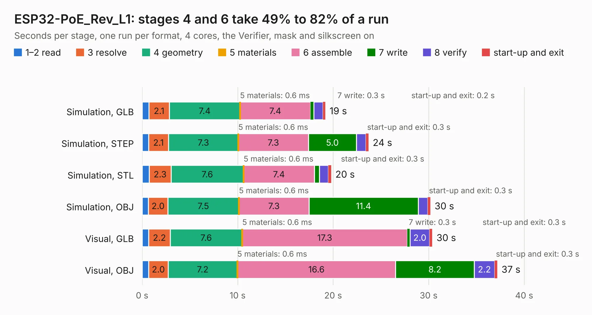

# 1843. ESP32-PoE_Rev_L1

Board 1,843 of the 3,103 of [Corpus Testing](../Corpus-Testing.md), on [Corpus Page 18](../CorpusTestingPages/Corpus-Testing-18.md#1843-esp32-poe_rev_l1).

| Mode and format | 1–2 read | 3 resolve | 4 geometry | 5 materials | 6 assemble | 7 write | 8 verify | start-up and exit | Total |
|---|---:|---:|---:|---:|---:|---:|---:|---:|---:|
| Simulation, GLB | 0.7 | 2.1 | 7.4 | 0.6&nbsp;ms | 7.4 | 0.3 | 1.0 | 0.2 | 19.2 |
| Simulation, STEP | 0.7 | 2.1 | 7.3 | 0.6&nbsp;ms | 7.3 | 5.0 | 1.0 | 0.3 | 23.7 |
| Simulation, STL | 0.7 | 2.3 | 7.6 | 0.6&nbsp;ms | 7.4 | 0.6 | 0.9 | 0.3 | 19.8 |
| Simulation, OBJ | 0.7 | 2.0 | 7.5 | 0.6&nbsp;ms | 7.3 | 11.4 | 1.0 | 0.3 | 30.2 |
| Visual, GLB | 0.7 | 2.2 | 7.6 | 0.6&nbsp;ms | 17.3 | 0.3 | 2.0 | 0.3 | 30.4 |
| Visual, OBJ | 0.7 | 2.0 | 7.2 | 0.6&nbsp;ms | 16.6 | 8.2 | 2.2 | 0.3 | 37.2 |

<table align="center"><tr><td valign="top">

| Board | Repo: [OLIMEX/ESP32-POE](https://github.com/OLIMEX/ESP32-POE) Board: `ESP32-PoE_Rev_L1.kicad_pcb` |
|---|---|
| Folder | HARDWARE / ESP32-PoE-hardware-revision-L1 |
| Complexity | 323&nbsp;/&nbsp;1000 (size&nbsp;258, features&nbsp;65) |
| KESE&nbsp;features | through vias, slotted holes, rounded, trapezoid or chamfered pads, filled zones, copper text |
| Tested | 9th November 2026 |
| Copper&nbsp;layers | 4 |
| File&nbsp;format | KiCad 5 (20171130) |
| Parts,&nbsp;tracks,&nbsp;vias | 128, 2,574, 221 |
| Triangles,&nbsp;simulation | 2,024,004 in 139 parts |
| Verifier | PASS in all six runs |

</td><td valign="top">

<table>
<tr><th>File type</th><th>File size</th><th>Peak memory used</th></tr>
<tr><th colspan="3" align="left">Simulation</th></tr>
<tr><td>GLB</td><td align="right">71&nbsp;MB</td><td align="right">673&nbsp;MB</td></tr>
<tr><td>STEP</td><td align="right">314&nbsp;MB</td><td align="right">826&nbsp;MB</td></tr>
<tr><td>STL</td><td align="right">101&nbsp;MB</td><td align="right">703&nbsp;MB</td></tr>
<tr><td>OBJ</td><td align="right">216&nbsp;MB</td><td align="right">1.4&nbsp;GB</td></tr>
<tr><th colspan="3" align="left">Visual</th></tr>
<tr><td>GLB</td><td align="right">49&nbsp;MB</td><td align="right">860&nbsp;MB</td></tr>
<tr><td>OBJ</td><td align="right">149&nbsp;MB</td><td align="right">1.1&nbsp;GB</td></tr>
</table>

</td></tr></table>

| Previous | Next |
|:---|---:|
| [1842. ESP32-PoE_Rev_L](b1842b_ESP32-POE_ESP32-PoE-Rev-L.md) | [1844. ESP32-PoE_Rev_M](b1844b_ESP32-POE_ESP32-PoE-Rev-M.md) |
