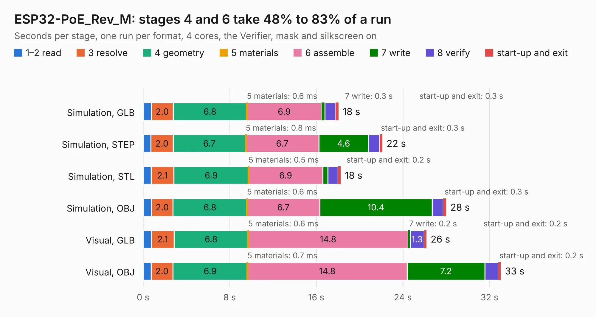

# 1845. ESP32-PoE_Rev_M

Board 1,845 of the 3,104 of [Corpus Testing](../Corpus-Testing.md), on [Corpus Page 18](../CorpusTestingPages/Corpus-Testing-18.md#1845-esp32-poe_rev_m).

| Mode and format | 1–2 read | 3 resolve | 4 geometry | 5 materials | 6 assemble | 7 write | 8 verify | start-up and exit | Total |
|---|---:|---:|---:|---:|---:|---:|---:|---:|---:|
| Simulation, GLB | 0.8 | 2.0 | 6.8 | 0.6&nbsp;ms | 6.9 | 0.3 | 1.0 | 0.3 | 18.0 |
| Simulation, STEP | 0.7 | 2.0 | 6.7 | 0.8&nbsp;ms | 6.7 | 4.6 | 1.0 | 0.3 | 22.1 |
| Simulation, STL | 0.7 | 2.1 | 6.9 | 0.5&nbsp;ms | 6.9 | 0.5 | 0.9 | 0.2 | 18.3 |
| Simulation, OBJ | 0.8 | 2.0 | 6.8 | 0.6&nbsp;ms | 6.7 | 10.4 | 1.0 | 0.3 | 28.0 |
| Visual, GLB | 0.8 | 2.1 | 6.8 | 0.6&nbsp;ms | 14.8 | 0.2 | 1.3 | 0.2 | 26.2 |
| Visual, OBJ | 0.7 | 2.0 | 6.9 | 0.7&nbsp;ms | 14.8 | 7.2 | 1.2 | 0.2 | 33.0 |

<table align="center"><tr><td valign="top">

| Board | Repo: [OLIMEX/ESP32-POE](https://github.com/OLIMEX/ESP32-POE) Board: `ESP32-PoE_Rev_M.kicad_pcb` |
|---|---|
| Folder | HARDWARE / ESP32-PoE-hardware-revision-M |
| Complexity | 368&nbsp;/&nbsp;1000 (size&nbsp;258, features&nbsp;110) |
| KESE&nbsp;features | through vias, slotted holes, rounded, trapezoid or chamfered pads, filled zones, copper text, knockout text, stack-up, dielectric εr and tanδ |
| Tested | 9th November 2026 |
| Copper&nbsp;layers | 4 |
| File&nbsp;format | KiCad 7 (20221018) |
| Parts,&nbsp;tracks,&nbsp;vias | 127, 2,528, 233 |
| Triangles,&nbsp;simulation | 1,971,162 in 133 parts |
| Verifier | PASS in all six runs |

</td><td valign="top">

<table>
<tr><th>File type</th><th>File size</th><th>Peak memory used</th></tr>
<tr><th colspan="3" align="left">Simulation</th></tr>
<tr><td>GLB</td><td align="right">69&nbsp;MB</td><td align="right">722&nbsp;MB</td></tr>
<tr><td>STEP</td><td align="right">335&nbsp;MB</td><td align="right">887&nbsp;MB</td></tr>
<tr><td>STL</td><td align="right">99&nbsp;MB</td><td align="right">694&nbsp;MB</td></tr>
<tr><td>OBJ</td><td align="right">211&nbsp;MB</td><td align="right">1.4&nbsp;GB</td></tr>
<tr><th colspan="3" align="left">Visual</th></tr>
<tr><td>GLB</td><td align="right">47&nbsp;MB</td><td align="right">874&nbsp;MB</td></tr>
<tr><td>OBJ</td><td align="right">144&nbsp;MB</td><td align="right">1.1&nbsp;GB</td></tr>
</table>

</td></tr></table>

| Previous | Next |
|:---|---:|
| [1844. ESP32-PoE_Rev_L1](b1844b_ESP32-POE_ESP32-PoE-Rev-L1.md) | [1846. ESP32-PoE_Rev_M1](b1846b_ESP32-POE_ESP32-PoE-Rev-M1.md) |
