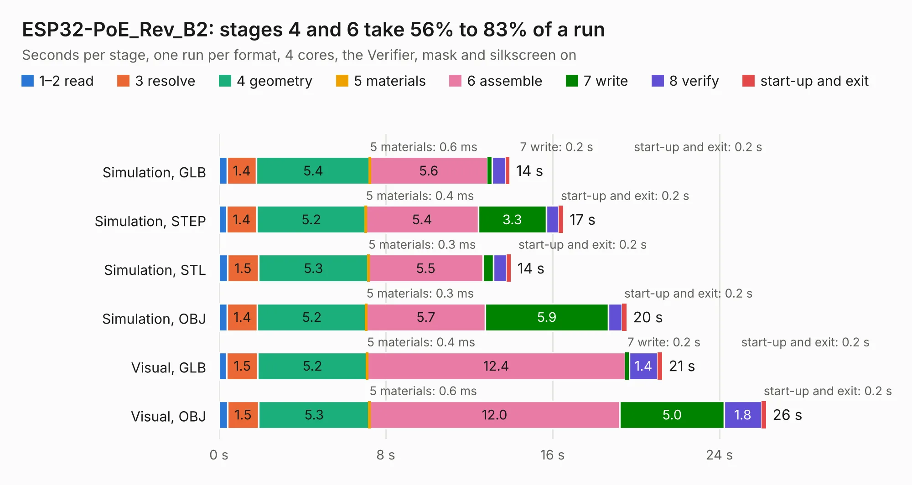

# 1846. ESP32-PoE_Rev_B2

Board 1,846 of the 3,116 of [Corpus Testing](../Corpus-Testing.md), on [Corpus Page 18](../CorpusTestingPages/Corpus-Testing-18.md#1846-esp32-poe_rev_b2).

| Mode and format | 1–2 read | 3 resolve | 4 geometry | 5 materials | 6 assemble | 7 write | 8 verify | start-up and exit | Total |
|---|---:|---:|---:|---:|---:|---:|---:|---:|---:|
| Simulation, GLB | 0.4 | 1.4 | 5.4 | 0.6&nbsp;ms | 5.6 | 0.2 | 0.7 | 0.2 | 13.9 |
| Simulation, STEP | 0.4 | 1.4 | 5.2 | 0.4&nbsp;ms | 5.4 | 3.3 | 0.6 | 0.2 | 16.5 |
| Simulation, STL | 0.4 | 1.5 | 5.3 | 0.3&nbsp;ms | 5.5 | 0.5 | 0.6 | 0.2 | 14.0 |
| Simulation, OBJ | 0.4 | 1.4 | 5.2 | 0.3&nbsp;ms | 5.7 | 5.9 | 0.7 | 0.2 | 19.5 |
| Visual, GLB | 0.4 | 1.5 | 5.2 | 0.4&nbsp;ms | 12.4 | 0.2 | 1.4 | 0.2 | 21.3 |
| Visual, OBJ | 0.4 | 1.5 | 5.3 | 0.6&nbsp;ms | 12.0 | 5.0 | 1.8 | 0.2 | 26.2 |

<table align="center"><tr><td valign="top">

| Board | Repo: [OLIMEX/ESP32-POE](https://github.com/OLIMEX/ESP32-POE) Board: `ESP32-PoE_Rev_B2.kicad_pcb` |
|---|---|
| Folder | HARDWARE / ESP32-PoE-hardware-revision-B2 |
| Complexity | 294&nbsp;/&nbsp;1000 (size&nbsp;239, features&nbsp;55) |
| KESE&nbsp;features | through vias, slotted holes, filled zones, copper text |
| Tested | 9th November 2026 |
| Copper&nbsp;layers | 2 |
| File&nbsp;format | KiCad 5 (20171130) |
| Parts,&nbsp;tracks,&nbsp;vias | 112, 2,429, 176 |
| Triangles,&nbsp;simulation | 1,427,864 in 144 parts |
| Verifier | PASS in all six runs |

</td><td valign="top">

<table>
<tr><th>File type</th><th>File size</th><th>Peak memory used</th></tr>
<tr><th colspan="3" align="left">Simulation</th></tr>
<tr><td>GLB</td><td align="right">51&nbsp;MB</td><td align="right">545&nbsp;MB</td></tr>
<tr><td>STEP</td><td align="right">286&nbsp;MB</td><td align="right">746&nbsp;MB</td></tr>
<tr><td>STL</td><td align="right">71&nbsp;MB</td><td align="right">531&nbsp;MB</td></tr>
<tr><td>OBJ</td><td align="right">152&nbsp;MB</td><td align="right">996&nbsp;MB</td></tr>
<tr><th colspan="3" align="left">Visual</th></tr>
<tr><td>GLB</td><td align="right">42&nbsp;MB</td><td align="right">811&nbsp;MB</td></tr>
<tr><td>OBJ</td><td align="right">127&nbsp;MB</td><td align="right">902&nbsp;MB</td></tr>
</table>

</td></tr></table>

| Previous | Next |
|:---|---:|
| [1845. ESP32-PoE_Rev_B1](b1845b_ESP32-POE_ESP32-PoE-Rev-B1.md) | [1847. ESP32-PoE_Rev_C](b1847b_ESP32-POE_HARDWARE-ESP32-PoE-hardware-revision-C_ESP32-PoE-Rev-C.md) |
