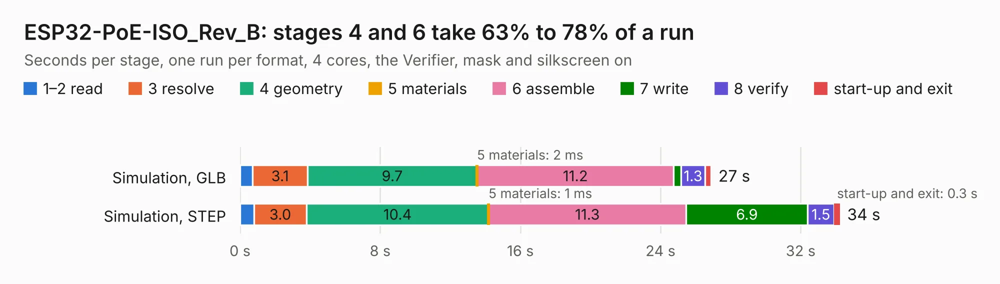

# 1847. ESP32-PoE-ISO_Rev_B

Board 1,847 of the 3,103 of [Corpus Testing](../Corpus-Testing.md), on [Corpus Page 18](../CorpusTestingPages/Corpus-Testing-18.md#1847-esp32-poe-iso_rev_b).

| Mode and format | 1–2 read | 3 resolve | 4 geometry | 5 materials | 6 assemble | 7 write | 8 verify | start-up and exit | Total |
|---|---:|---:|---:|---:|---:|---:|---:|---:|---:|
| Simulation, GLB | 0.7 | 3.1 | 9.7 | 2&nbsp;ms | 11.2 | 0.4 | 1.3 | 0.4 | 26.9 |
| Simulation, STEP | 0.8 | 3.0 | 10.4 | 1&nbsp;ms | 11.3 | 6.9 | 1.5 | 0.3 | 34.2 |
| Simulation, STL | 0.9 | 3.8 | 10.1 | 1&nbsp;ms | 10.4 | 1.0 | 1.5 | 0.4 | 28.2 |
| Simulation, OBJ | 0.8 | 3.2 | 9.1 | 1&nbsp;ms | 10.4 | 14.2 | 1.1 | 0.3 | 39.2 |
| Visual, GLB | 0.7 | 2.9 | 8.6 | 1&nbsp;ms | 22.2 | 0.3 | 2.9 | 0.2 | 37.7 |
| Visual, OBJ | 0.7 | 2.6 | 8.3 | 1&nbsp;ms | 21.5 | 9.5 | 3.0 | 0.3 | 46.0 |

<table align="center"><tr><td valign="top">

| Board | Repo: [OLIMEX/ESP32-POE-ISO](https://github.com/OLIMEX/ESP32-POE-ISO) Board: `ESP32-PoE-ISO_Rev_B.kicad_pcb` |
|---|---|
| Folder | HARDWARE / ESP32-PoE-ISO-Rev.B |
| Complexity | 325&nbsp;/&nbsp;1000 (size&nbsp;260, features&nbsp;65) |
| KESE&nbsp;features | through vias, slotted holes, rounded, trapezoid or chamfered pads, filled zones, curved board outline |
| Tested | 9th November 2026 |
| Copper&nbsp;layers | 4 |
| File&nbsp;format | KiCad 5 (20171130) |
| Parts,&nbsp;tracks,&nbsp;vias | 118, 2,830, 332 |
| Triangles,&nbsp;simulation | 2,271,626 in 142 parts |
| Verifier | PASS in all six runs |

</td><td valign="top">

<table>
<tr><th>File type</th><th>File size</th><th>Peak memory used</th></tr>
<tr><th colspan="3" align="left">Simulation</th></tr>
<tr><td>GLB</td><td align="right">79&nbsp;MB</td><td align="right">817&nbsp;MB</td></tr>
<tr><td>STEP</td><td align="right">312&nbsp;MB</td><td align="right">892&nbsp;MB</td></tr>
<tr><td>STL</td><td align="right">114&nbsp;MB</td><td align="right">805&nbsp;MB</td></tr>
<tr><td>OBJ</td><td align="right">242&nbsp;MB</td><td align="right">1.5&nbsp;GB</td></tr>
<tr><th colspan="3" align="left">Visual</th></tr>
<tr><td>GLB</td><td align="right">51&nbsp;MB</td><td align="right">892&nbsp;MB</td></tr>
<tr><td>OBJ</td><td align="right">157&nbsp;MB</td><td align="right">1.1&nbsp;GB</td></tr>
</table>

</td></tr></table>

| Previous | Next |
|:---|---:|
| [1846. ESP32-PoE_Rev_M2](b1846b_ESP32-POE_ESP32-PoE-Rev-M2.md) | [1848. ESP32-PoE-ISO_Rev_C](b1848b_ESP32-POE-ISO_ESP32-PoE-ISO-Rev-C.md) |
