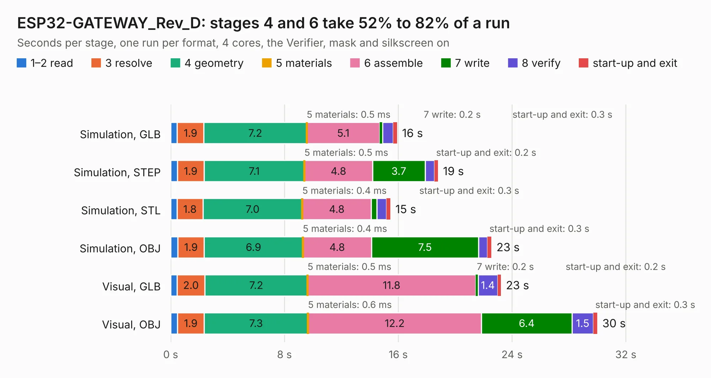

# 1849 ESP32-GATEWAY_Rev_D

Board 1,849 of the 3,138 of [Corpus Testing](../Corpus-Testing.md), on [Corpus Page 18](../CorpusTestingPages/Corpus-Testing-18.md#1849-esp32-gateway_rev_d).

| Mode and format | 1–2 read | 3 resolve | 4 geometry | 5 materials | 6 assemble | 7 write | 8 verify | start-up and exit | Total |
|---|---:|---:|---:|---:|---:|---:|---:|---:|---:|
| Simulation, GLB | 0.5 | 1.9 | 7.2 | 0.5&nbsp;ms | 5.1 | 0.2 | 0.7 | 0.3 | 15.9 |
| Simulation, STEP | 0.5 | 1.9 | 7.1 | 0.5&nbsp;ms | 4.8 | 3.7 | 0.7 | 0.2 | 18.8 |
| Simulation, STL | 0.4 | 1.8 | 7.0 | 0.4&nbsp;ms | 4.8 | 0.4 | 0.7 | 0.3 | 15.4 |
| Simulation, OBJ | 0.5 | 1.9 | 6.9 | 0.4&nbsp;ms | 4.8 | 7.5 | 0.6 | 0.3 | 22.5 |
| Visual, GLB | 0.4 | 2.0 | 7.2 | 0.5&nbsp;ms | 11.8 | 0.2 | 1.4 | 0.2 | 23.2 |
| Visual, OBJ | 0.5 | 1.9 | 7.3 | 0.6&nbsp;ms | 12.2 | 6.4 | 1.5 | 0.3 | 30.0 |

<table align="center"><tr><td valign="top">

| Board | Repo: [OLIMEX/ESP32-GATEWAY](https://github.com/OLIMEX/ESP32-GATEWAY) Board: `ESP32-GATEWAY_Rev_D.kicad_pcb` |
|---|---|
| Folder | HARDWARE / Hardware revision D |
| Complexity | 288&nbsp;/&nbsp;1000 (size&nbsp;233, features&nbsp;55) |
| KESE&nbsp;features | through vias, slotted holes, filled zones, copper text |
| Tested | 9th November 2026 |
| Copper&nbsp;layers | 2 |
| File&nbsp;format | KiCad 5 (20171130) |
| Parts,&nbsp;tracks,&nbsp;vias | 82, 1,793, 226 |
| Triangles,&nbsp;simulation | 1,276,634 in 102 parts |
| Verifier | PASS in all six runs |

</td><td valign="top">

<table>
<tr><th>File type</th><th>File size</th><th>Peak memory used</th></tr>
<tr><th colspan="3" align="left">Simulation</th></tr>
<tr><td>GLB</td><td align="right">45&nbsp;MB</td><td align="right">541&nbsp;MB</td></tr>
<tr><td>STEP</td><td align="right">236&nbsp;MB</td><td align="right">642&nbsp;MB</td></tr>
<tr><td>STL</td><td align="right">64&nbsp;MB</td><td align="right">544&nbsp;MB</td></tr>
<tr><td>OBJ</td><td align="right">135&nbsp;MB</td><td align="right">888&nbsp;MB</td></tr>
<tr><th colspan="3" align="left">Visual</th></tr>
<tr><td>GLB</td><td align="right">37&nbsp;MB</td><td align="right">697&nbsp;MB</td></tr>
<tr><td>OBJ</td><td align="right">111&nbsp;MB</td><td align="right">803&nbsp;MB</td></tr>
</table>

</td></tr></table>

| Previous | Next |
|:---|---:|
| [1848 ESP32-GATEWAY_Rev_C](b1848b_ESP32-GATEWAY_ESP32-GATEWAY-Rev-C.md) | [1850 ESP32-GATEWAY_Rev_E](b1850b_ESP32-GATEWAY_ESP32-GATEWAY-Rev-E.md) |
