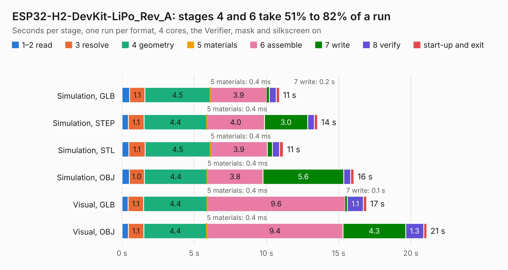

# 1849. ESP32-H2-DevKit-LiPo_Rev_A

Board 1,849 of the 3,130 of [Corpus Testing](../Corpus-Testing.md), on [Corpus Page 18](../CorpusTestingPages/Corpus-Testing-18.md#1849-esp32-h2-devkit-lipo_rev_a).

| Mode and format | 1–2 read | 3 resolve | 4 geometry | 5 materials | 6 assemble | 7 write | 8 verify | start-up and exit | Total |
|---|---:|---:|---:|---:|---:|---:|---:|---:|---:|
| Simulation, GLB | 0.5 | 1.1 | 4.5 | 0.4&nbsp;ms | 3.9 | 0.2 | 0.5 | 0.2 | 10.9 |
| Simulation, STEP | 0.4 | 1.1 | 4.4 | 0.4&nbsp;ms | 4.0 | 3.0 | 0.5 | 0.2 | 13.5 |
| Simulation, STL | 0.5 | 1.1 | 4.5 | 0.4&nbsp;ms | 3.9 | 0.4 | 0.5 | 0.3 | 11.2 |
| Simulation, OBJ | 0.5 | 1.0 | 4.4 | 0.4&nbsp;ms | 3.8 | 5.6 | 0.5 | 0.2 | 16.1 |
| Visual, GLB | 0.4 | 1.1 | 4.4 | 0.4&nbsp;ms | 9.6 | 0.1 | 1.1 | 0.2 | 16.9 |
| Visual, OBJ | 0.4 | 1.1 | 4.4 | 0.4&nbsp;ms | 9.4 | 4.3 | 1.3 | 0.2 | 21.1 |

<table align="center"><tr><td valign="top">

| Board | Repo: [OLIMEX/ESP32-H2-DevKit-Lipo](https://github.com/OLIMEX/ESP32-H2-DevKit-Lipo) Board: `ESP32-H2-DevKit-LiPo_Rev_A.kicad_pcb` |
|---|---|
| Folder | HARDWARE / ESP32-H2-DevKit-Lipo-Rev.A |
| Complexity | 282&nbsp;/&nbsp;1000 (size&nbsp;182, features&nbsp;100) |
| KESE&nbsp;features | through vias, slotted holes, rounded, trapezoid or chamfered pads, filled zones, knockout text, stack-up, dielectric εr and tanδ |
| Tested | 9th November 2026 |
| Copper&nbsp;layers | 2 |
| File&nbsp;format | KiCad 7 (20221018) |
| Parts,&nbsp;tracks,&nbsp;vias | 68, 1,096, 124 |
| Triangles,&nbsp;simulation | 1,066,038 in 83 parts |
| Verifier | PASS in all six runs |

</td><td valign="top">

<table>
<tr><th>File type</th><th>File size</th><th>Peak memory used</th></tr>
<tr><th colspan="3" align="left">Simulation</th></tr>
<tr><td>GLB</td><td align="right">38&nbsp;MB</td><td align="right">552&nbsp;MB</td></tr>
<tr><td>STEP</td><td align="right">224&nbsp;MB</td><td align="right">574&nbsp;MB</td></tr>
<tr><td>STL</td><td align="right">53&nbsp;MB</td><td align="right">517&nbsp;MB</td></tr>
<tr><td>OBJ</td><td align="right">113&nbsp;MB</td><td align="right">790&nbsp;MB</td></tr>
<tr><th colspan="3" align="left">Visual</th></tr>
<tr><td>GLB</td><td align="right">32&nbsp;MB</td><td align="right">694&nbsp;MB</td></tr>
<tr><td>OBJ</td><td align="right">95&nbsp;MB</td><td align="right">719&nbsp;MB</td></tr>
</table>

</td></tr></table>

| Previous | Next |
|:---|---:|
| [1848. ESP32-GATEWAY_Rev_I](b1848b_ESP32-GATEWAY_ESP32-GATEWAY-Rev-I.md) | [1850. ESP32-P4-DevKit_Rev_B](b1850b_ESP32-P4-DevKit_ESP32-P4-DevKit-Rev-B.md) |
