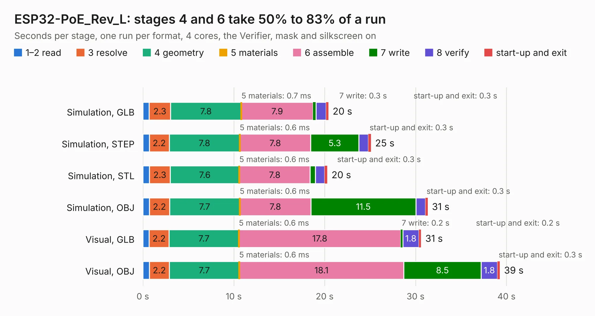

# 1849. ESP32-PoE_Rev_L

Board 1,849 of the 3,110 of [Corpus Testing](../Corpus-Testing.md), on [Corpus Page 18](../CorpusTestingPages/Corpus-Testing-18.md#1849-esp32-poe_rev_l).

| Mode and format | 1–2 read | 3 resolve | 4 geometry | 5 materials | 6 assemble | 7 write | 8 verify | start-up and exit | Total |
|---|---:|---:|---:|---:|---:|---:|---:|---:|---:|
| Simulation, GLB | 0.7 | 2.3 | 7.8 | 0.7&nbsp;ms | 7.9 | 0.3 | 1.1 | 0.3 | 20.4 |
| Simulation, STEP | 0.7 | 2.2 | 7.8 | 0.6&nbsp;ms | 7.8 | 5.3 | 1.1 | 0.3 | 25.1 |
| Simulation, STL | 0.7 | 2.3 | 7.6 | 0.6&nbsp;ms | 7.8 | 0.6 | 1.0 | 0.3 | 20.3 |
| Simulation, OBJ | 0.7 | 2.2 | 7.7 | 0.6&nbsp;ms | 7.8 | 11.5 | 1.1 | 0.3 | 31.3 |
| Visual, GLB | 0.7 | 2.2 | 7.7 | 0.6&nbsp;ms | 17.8 | 0.2 | 1.8 | 0.2 | 30.6 |
| Visual, OBJ | 0.7 | 2.2 | 7.7 | 0.6&nbsp;ms | 18.1 | 8.5 | 1.8 | 0.3 | 39.3 |

<table align="center"><tr><td valign="top">

| Board | Repo: [OLIMEX/ESP32-POE](https://github.com/OLIMEX/ESP32-POE) Board: `ESP32-PoE_Rev_L.kicad_pcb` |
|---|---|
| Folder | HARDWARE / ESP32-PoE-hardware-revision-L |
| Complexity | 323&nbsp;/&nbsp;1000 (size&nbsp;258, features&nbsp;65) |
| KESE&nbsp;features | through vias, slotted holes, rounded, trapezoid or chamfered pads, filled zones, copper text |
| Tested | 9th November 2026 |
| Copper&nbsp;layers | 4 |
| File&nbsp;format | KiCad 5 (20171130) |
| Parts,&nbsp;tracks,&nbsp;vias | 128, 2,574, 221 |
| Triangles,&nbsp;simulation | 2,018,962 in 139 parts |
| Verifier | PASS in all six runs |

</td><td valign="top">

<table>
<tr><th>File type</th><th>File size</th><th>Peak memory used</th></tr>
<tr><th colspan="3" align="left">Simulation</th></tr>
<tr><td>GLB</td><td align="right">71&nbsp;MB</td><td align="right">669&nbsp;MB</td></tr>
<tr><td>STEP</td><td align="right">313&nbsp;MB</td><td align="right">857&nbsp;MB</td></tr>
<tr><td>STL</td><td align="right">101&nbsp;MB</td><td align="right">677&nbsp;MB</td></tr>
<tr><td>OBJ</td><td align="right">216&nbsp;MB</td><td align="right">1.4&nbsp;GB</td></tr>
<tr><th colspan="3" align="left">Visual</th></tr>
<tr><td>GLB</td><td align="right">49&nbsp;MB</td><td align="right">864&nbsp;MB</td></tr>
<tr><td>OBJ</td><td align="right">149&nbsp;MB</td><td align="right">1.1&nbsp;GB</td></tr>
</table>

</td></tr></table>

| Previous | Next |
|:---|---:|
| [1848. ESP32-PoE_Rev_K](b1848b_ESP32-POE_ESP32-PoE-Rev-K.md) | [1850. ESP32-PoE_Rev_L1](b1850b_ESP32-POE_ESP32-PoE-Rev-L1.md) |
