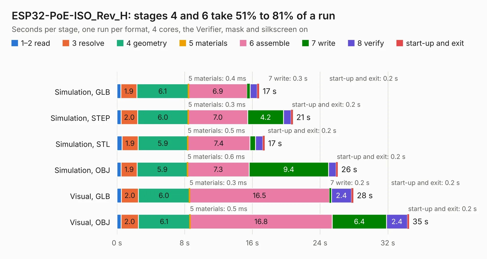

# 1850. ESP32-PoE-ISO_Rev_H

Board 1,850 of the 3,102 of [Corpus Testing](../Corpus-Testing.md), on [Corpus Page 18](../CorpusTestingPages/Corpus-Testing-18.md#1850-esp32-poe-iso_rev_h).

| Mode and format | 1–2 read | 3 resolve | 4 geometry | 5 materials | 6 assemble | 7 write | 8 verify | start-up and exit | Total |
|---|---:|---:|---:|---:|---:|---:|---:|---:|---:|
| Simulation, GLB | 0.5 | 1.9 | 6.1 | 0.4&nbsp;ms | 6.9 | 0.3 | 0.8 | 0.2 | 16.8 |
| Simulation, STEP | 0.5 | 2.0 | 6.0 | 0.3&nbsp;ms | 7.0 | 4.2 | 0.9 | 0.2 | 20.8 |
| Simulation, STL | 0.6 | 1.9 | 5.9 | 0.5&nbsp;ms | 7.4 | 0.6 | 0.9 | 0.2 | 17.4 |
| Simulation, OBJ | 0.5 | 1.9 | 5.9 | 0.6&nbsp;ms | 7.3 | 9.4 | 0.9 | 0.2 | 26.1 |
| Visual, GLB | 0.5 | 2.0 | 6.0 | 0.3&nbsp;ms | 16.5 | 0.2 | 2.4 | 0.2 | 27.9 |
| Visual, OBJ | 0.5 | 2.0 | 6.1 | 0.5&nbsp;ms | 16.8 | 6.4 | 2.4 | 0.2 | 34.5 |

<table align="center"><tr><td valign="top">

| Board | Repo: [OLIMEX/ESP32-POE-ISO](https://github.com/OLIMEX/ESP32-POE-ISO) Board: `ESP32-PoE-ISO_Rev_H.kicad_pcb` |
|---|---|
| Folder | HARDWARE / ESP32-PoE-ISO-Rev.H |
| Complexity | 337&nbsp;/&nbsp;1000 (size&nbsp;262, features&nbsp;75) |
| KESE&nbsp;features | through vias, slotted holes, rounded, trapezoid or chamfered pads, filled zones, copper text, curved board outline |
| Tested | 9th November 2026 |
| Copper&nbsp;layers | 4 |
| File&nbsp;format | KiCad 5 (20171130) |
| Parts,&nbsp;tracks,&nbsp;vias | 123, 3,089, 329 |
| Triangles,&nbsp;simulation | 2,272,098 in 138 parts |
| Verifier | PASS in all six runs |

</td><td valign="top">

<table>
<tr><th>File type</th><th>File size</th><th>Peak memory used</th></tr>
<tr><th colspan="3" align="left">Simulation</th></tr>
<tr><td>GLB</td><td align="right">80&nbsp;MB</td><td align="right">801&nbsp;MB</td></tr>
<tr><td>STEP</td><td align="right">318&nbsp;MB</td><td align="right">881&nbsp;MB</td></tr>
<tr><td>STL</td><td align="right">114&nbsp;MB</td><td align="right">787&nbsp;MB</td></tr>
<tr><td>OBJ</td><td align="right">242&nbsp;MB</td><td align="right">1.6&nbsp;GB</td></tr>
<tr><th colspan="3" align="left">Visual</th></tr>
<tr><td>GLB</td><td align="right">52&nbsp;MB</td><td align="right">945&nbsp;MB</td></tr>
<tr><td>OBJ</td><td align="right">160&nbsp;MB</td><td align="right">1.1&nbsp;GB</td></tr>
</table>

</td></tr></table>

| Previous | Next |
|:---|---:|
| [1849. ESP32-PoE-ISO_Rev_G1](b1849b_ESP32-POE-ISO_ESP32-PoE-ISO-Rev-G1.md) | [1851. ESP32-PoE-ISO_Rev_I](b1851b_ESP32-POE-ISO_ESP32-PoE-ISO-Rev-I.md) |
