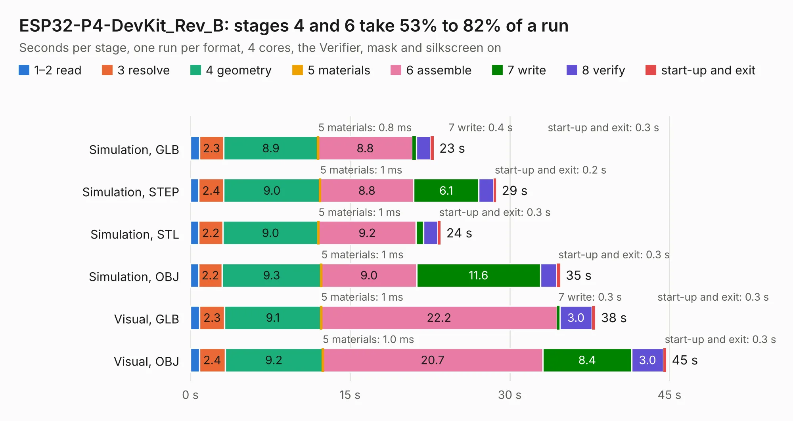

# 1851. ESP32-P4-DevKit_Rev_B

Board 1,851 of the 3,131 of [Corpus Testing](../Corpus-Testing.md), on [Corpus Page 18](../CorpusTestingPages/Corpus-Testing-18.md#1851-esp32-p4-devkit_rev_b).

| Mode and format | 1–2 read | 3 resolve | 4 geometry | 5 materials | 6 assemble | 7 write | 8 verify | start-up and exit | Total |
|---|---:|---:|---:|---:|---:|---:|---:|---:|---:|
| Simulation, GLB | 0.8 | 2.3 | 8.9 | 0.8&nbsp;ms | 8.8 | 0.4 | 1.4 | 0.3 | 22.9 |
| Simulation, STEP | 0.8 | 2.4 | 9.0 | 1&nbsp;ms | 8.8 | 6.1 | 1.4 | 0.2 | 28.7 |
| Simulation, STL | 0.8 | 2.2 | 9.0 | 1&nbsp;ms | 9.2 | 0.7 | 1.3 | 0.3 | 23.5 |
| Simulation, OBJ | 0.8 | 2.2 | 9.3 | 1&nbsp;ms | 9.0 | 11.6 | 1.5 | 0.3 | 34.7 |
| Visual, GLB | 0.9 | 2.3 | 9.1 | 1&nbsp;ms | 22.2 | 0.3 | 3.0 | 0.3 | 38.0 |
| Visual, OBJ | 0.9 | 2.4 | 9.2 | 1.0&nbsp;ms | 20.7 | 8.4 | 3.0 | 0.3 | 44.7 |

<table align="center"><tr><td valign="top">

| Board | Repo: [OLIMEX/ESP32-P4-DevKit](https://github.com/OLIMEX/ESP32-P4-DevKit) Board: `ESP32-P4-DevKit_Rev_B.kicad_pcb` |
|---|---|
| Folder | HARDWARE / ESP32-P4-DevKit-Rev.B |
| Complexity | 363&nbsp;/&nbsp;1000 (size&nbsp;268, features&nbsp;95) |
| KESE&nbsp;features | through vias, slotted holes, filled zones, knockout text, stack-up, dielectric εr and tanδ, mask and silkscreen colours |
| Tested | 9th November 2026 |
| Copper&nbsp;layers | 4 |
| File&nbsp;format | KiCad 7 (20221018) |
| Parts,&nbsp;tracks,&nbsp;vias | 138, 2,985, 213 |
| Triangles,&nbsp;simulation | 2,254,720 in 189 parts |
| Verifier | PASS in all six runs |

</td><td valign="top">

<table>
<tr><th>File type</th><th>File size</th><th>Peak memory used</th></tr>
<tr><th colspan="3" align="left">Simulation</th></tr>
<tr><td>GLB</td><td align="right">80&nbsp;MB</td><td align="right">789&nbsp;MB</td></tr>
<tr><td>STEP</td><td align="right">407&nbsp;MB</td><td align="right">988&nbsp;MB</td></tr>
<tr><td>STL</td><td align="right">113&nbsp;MB</td><td align="right">773&nbsp;MB</td></tr>
<tr><td>OBJ</td><td align="right">245&nbsp;MB</td><td align="right">1.6&nbsp;GB</td></tr>
<tr><th colspan="3" align="left">Visual</th></tr>
<tr><td>GLB</td><td align="right">57&nbsp;MB</td><td align="right">978&nbsp;MB</td></tr>
<tr><td>OBJ</td><td align="right">175&nbsp;MB</td><td align="right">1.2&nbsp;GB</td></tr>
</table>

</td></tr></table>

| Previous | Next |
|:---|---:|
| [1850. ESP32-H2-DevKit-LiPo_Rev_A](b1850b_ESP32-H2-DevKit-Lipo_ESP32-H2-DevKit-LiPo-Rev-A.md) | [1852. ESP32-P4-DevKit_Rev_C](b1852b_ESP32-P4-DevKit_ESP32-P4-DevKit-Rev-C.md) |
