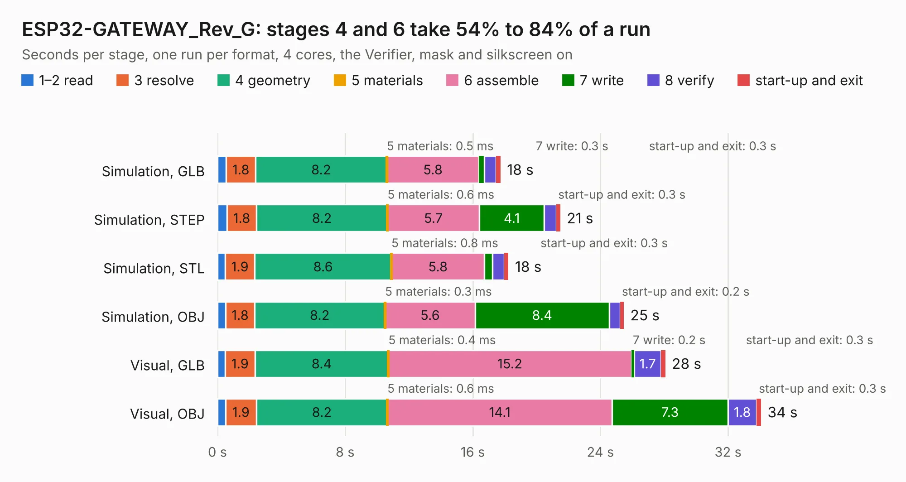

# 1852. ESP32-GATEWAY_Rev_G

Board 1,852 of the 3,138 of [Corpus Testing](../Corpus-Testing.md), on [Corpus Page 18](../CorpusTestingPages/Corpus-Testing-18.md#1852-esp32-gateway_rev_g).

| Mode and format | 1–2 read | 3 resolve | 4 geometry | 5 materials | 6 assemble | 7 write | 8 verify | start-up and exit | Total |
|---|---:|---:|---:|---:|---:|---:|---:|---:|---:|
| Simulation, GLB | 0.5 | 1.8 | 8.2 | 0.5&nbsp;ms | 5.8 | 0.3 | 0.8 | 0.3 | 17.7 |
| Simulation, STEP | 0.6 | 1.8 | 8.2 | 0.6&nbsp;ms | 5.7 | 4.1 | 0.7 | 0.3 | 21.5 |
| Simulation, STL | 0.5 | 1.9 | 8.6 | 0.8&nbsp;ms | 5.8 | 0.5 | 0.7 | 0.3 | 18.2 |
| Simulation, OBJ | 0.5 | 1.8 | 8.2 | 0.3&nbsp;ms | 5.6 | 8.4 | 0.7 | 0.2 | 25.5 |
| Visual, GLB | 0.5 | 1.9 | 8.4 | 0.4&nbsp;ms | 15.2 | 0.2 | 1.7 | 0.3 | 28.1 |
| Visual, OBJ | 0.5 | 1.9 | 8.2 | 0.6&nbsp;ms | 14.1 | 7.3 | 1.8 | 0.3 | 34.1 |

<table align="center"><tr><td valign="top">

| Board | Repo: [OLIMEX/ESP32-GATEWAY](https://github.com/OLIMEX/ESP32-GATEWAY) Board: `ESP32-GATEWAY_Rev_G.kicad_pcb` |
|---|---|
| Folder | HARDWARE / Hardware revision G |
| Complexity | 291&nbsp;/&nbsp;1000 (size&nbsp;236, features&nbsp;55) |
| KESE&nbsp;features | through vias, slotted holes, filled zones, copper text |
| Tested | 9th November 2026 |
| Copper&nbsp;layers | 2 |
| File&nbsp;format | KiCad 5 (20171130) |
| Parts,&nbsp;tracks,&nbsp;vias | 90, 1,944, 322 |
| Triangles,&nbsp;simulation | 1,438,022 in 110 parts |
| Verifier | PASS in all six runs |

</td><td valign="top">

<table>
<tr><th>File type</th><th>File size</th><th>Peak memory used</th></tr>
<tr><th colspan="3" align="left">Simulation</th></tr>
<tr><td>GLB</td><td align="right">51&nbsp;MB</td><td align="right">607&nbsp;MB</td></tr>
<tr><td>STEP</td><td align="right">245&nbsp;MB</td><td align="right">713&nbsp;MB</td></tr>
<tr><td>STL</td><td align="right">72&nbsp;MB</td><td align="right">591&nbsp;MB</td></tr>
<tr><td>OBJ</td><td align="right">151&nbsp;MB</td><td align="right">999&nbsp;MB</td></tr>
<tr><th colspan="3" align="left">Visual</th></tr>
<tr><td>GLB</td><td align="right">42&nbsp;MB</td><td align="right">811&nbsp;MB</td></tr>
<tr><td>OBJ</td><td align="right">127&nbsp;MB</td><td align="right">971&nbsp;MB</td></tr>
</table>

</td></tr></table>

| Previous | Next |
|:---|---:|
| [1851. ESP32-GATEWAY_Rev_F](b1851b_ESP32-GATEWAY_ESP32-GATEWAY-Rev-F.md) | [1853. ESP32-GATEWAY_Rev_H](b1853b_ESP32-GATEWAY_ESP32-GATEWAY-Rev-H.md) |
