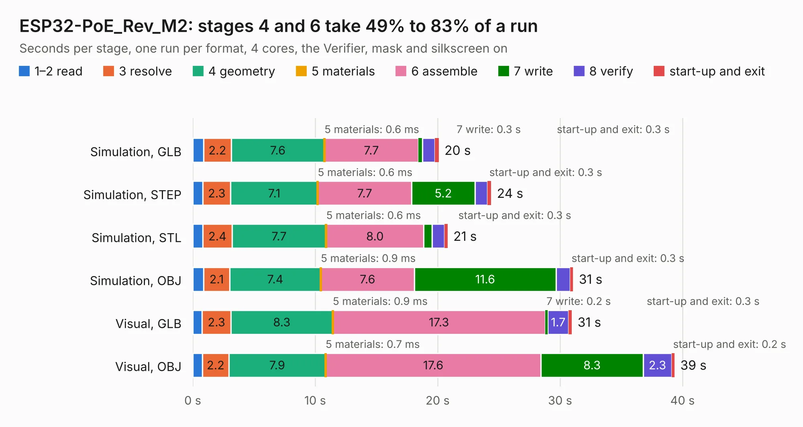

# 1852. ESP32-PoE_Rev_M2

Board 1,852 of the 3,109 of [Corpus Testing](../Corpus-Testing.md), on [Corpus Page 18](../CorpusTestingPages/Corpus-Testing-18.md#1852-esp32-poe_rev_m2).

| Mode and format | 1–2 read | 3 resolve | 4 geometry | 5 materials | 6 assemble | 7 write | 8 verify | start-up and exit | Total |
|---|---:|---:|---:|---:|---:|---:|---:|---:|---:|
| Simulation, GLB | 0.9 | 2.2 | 7.6 | 0.6&nbsp;ms | 7.7 | 0.3 | 1.0 | 0.3 | 20.1 |
| Simulation, STEP | 0.8 | 2.3 | 7.1 | 0.6&nbsp;ms | 7.7 | 5.2 | 1.0 | 0.3 | 24.4 |
| Simulation, STL | 0.8 | 2.4 | 7.7 | 0.6&nbsp;ms | 8.0 | 0.7 | 1.0 | 0.3 | 20.8 |
| Simulation, OBJ | 0.9 | 2.1 | 7.4 | 0.9&nbsp;ms | 7.6 | 11.6 | 1.1 | 0.3 | 31.1 |
| Visual, GLB | 0.8 | 2.3 | 8.3 | 0.9&nbsp;ms | 17.3 | 0.2 | 1.7 | 0.3 | 31.0 |
| Visual, OBJ | 0.8 | 2.2 | 7.9 | 0.7&nbsp;ms | 17.6 | 8.3 | 2.3 | 0.2 | 39.3 |

<table align="center"><tr><td valign="top">

| Board | Repo: [OLIMEX/ESP32-POE](https://github.com/OLIMEX/ESP32-POE) Board: `ESP32-PoE_Rev_M2.kicad_pcb` |
|---|---|
| Folder | HARDWARE / ESP32-PoE-hardware-revision-M2 |
| Complexity | 368&nbsp;/&nbsp;1000 (size&nbsp;258, features&nbsp;110) |
| KESE&nbsp;features | through vias, slotted holes, rounded, trapezoid or chamfered pads, filled zones, copper text, knockout text, stack-up, dielectric εr and tanδ |
| Tested | 9th November 2026 |
| Copper&nbsp;layers | 4 |
| File&nbsp;format | KiCad 7 (20221018) |
| Parts,&nbsp;tracks,&nbsp;vias | 128, 2,528, 233 |
| Triangles,&nbsp;simulation | 1,972,166 in 133 parts |
| Verifier | PASS in all six runs |

</td><td valign="top">

<table>
<tr><th>File type</th><th>File size</th><th>Peak memory used</th></tr>
<tr><th colspan="3" align="left">Simulation</th></tr>
<tr><td>GLB</td><td align="right">69&nbsp;MB</td><td align="right">713&nbsp;MB</td></tr>
<tr><td>STEP</td><td align="right">335&nbsp;MB</td><td align="right">843&nbsp;MB</td></tr>
<tr><td>STL</td><td align="right">99&nbsp;MB</td><td align="right">761&nbsp;MB</td></tr>
<tr><td>OBJ</td><td align="right">211&nbsp;MB</td><td align="right">1.4&nbsp;GB</td></tr>
<tr><th colspan="3" align="left">Visual</th></tr>
<tr><td>GLB</td><td align="right">47&nbsp;MB</td><td align="right">835&nbsp;MB</td></tr>
<tr><td>OBJ</td><td align="right">145&nbsp;MB</td><td align="right">1.0&nbsp;GB</td></tr>
</table>

</td></tr></table>

| Previous | Next |
|:---|---:|
| [1851. ESP32-PoE_Rev_M1](b1851b_ESP32-POE_ESP32-PoE-Rev-M1.md) | [1853. ESP32-PoE-ISO_Rev_B](b1853b_ESP32-POE-ISO_ESP32-PoE-ISO-Rev-B.md) |
