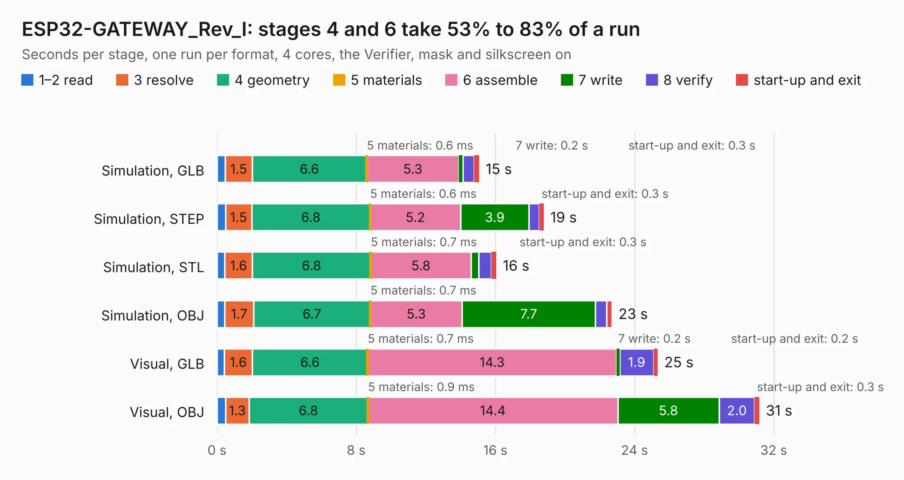

# 1854. ESP32-GATEWAY_Rev_I

Board 1,854 of the 3,139 of [Corpus Testing](../Corpus-Testing.md), on [Corpus Page 18](../CorpusTestingPages/Corpus-Testing-18.md#1854-esp32-gateway_rev_i).

| Mode and format | 1–2 read | 3 resolve | 4 geometry | 5 materials | 6 assemble | 7 write | 8 verify | start-up and exit | Total |
|---|---:|---:|---:|---:|---:|---:|---:|---:|---:|
| Simulation, GLB | 0.5 | 1.5 | 6.6 | 0.6&nbsp;ms | 5.3 | 0.2 | 0.6 | 0.3 | 15.1 |
| Simulation, STEP | 0.5 | 1.5 | 6.8 | 0.6&nbsp;ms | 5.2 | 3.9 | 0.6 | 0.3 | 18.8 |
| Simulation, STL | 0.4 | 1.6 | 6.8 | 0.7&nbsp;ms | 5.8 | 0.4 | 0.7 | 0.3 | 16.1 |
| Simulation, OBJ | 0.4 | 1.7 | 6.7 | 0.7&nbsp;ms | 5.3 | 7.7 | 0.6 | 0.3 | 22.7 |
| Visual, GLB | 0.4 | 1.6 | 6.6 | 0.7&nbsp;ms | 14.3 | 0.2 | 1.9 | 0.2 | 25.3 |
| Visual, OBJ | 0.5 | 1.3 | 6.8 | 0.9&nbsp;ms | 14.4 | 5.8 | 2.0 | 0.3 | 31.2 |

<table align="center"><tr><td valign="top">

| Board | Repo: [OLIMEX/ESP32-GATEWAY](https://github.com/OLIMEX/ESP32-GATEWAY) Board: `ESP32-GATEWAY_Rev_I.kicad_pcb` |
|---|---|
| Folder | HARDWARE / Hardware revision I |
| Complexity | 281&nbsp;/&nbsp;1000 (size&nbsp;236, features&nbsp;45) |
| KESE&nbsp;features | through vias, slotted holes, filled zones |
| Tested | 9th November 2026 |
| Copper&nbsp;layers | 2 |
| File&nbsp;format | KiCad 5 (20171130) |
| Parts,&nbsp;tracks,&nbsp;vias | 98, 1,934, 287 |
| Triangles,&nbsp;simulation | 1,474,380 in 111 parts |
| Verifier | PASS in all six runs |

</td><td valign="top">

<table>
<tr><th>File type</th><th>File size</th><th>Peak memory used</th></tr>
<tr><th colspan="3" align="left">Simulation</th></tr>
<tr><td>GLB</td><td align="right">52&nbsp;MB</td><td align="right">608&nbsp;MB</td></tr>
<tr><td>STEP</td><td align="right">259&nbsp;MB</td><td align="right">722&nbsp;MB</td></tr>
<tr><td>STL</td><td align="right">74&nbsp;MB</td><td align="right">620&nbsp;MB</td></tr>
<tr><td>OBJ</td><td align="right">156&nbsp;MB</td><td align="right">1.0&nbsp;GB</td></tr>
<tr><th colspan="3" align="left">Visual</th></tr>
<tr><td>GLB</td><td align="right">43&nbsp;MB</td><td align="right">783&nbsp;MB</td></tr>
<tr><td>OBJ</td><td align="right">131&nbsp;MB</td><td align="right">941&nbsp;MB</td></tr>
</table>

</td></tr></table>

| Previous | Next |
|:---|---:|
| [1853. ESP32-GATEWAY_Rev_H](b1853b_ESP32-GATEWAY_ESP32-GATEWAY-Rev-H.md) | [1855. ESP32-H2-DevKit-LiPo_Rev_A](b1855b_ESP32-H2-DevKit-Lipo_ESP32-H2-DevKit-LiPo-Rev-A.md) |
