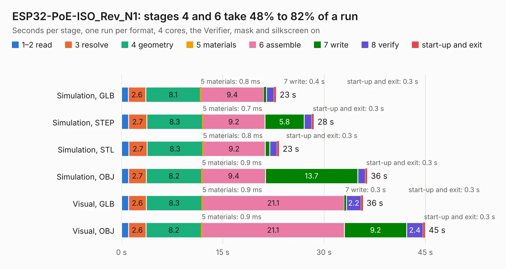

# 1858. ESP32-PoE-ISO_Rev_N1

Board 1,858 of the 3,102 of [Corpus Testing](../Corpus-Testing.md), on [Corpus Page 18](../CorpusTestingPages/Corpus-Testing-18.md#1858-esp32-poe-iso_rev_n1).

| Mode and format | 1–2 read | 3 resolve | 4 geometry | 5 materials | 6 assemble | 7 write | 8 verify | start-up and exit | Total |
|---|---:|---:|---:|---:|---:|---:|---:|---:|---:|
| Simulation, GLB | 1.0 | 2.6 | 8.1 | 0.8&nbsp;ms | 9.4 | 0.4 | 1.1 | 0.3 | 22.9 |
| Simulation, STEP | 1.0 | 2.7 | 8.3 | 0.7&nbsp;ms | 9.2 | 5.8 | 1.2 | 0.3 | 28.5 |
| Simulation, STL | 1.1 | 2.7 | 8.3 | 0.8&nbsp;ms | 9.2 | 0.7 | 1.1 | 0.3 | 23.3 |
| Simulation, OBJ | 1.0 | 2.7 | 8.2 | 0.9&nbsp;ms | 9.4 | 13.7 | 1.1 | 0.3 | 36.4 |
| Visual, GLB | 1.0 | 2.6 | 8.3 | 0.9&nbsp;ms | 21.1 | 0.3 | 2.2 | 0.3 | 35.8 |
| Visual, OBJ | 1.0 | 2.6 | 8.2 | 0.9&nbsp;ms | 21.1 | 9.2 | 2.4 | 0.3 | 45.0 |

<table align="center"><tr><td valign="top">

| Board | Repo: [OLIMEX/ESP32-POE-ISO](https://github.com/OLIMEX/ESP32-POE-ISO) Board: `ESP32-PoE-ISO_Rev_N1.kicad_pcb` |
|---|---|
| Folder | HARDWARE / ESP32-PoE-ISO-Rev.N1 |
| Complexity | 389&nbsp;/&nbsp;1000 (size&nbsp;264, features&nbsp;125) |
| KESE&nbsp;features | through vias, slotted holes, rounded, trapezoid or chamfered pads, filled zones, copper text, curved board outline, knockout text, stack-up, dielectric εr and tanδ, mask and silkscreen colours |
| Tested | 9th November 2026 |
| Copper&nbsp;layers | 4 |
| File&nbsp;format | KiCad 7 (20221018) |
| Parts,&nbsp;tracks,&nbsp;vias | 128, 3,683, 326 |
| Triangles,&nbsp;simulation | 2,295,698 in 134 parts |
| Verifier | PASS in all six runs |

</td><td valign="top">

<table>
<tr><th>File type</th><th>File size</th><th>Peak memory used</th></tr>
<tr><th colspan="3" align="left">Simulation</th></tr>
<tr><td>GLB</td><td align="right">81&nbsp;MB</td><td align="right">838&nbsp;MB</td></tr>
<tr><td>STEP</td><td align="right">348&nbsp;MB</td><td align="right">949&nbsp;MB</td></tr>
<tr><td>STL</td><td align="right">115&nbsp;MB</td><td align="right">791&nbsp;MB</td></tr>
<tr><td>OBJ</td><td align="right">246&nbsp;MB</td><td align="right">1.6&nbsp;GB</td></tr>
<tr><th colspan="3" align="left">Visual</th></tr>
<tr><td>GLB</td><td align="right">53&nbsp;MB</td><td align="right">959&nbsp;MB</td></tr>
<tr><td>OBJ</td><td align="right">164&nbsp;MB</td><td align="right">1.2&nbsp;GB</td></tr>
</table>

</td></tr></table>

| Previous | Next |
|:---|---:|
| [1857. ESP32-PoE-ISO_Rev_N](b1857b_ESP32-POE-ISO_ESP32-PoE-ISO-Rev-N.md) | [1859. ESP32-PoE-ISO_Rev_O](b1859b_ESP32-POE-ISO_ESP32-PoE-ISO-Rev-O.md) |
