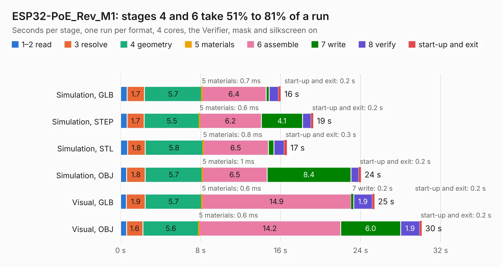

# 1858. ESP32-PoE_Rev_M1

Board 1,858 of the 3,116 of [Corpus Testing](../Corpus-Testing.md), on [Corpus Page 18](../CorpusTestingPages/Corpus-Testing-18.md#1858-esp32-poe_rev_m1).

| Mode and format | 1–2 read | 3 resolve | 4 geometry | 5 materials | 6 assemble | 7 write | 8 verify | start-up and exit | Total |
|---|---:|---:|---:|---:|---:|---:|---:|---:|---:|
| Simulation, GLB | 0.7 | 1.7 | 5.7 | 0.7&nbsp;ms | 6.4 | 0.3 | 0.9 | 0.2 | 16.0 |
| Simulation, STEP | 0.6 | 1.7 | 5.5 | 0.6&nbsp;ms | 6.2 | 4.1 | 0.9 | 0.2 | 19.3 |
| Simulation, STL | 0.7 | 1.8 | 5.8 | 0.8&nbsp;ms | 6.5 | 0.6 | 1.0 | 0.3 | 16.6 |
| Simulation, OBJ | 0.6 | 1.8 | 5.7 | 1&nbsp;ms | 6.5 | 8.4 | 0.8 | 0.2 | 24.0 |
| Visual, GLB | 0.6 | 1.9 | 5.7 | 0.6&nbsp;ms | 14.9 | 0.2 | 1.9 | 0.2 | 25.4 |
| Visual, OBJ | 0.6 | 1.6 | 5.6 | 0.6&nbsp;ms | 14.2 | 6.0 | 1.9 | 0.2 | 30.1 |

<table align="center"><tr><td valign="top">

| Board | Repo: [OLIMEX/ESP32-POE](https://github.com/OLIMEX/ESP32-POE) Board: `ESP32-PoE_Rev_M1.kicad_pcb` |
|---|---|
| Folder | HARDWARE / ESP32-PoE-hardware-revision-M1 |
| Complexity | 368&nbsp;/&nbsp;1000 (size&nbsp;258, features&nbsp;110) |
| KESE&nbsp;features | through vias, slotted holes, rounded, trapezoid or chamfered pads, filled zones, copper text, knockout text, stack-up, dielectric εr and tanδ |
| Tested | 9th November 2026 |
| Copper&nbsp;layers | 4 |
| File&nbsp;format | KiCad 7 (20221018) |
| Parts,&nbsp;tracks,&nbsp;vias | 127, 2,528, 233 |
| Triangles,&nbsp;simulation | 1,971,162 in 133 parts |
| Verifier | PASS in all six runs |

</td><td valign="top">

<table>
<tr><th>File type</th><th>File size</th><th>Peak memory used</th></tr>
<tr><th colspan="3" align="left">Simulation</th></tr>
<tr><td>GLB</td><td align="right">69&nbsp;MB</td><td align="right">741&nbsp;MB</td></tr>
<tr><td>STEP</td><td align="right">335&nbsp;MB</td><td align="right">835&nbsp;MB</td></tr>
<tr><td>STL</td><td align="right">99&nbsp;MB</td><td align="right">745&nbsp;MB</td></tr>
<tr><td>OBJ</td><td align="right">211&nbsp;MB</td><td align="right">1.4&nbsp;GB</td></tr>
<tr><th colspan="3" align="left">Visual</th></tr>
<tr><td>GLB</td><td align="right">47&nbsp;MB</td><td align="right">848&nbsp;MB</td></tr>
<tr><td>OBJ</td><td align="right">144&nbsp;MB</td><td align="right">1.1&nbsp;GB</td></tr>
</table>

</td></tr></table>

| Previous | Next |
|:---|---:|
| [1857. ESP32-PoE_Rev_M](b1857b_ESP32-POE_ESP32-PoE-Rev-M.md) | [1859. ESP32-PoE_Rev_M2](b1859b_ESP32-POE_ESP32-PoE-Rev-M2.md) |
