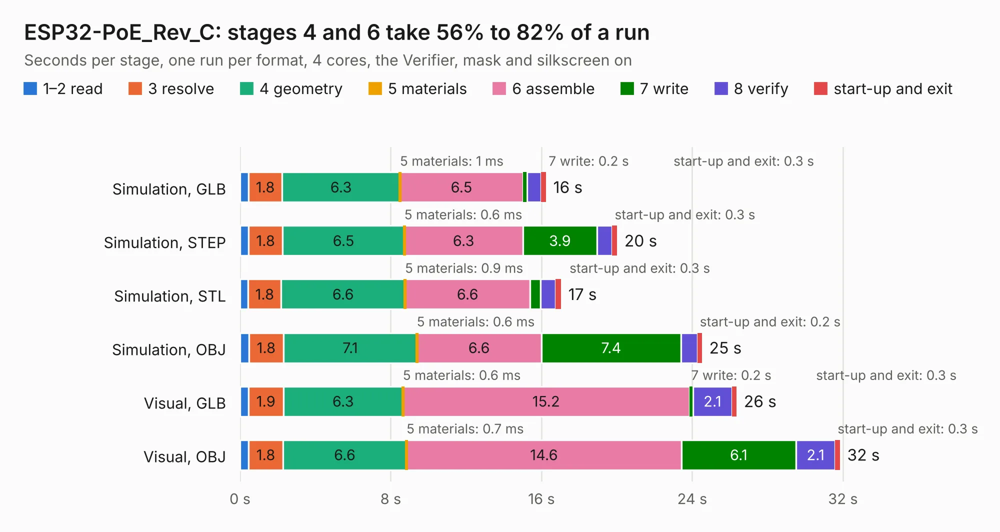

# 1858. ESP32-PoE_Rev_C

Board 1,858 of the 3,130 of [Corpus Testing](../Corpus-Testing.md), on [Corpus Page 18](../CorpusTestingPages/Corpus-Testing-18.md#1858-esp32-poe_rev_c).

| Mode and format | 1–2 read | 3 resolve | 4 geometry | 5 materials | 6 assemble | 7 write | 8 verify | start-up and exit | Total |
|---|---:|---:|---:|---:|---:|---:|---:|---:|---:|
| Simulation, GLB | 0.4 | 1.8 | 6.3 | 1&nbsp;ms | 6.5 | 0.2 | 0.8 | 0.3 | 16.2 |
| Simulation, STEP | 0.4 | 1.8 | 6.5 | 0.6&nbsp;ms | 6.3 | 3.9 | 0.8 | 0.3 | 20.0 |
| Simulation, STL | 0.4 | 1.8 | 6.6 | 0.9&nbsp;ms | 6.6 | 0.5 | 0.8 | 0.3 | 17.0 |
| Simulation, OBJ | 0.5 | 1.8 | 7.1 | 0.6&nbsp;ms | 6.6 | 7.4 | 0.9 | 0.2 | 24.5 |
| Visual, GLB | 0.4 | 1.9 | 6.3 | 0.6&nbsp;ms | 15.2 | 0.2 | 2.1 | 0.3 | 26.4 |
| Visual, OBJ | 0.5 | 1.8 | 6.6 | 0.7&nbsp;ms | 14.6 | 6.1 | 2.1 | 0.3 | 31.8 |

<table align="center"><tr><td valign="top">

| Board | Repo: [OLIMEX/ESP32-POE](https://github.com/OLIMEX/ESP32-POE) Board: `ESP32-PoE_Rev_C.kicad_pcb` |
|---|---|
| Folder | HARDWARE / ESP32-PoE-hardware-revision-C |
| Complexity | 294&nbsp;/&nbsp;1000 (size&nbsp;239, features&nbsp;55) |
| KESE&nbsp;features | through vias, slotted holes, filled zones, copper text |
| Tested | 9th November 2026 |
| Copper&nbsp;layers | 2 |
| File&nbsp;format | KiCad 5 (20171130) |
| Parts,&nbsp;tracks,&nbsp;vias | 111, 2,500, 173 |
| Triangles,&nbsp;simulation | 1,413,496 in 139 parts |
| Verifier | PASS in all six runs |

</td><td valign="top">

<table>
<tr><th>File type</th><th>File size</th><th>Peak memory used</th></tr>
<tr><th colspan="3" align="left">Simulation</th></tr>
<tr><td>GLB</td><td align="right">50&nbsp;MB</td><td align="right">524&nbsp;MB</td></tr>
<tr><td>STEP</td><td align="right">284&nbsp;MB</td><td align="right">716&nbsp;MB</td></tr>
<tr><td>STL</td><td align="right">71&nbsp;MB</td><td align="right">563&nbsp;MB</td></tr>
<tr><td>OBJ</td><td align="right">151&nbsp;MB</td><td align="right">979&nbsp;MB</td></tr>
<tr><th colspan="3" align="left">Visual</th></tr>
<tr><td>GLB</td><td align="right">42&nbsp;MB</td><td align="right">787&nbsp;MB</td></tr>
<tr><td>OBJ</td><td align="right">126&nbsp;MB</td><td align="right">928&nbsp;MB</td></tr>
</table>

</td></tr></table>

| Previous | Next |
|:---|---:|
| [1857. ESP32-PoE_Rev_B2](b1857b_ESP32-POE_ESP32-PoE-Rev-B2.md) | [1859. ESP32-PoE_Rev_C](b1859b_ESP32-POE_HARDWARE-ESP32-PoE-hardware-revision-C1_ESP32-PoE-Rev-C.md) |
