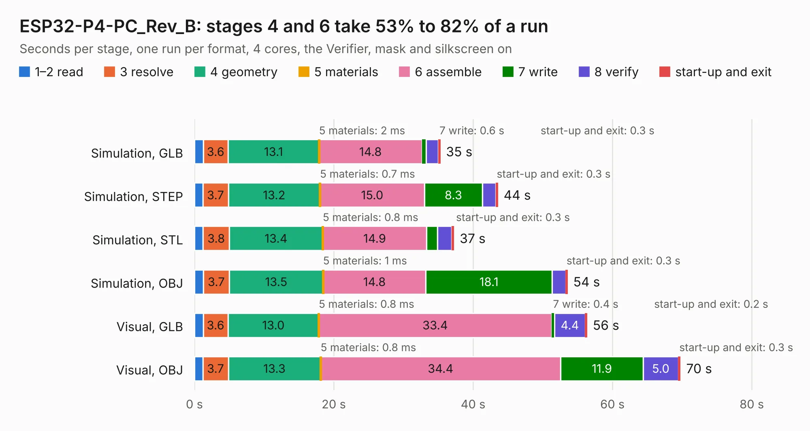

# 1860. ESP32-P4-PC_Rev_B

Board 1,860 of the 3,139 of [Corpus Testing](../Corpus-Testing.md), on [Corpus Page 18](../CorpusTestingPages/Corpus-Testing-18.md#1860-esp32-p4-pc_rev_b).

| Mode and format | 1–2 read | 3 resolve | 4 geometry | 5 materials | 6 assemble | 7 write | 8 verify | start-up and exit | Total |
|---|---:|---:|---:|---:|---:|---:|---:|---:|---:|
| Simulation, GLB | 1.3 | 3.6 | 13.1 | 2&nbsp;ms | 14.8 | 0.6 | 1.8 | 0.3 | 35.3 |
| Simulation, STEP | 1.2 | 3.7 | 13.2 | 0.7&nbsp;ms | 15.0 | 8.3 | 1.9 | 0.3 | 43.5 |
| Simulation, STL | 1.2 | 3.8 | 13.4 | 0.8&nbsp;ms | 14.9 | 1.5 | 2.1 | 0.3 | 37.2 |
| Simulation, OBJ | 1.3 | 3.7 | 13.5 | 1&nbsp;ms | 14.8 | 18.1 | 2.0 | 0.3 | 53.5 |
| Visual, GLB | 1.3 | 3.6 | 13.0 | 0.8&nbsp;ms | 33.4 | 0.4 | 4.4 | 0.2 | 56.4 |
| Visual, OBJ | 1.2 | 3.7 | 13.3 | 0.8&nbsp;ms | 34.4 | 11.9 | 5.0 | 0.3 | 69.8 |

<table align="center"><tr><td valign="top">

| Board | Repo: [OLIMEX/ESP32-P4-PC](https://github.com/OLIMEX/ESP32-P4-PC) Board: `ESP32-P4-PC_Rev_B.kicad_pcb` |
|---|---|
| Folder | HARDWARE / ESP32-P4-PC-Rev.B |
| Complexity | 408&nbsp;/&nbsp;1000 (size&nbsp;293, features&nbsp;115) |
| KESE&nbsp;features | through vias, slotted holes, rounded, trapezoid or chamfered pads, filled zones, copper text, knockout text, stack-up, dielectric εr and tanδ, mask and silkscreen colours |
| Tested | 9th November 2026 |
| Copper&nbsp;layers | 4 |
| File&nbsp;format | KiCad 7 (20221018) |
| Parts,&nbsp;tracks,&nbsp;vias | 312, 5,090, 549 |
| Triangles,&nbsp;simulation | 4,020,402 in 316 parts |
| Verifier | PASS in all six runs |

</td><td valign="top">

<table>
<tr><th>File type</th><th>File size</th><th>Peak memory used</th></tr>
<tr><th colspan="3" align="left">Simulation</th></tr>
<tr><td>GLB</td><td align="right">142&nbsp;MB</td><td align="right">1.3&nbsp;GB</td></tr>
<tr><td>STEP</td><td align="right">676&nbsp;MB</td><td align="right">1.6&nbsp;GB</td></tr>
<tr><td>STL</td><td align="right">201&nbsp;MB</td><td align="right">1.3&nbsp;GB</td></tr>
<tr><td>OBJ</td><td align="right">440&nbsp;MB</td><td align="right">2.7&nbsp;GB</td></tr>
<tr><th colspan="3" align="left">Visual</th></tr>
<tr><td>GLB</td><td align="right">96&nbsp;MB</td><td align="right">1.5&nbsp;GB</td></tr>
<tr><td>OBJ</td><td align="right">303&nbsp;MB</td><td align="right">2.0&nbsp;GB</td></tr>
</table>

</td></tr></table>

| Previous | Next |
|:---|---:|
| [1859. ESP32-P4-DevKit_Rev_D1](b1859b_ESP32-P4-DevKit_ESP32-P4-DevKit-Rev-D1.md) | [1861. ESP32-P4-PC_Rev_C](b1861b_ESP32-P4-PC_ESP32-P4-PC-Rev-C.md) |
