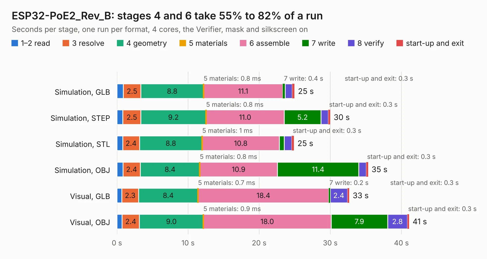

# 1861. ESP32-PoE2_Rev_B

Board 1,861 of the 3,103 of [Corpus Testing](../Corpus-Testing.md), on [Corpus Page 18](../CorpusTestingPages/Corpus-Testing-18.md#1861-esp32-poe2_rev_b).

| Mode and format | 1–2 read | 3 resolve | 4 geometry | 5 materials | 6 assemble | 7 write | 8 verify | start-up and exit | Total |
|---|---:|---:|---:|---:|---:|---:|---:|---:|---:|
| Simulation, GLB | 0.9 | 2.5 | 8.8 | 0.8&nbsp;ms | 11.1 | 0.4 | 1.0 | 0.3 | 25.0 |
| Simulation, STEP | 0.8 | 2.5 | 9.2 | 0.8&nbsp;ms | 11.0 | 5.2 | 1.0 | 0.3 | 30.0 |
| Simulation, STL | 0.8 | 2.4 | 8.8 | 1&nbsp;ms | 10.8 | 0.7 | 1.1 | 0.3 | 24.9 |
| Simulation, OBJ | 0.8 | 2.4 | 8.4 | 0.8&nbsp;ms | 10.9 | 11.4 | 1.0 | 0.3 | 35.3 |
| Visual, GLB | 0.7 | 2.3 | 8.4 | 0.7&nbsp;ms | 18.4 | 0.2 | 2.4 | 0.3 | 32.7 |
| Visual, OBJ | 0.7 | 2.4 | 9.0 | 0.9&nbsp;ms | 18.0 | 7.9 | 2.8 | 0.3 | 41.1 |

<table align="center"><tr><td valign="top">

| Board | Repo: [OLIMEX/ESP32-POE2](https://github.com/OLIMEX/ESP32-POE2) Board: `ESP32-PoE2_Rev_B.kicad_pcb` |
|---|---|
| Folder | HARDWARE / ESP32-PoE2_Rev_B |
| Complexity | 380&nbsp;/&nbsp;1000 (size&nbsp;260, features&nbsp;120) |
| KESE&nbsp;features | through vias, slotted holes, rounded, trapezoid or chamfered pads, filled zones, copper text, curved board outline, knockout text, stack-up, dielectric εr and tanδ |
| Tested | 9th November 2026 |
| Copper&nbsp;layers | 4 |
| File&nbsp;format | KiCad 7 (20221018) |
| Parts,&nbsp;tracks,&nbsp;vias | 142, 2,198, 390 |
| Triangles,&nbsp;simulation | 2,336,490 in 142 parts |
| Verifier | PASS in all six runs |

</td><td valign="top">

<table>
<tr><th>File type</th><th>File size</th><th>Peak memory used</th></tr>
<tr><th colspan="3" align="left">Simulation</th></tr>
<tr><td>GLB</td><td align="right">81&nbsp;MB</td><td align="right">780&nbsp;MB</td></tr>
<tr><td>STEP</td><td align="right">346&nbsp;MB</td><td align="right">1.0&nbsp;GB</td></tr>
<tr><td>STL</td><td align="right">117&nbsp;MB</td><td align="right">823&nbsp;MB</td></tr>
<tr><td>OBJ</td><td align="right">250&nbsp;MB</td><td align="right">1.6&nbsp;GB</td></tr>
<tr><th colspan="3" align="left">Visual</th></tr>
<tr><td>GLB</td><td align="right">54&nbsp;MB</td><td align="right">974&nbsp;MB</td></tr>
<tr><td>OBJ</td><td align="right">167&nbsp;MB</td><td align="right">1.2&nbsp;GB</td></tr>
</table>

</td></tr></table>

| Previous | Next |
|:---|---:|
| [1860. ESP32-PoE-ISO_Rev_O](b1860b_ESP32-POE-ISO_ESP32-PoE-ISO-Rev-O.md) | [1862. ESP32-PRO_Rev_B](b1862b_ESP32-PRO_ESP32-PRO-Rev-B.md) |
