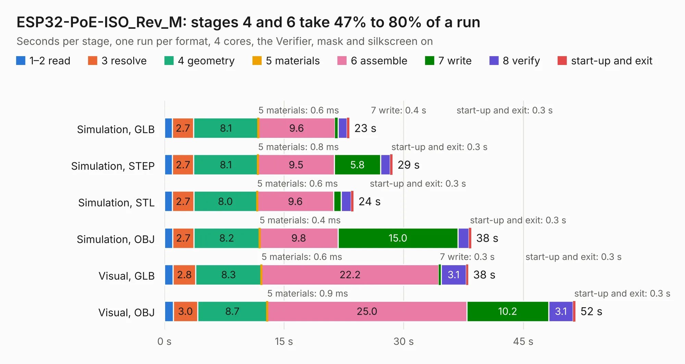

# 1863. ESP32-PoE-ISO_Rev_M

Board 1,863 of the 3,110 of [Corpus Testing](../Corpus-Testing.md), on [Corpus Page 18](../CorpusTestingPages/Corpus-Testing-18.md#1863-esp32-poe-iso_rev_m).

| Mode and format | 1–2 read | 3 resolve | 4 geometry | 5 materials | 6 assemble | 7 write | 8 verify | start-up and exit | Total |
|---|---:|---:|---:|---:|---:|---:|---:|---:|---:|
| Simulation, GLB | 1.0 | 2.7 | 8.1 | 0.6&nbsp;ms | 9.6 | 0.4 | 1.1 | 0.3 | 23.2 |
| Simulation, STEP | 1.0 | 2.7 | 8.1 | 0.8&nbsp;ms | 9.5 | 5.8 | 1.2 | 0.3 | 28.6 |
| Simulation, STL | 1.0 | 2.7 | 8.0 | 0.6&nbsp;ms | 9.6 | 0.9 | 1.2 | 0.3 | 23.7 |
| Simulation, OBJ | 1.0 | 2.7 | 8.2 | 0.4&nbsp;ms | 9.8 | 15.0 | 1.4 | 0.3 | 38.5 |
| Visual, GLB | 1.1 | 2.8 | 8.3 | 0.6&nbsp;ms | 22.2 | 0.3 | 3.1 | 0.3 | 38.1 |
| Visual, OBJ | 1.1 | 3.0 | 8.7 | 0.9&nbsp;ms | 25.0 | 10.2 | 3.1 | 0.3 | 51.5 |

<table align="center"><tr><td valign="top">

| Board | Repo: [OLIMEX/ESP32-POE-ISO](https://github.com/OLIMEX/ESP32-POE-ISO) Board: `ESP32-PoE-ISO_Rev_M.kicad_pcb` |
|---|---|
| Folder | HARDWARE / ESP32-PoE-ISO-Rev.M |
| Complexity | 389&nbsp;/&nbsp;1000 (size&nbsp;264, features&nbsp;125) |
| KESE&nbsp;features | through vias, slotted holes, rounded, trapezoid or chamfered pads, filled zones, copper text, curved board outline, knockout text, stack-up, dielectric εr and tanδ, mask and silkscreen colours |
| Tested | 9th November 2026 |
| Copper&nbsp;layers | 4 |
| File&nbsp;format | KiCad 7 (20221018) |
| Parts,&nbsp;tracks,&nbsp;vias | 125, 3,737, 325 |
| Triangles,&nbsp;simulation | 2,278,208 in 134 parts |
| Verifier | PASS in all six runs |

</td><td valign="top">

<table>
<tr><th>File type</th><th>File size</th><th>Peak memory used</th></tr>
<tr><th colspan="3" align="left">Simulation</th></tr>
<tr><td>GLB</td><td align="right">80&nbsp;MB</td><td align="right">861&nbsp;MB</td></tr>
<tr><td>STEP</td><td align="right">342&nbsp;MB</td><td align="right">907&nbsp;MB</td></tr>
<tr><td>STL</td><td align="right">114&nbsp;MB</td><td align="right">874&nbsp;MB</td></tr>
<tr><td>OBJ</td><td align="right">244&nbsp;MB</td><td align="right">1.5&nbsp;GB</td></tr>
<tr><th colspan="3" align="left">Visual</th></tr>
<tr><td>GLB</td><td align="right">53&nbsp;MB</td><td align="right">959&nbsp;MB</td></tr>
<tr><td>OBJ</td><td align="right">162&nbsp;MB</td><td align="right">1.1&nbsp;GB</td></tr>
</table>

</td></tr></table>

| Previous | Next |
|:---|---:|
| [1862. ESP32-PoE-ISO_Rev_L](b1862b_ESP32-POE-ISO_ESP32-PoE-ISO-Rev-L.md) | [1864. ESP32-PoE-ISO_Rev_M1](b1864b_ESP32-POE-ISO_ESP32-PoE-ISO-Rev-M1.md) |
