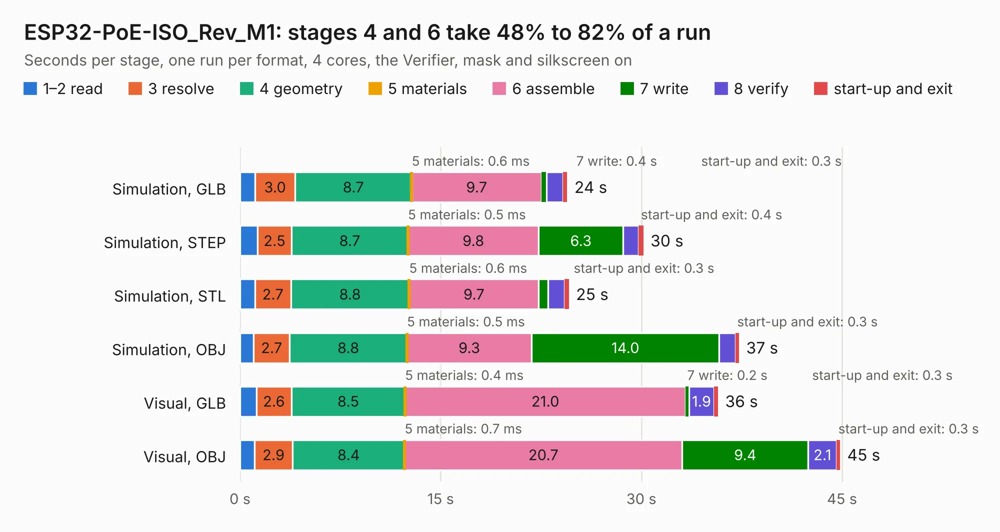

# 1865. ESP32-PoE-ISO_Rev_M1

Board 1,865 of the 3,111 of [Corpus Testing](../Corpus-Testing.md), on [Corpus Page 18](../CorpusTestingPages/Corpus-Testing-18.md#1865-esp32-poe-iso_rev_m1).

| Mode and format | 1–2 read | 3 resolve | 4 geometry | 5 materials | 6 assemble | 7 write | 8 verify | start-up and exit | Total |
|---|---:|---:|---:|---:|---:|---:|---:|---:|---:|
| Simulation, GLB | 1.1 | 3.0 | 8.7 | 0.6&nbsp;ms | 9.7 | 0.4 | 1.2 | 0.3 | 24.5 |
| Simulation, STEP | 1.3 | 2.5 | 8.7 | 0.5&nbsp;ms | 9.8 | 6.3 | 1.2 | 0.4 | 30.1 |
| Simulation, STL | 1.1 | 2.7 | 8.8 | 0.6&nbsp;ms | 9.7 | 0.7 | 1.2 | 0.3 | 24.6 |
| Simulation, OBJ | 1.0 | 2.7 | 8.8 | 0.5&nbsp;ms | 9.3 | 14.0 | 1.2 | 0.3 | 37.3 |
| Visual, GLB | 1.2 | 2.6 | 8.5 | 0.4&nbsp;ms | 21.0 | 0.2 | 1.9 | 0.3 | 35.7 |
| Visual, OBJ | 1.1 | 2.9 | 8.4 | 0.7&nbsp;ms | 20.7 | 9.4 | 2.1 | 0.3 | 44.9 |

<table align="center"><tr><td valign="top">

| Board | Repo: [OLIMEX/ESP32-POE-ISO](https://github.com/OLIMEX/ESP32-POE-ISO) Board: `ESP32-PoE-ISO_Rev_M1.kicad_pcb` |
|---|---|
| Folder | HARDWARE / ESP32-PoE-ISO-Rev.M1 |
| Complexity | 389&nbsp;/&nbsp;1000 (size&nbsp;264, features&nbsp;125) |
| KESE&nbsp;features | through vias, slotted holes, rounded, trapezoid or chamfered pads, filled zones, copper text, curved board outline, knockout text, stack-up, dielectric εr and tanδ, mask and silkscreen colours |
| Tested | 9th November 2026 |
| Copper&nbsp;layers | 4 |
| File&nbsp;format | KiCad 7 (20221018) |
| Parts,&nbsp;tracks,&nbsp;vias | 126, 3,737, 325 |
| Triangles,&nbsp;simulation | 2,279,540 in 134 parts |
| Verifier | PASS in all six runs |

</td><td valign="top">

<table>
<tr><th>File type</th><th>File size</th><th>Peak memory used</th></tr>
<tr><th colspan="3" align="left">Simulation</th></tr>
<tr><td>GLB</td><td align="right">80&nbsp;MB</td><td align="right">823&nbsp;MB</td></tr>
<tr><td>STEP</td><td align="right">343&nbsp;MB</td><td align="right">902&nbsp;MB</td></tr>
<tr><td>STL</td><td align="right">114&nbsp;MB</td><td align="right">854&nbsp;MB</td></tr>
<tr><td>OBJ</td><td align="right">244&nbsp;MB</td><td align="right">1.6&nbsp;GB</td></tr>
<tr><th colspan="3" align="left">Visual</th></tr>
<tr><td>GLB</td><td align="right">53&nbsp;MB</td><td align="right">953&nbsp;MB</td></tr>
<tr><td>OBJ</td><td align="right">163&nbsp;MB</td><td align="right">1.2&nbsp;GB</td></tr>
</table>

</td></tr></table>

| Previous | Next |
|:---|---:|
| [1864. ESP32-PoE-ISO_Rev_M](b1864b_ESP32-POE-ISO_ESP32-PoE-ISO-Rev-M.md) | [1866. ESP32-PoE-ISO_Rev_N](b1866b_ESP32-POE-ISO_ESP32-PoE-ISO-Rev-N.md) |
