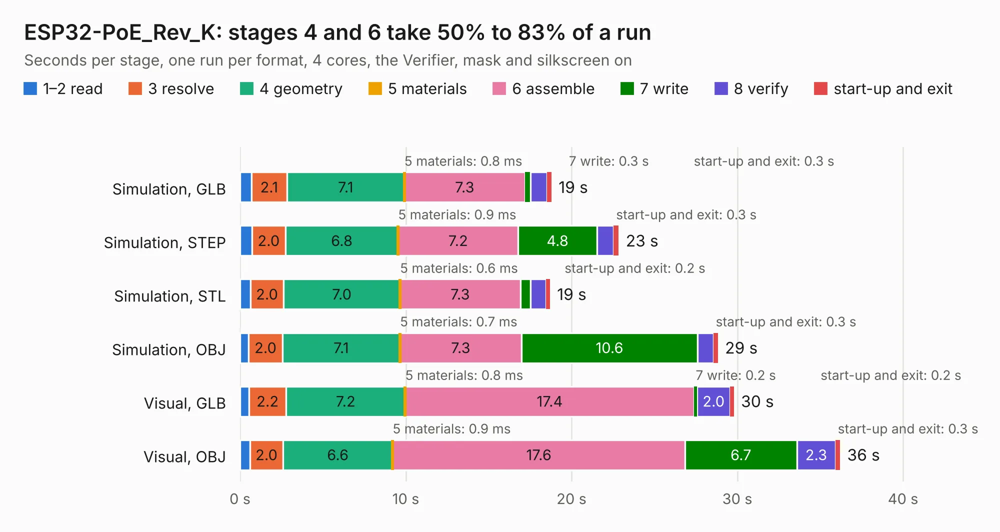

# 1865. ESP32-PoE_Rev_K

Board 1,865 of the 3,130 of [Corpus Testing](../Corpus-Testing.md), on [Corpus Page 18](../CorpusTestingPages/Corpus-Testing-18.md#1865-esp32-poe_rev_k).

| Mode and format | 1–2 read | 3 resolve | 4 geometry | 5 materials | 6 assemble | 7 write | 8 verify | start-up and exit | Total |
|---|---:|---:|---:|---:|---:|---:|---:|---:|---:|
| Simulation, GLB | 0.7 | 2.1 | 7.1 | 0.8&nbsp;ms | 7.3 | 0.3 | 1.0 | 0.3 | 18.8 |
| Simulation, STEP | 0.7 | 2.0 | 6.8 | 0.9&nbsp;ms | 7.2 | 4.8 | 1.0 | 0.3 | 22.8 |
| Simulation, STL | 0.6 | 2.0 | 7.0 | 0.6&nbsp;ms | 7.3 | 0.6 | 0.9 | 0.2 | 18.7 |
| Simulation, OBJ | 0.5 | 2.0 | 7.1 | 0.7&nbsp;ms | 7.3 | 10.6 | 1.0 | 0.3 | 28.8 |
| Visual, GLB | 0.5 | 2.2 | 7.2 | 0.8&nbsp;ms | 17.4 | 0.2 | 2.0 | 0.2 | 29.8 |
| Visual, OBJ | 0.6 | 2.0 | 6.6 | 0.9&nbsp;ms | 17.6 | 6.7 | 2.3 | 0.3 | 36.2 |

<table align="center"><tr><td valign="top">

| Board | Repo: [OLIMEX/ESP32-POE](https://github.com/OLIMEX/ESP32-POE) Board: `ESP32-PoE_Rev_K.kicad_pcb` |
|---|---|
| Folder | HARDWARE / ESP32-PoE-hardware-revision-K |
| Complexity | 323&nbsp;/&nbsp;1000 (size&nbsp;258, features&nbsp;65) |
| KESE&nbsp;features | through vias, slotted holes, rounded, trapezoid or chamfered pads, filled zones, copper text |
| Tested | 9th November 2026 |
| Copper&nbsp;layers | 4 |
| File&nbsp;format | KiCad 5 (20171130) |
| Parts,&nbsp;tracks,&nbsp;vias | 128, 2,562, 219 |
| Triangles,&nbsp;simulation | 2,011,184 in 139 parts |
| Verifier | PASS in all six runs |

</td><td valign="top">

<table>
<tr><th>File type</th><th>File size</th><th>Peak memory used</th></tr>
<tr><th colspan="3" align="left">Simulation</th></tr>
<tr><td>GLB</td><td align="right">71&nbsp;MB</td><td align="right">782&nbsp;MB</td></tr>
<tr><td>STEP</td><td align="right">312&nbsp;MB</td><td align="right">870&nbsp;MB</td></tr>
<tr><td>STL</td><td align="right">101&nbsp;MB</td><td align="right">734&nbsp;MB</td></tr>
<tr><td>OBJ</td><td align="right">215&nbsp;MB</td><td align="right">1.4&nbsp;GB</td></tr>
<tr><th colspan="3" align="left">Visual</th></tr>
<tr><td>GLB</td><td align="right">49&nbsp;MB</td><td align="right">877&nbsp;MB</td></tr>
<tr><td>OBJ</td><td align="right">148&nbsp;MB</td><td align="right">1.1&nbsp;GB</td></tr>
</table>

</td></tr></table>

| Previous | Next |
|:---|---:|
| [1864. ESP32-PoE_Rev_J](b1864b_ESP32-POE_ESP32-PoE-Rev-J.md) | [1866. ESP32-PoE_Rev_L](b1866b_ESP32-POE_ESP32-PoE-Rev-L.md) |
