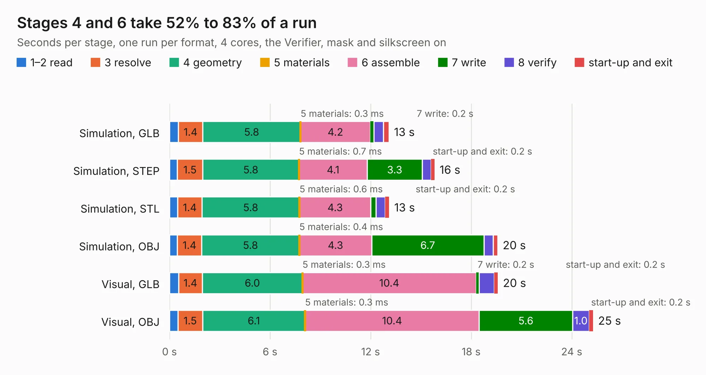

# 1865. ESP32-S3-DevKit-LiPo_Rev_B_DIMM

Board 1,865 of the 3,102 of [Corpus Testing](../Corpus-Testing.md), on [Corpus Page 18](../CorpusTestingPages/Corpus-Testing-18.md#1865-esp32-s3-devkit-lipo_rev_b_dimm).

| Mode and format | 1–2 read | 3 resolve | 4 geometry | 5 materials | 6 assemble | 7 write | 8 verify | start-up and exit | Total |
|---|---:|---:|---:|---:|---:|---:|---:|---:|---:|
| Simulation, GLB | 0.5 | 1.4 | 5.8 | 0.3&nbsp;ms | 4.2 | 0.2 | 0.6 | 0.3 | 13.1 |
| Simulation, STEP | 0.5 | 1.5 | 5.8 | 0.7&nbsp;ms | 4.1 | 3.3 | 0.5 | 0.2 | 15.8 |
| Simulation, STL | 0.5 | 1.4 | 5.8 | 0.6&nbsp;ms | 4.3 | 0.3 | 0.5 | 0.2 | 13.1 |
| Simulation, OBJ | 0.5 | 1.4 | 5.8 | 0.4&nbsp;ms | 4.3 | 6.7 | 0.6 | 0.3 | 19.6 |
| Visual, GLB | 0.5 | 1.4 | 6.0 | 0.3&nbsp;ms | 10.4 | 0.2 | 0.9 | 0.2 | 19.6 |
| Visual, OBJ | 0.5 | 1.5 | 6.1 | 0.3&nbsp;ms | 10.4 | 5.6 | 1.0 | 0.2 | 25.3 |

<table align="center"><tr><td valign="top">

| Board | Repo: [OLIMEX/ESP32-S3-DevKit-LiPo](https://github.com/OLIMEX/ESP32-S3-DevKit-LiPo) Board: `ESP32-S3-DevKit-LiPo_Rev_B_DIMM.kicad_pcb` |
|---|---|
| Folder | HARDWARE / Dimensions |
| Complexity | 237&nbsp;/&nbsp;1000 (size&nbsp;182, features&nbsp;55) |
| KESE&nbsp;features | through vias, slotted holes, filled zones, copper text |
| Tested | 9th November 2026 |
| Copper&nbsp;layers | 2 |
| File&nbsp;format | KiCad 7 (20221018) |
| Parts,&nbsp;tracks,&nbsp;vias | 54, 1,324, 128 |
| Triangles,&nbsp;simulation | 1,184,962 in 82 parts |
| Verifier | PASS in all six runs |

</td><td valign="top">

<table>
<tr><th>File type</th><th>File size</th><th>Peak memory used</th></tr>
<tr><th colspan="3" align="left">Simulation</th></tr>
<tr><td>GLB</td><td align="right">42&nbsp;MB</td><td align="right">562&nbsp;MB</td></tr>
<tr><td>STEP</td><td align="right">233&nbsp;MB</td><td align="right">633&nbsp;MB</td></tr>
<tr><td>STL</td><td align="right">59&nbsp;MB</td><td align="right">542&nbsp;MB</td></tr>
<tr><td>OBJ</td><td align="right">125&nbsp;MB</td><td align="right">851&nbsp;MB</td></tr>
<tr><th colspan="3" align="left">Visual</th></tr>
<tr><td>GLB</td><td align="right">35&nbsp;MB</td><td align="right">769&nbsp;MB</td></tr>
<tr><td>OBJ</td><td align="right">106&nbsp;MB</td><td align="right">801&nbsp;MB</td></tr>
</table>

</td></tr></table>

| Previous | Next |
|:---|---:|
| [1864. ESP32-S2-DevKit-USB_Rev_B](b1864b_ESP32-S2-DevKit-LiPo-USB_ESP32-S2-DevKit-USB-Rev-B.md) | [1866. ESP32-S3-DevKit-LiPo_Rev_B](b1866b_ESP32-S3-DevKit-LiPo_ESP32-S3-DevKit-LiPo-Rev-B.md) |
