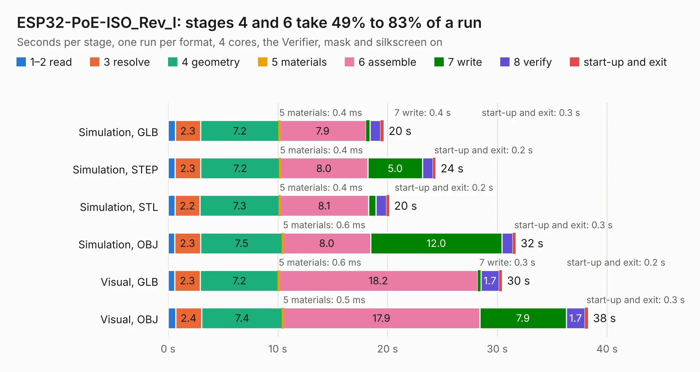

# 1866. ESP32-PoE-ISO_Rev_I

Board 1,866 of the 3,117 of [Corpus Testing](../Corpus-Testing.md), on [Corpus Page 18](../CorpusTestingPages/Corpus-Testing-18.md#1866-esp32-poe-iso_rev_i).

| Mode and format | 1–2 read | 3 resolve | 4 geometry | 5 materials | 6 assemble | 7 write | 8 verify | start-up and exit | Total |
|---|---:|---:|---:|---:|---:|---:|---:|---:|---:|
| Simulation, GLB | 0.7 | 2.3 | 7.2 | 0.4&nbsp;ms | 7.9 | 0.4 | 1.0 | 0.3 | 19.6 |
| Simulation, STEP | 0.6 | 2.3 | 7.2 | 0.4&nbsp;ms | 8.0 | 5.0 | 1.0 | 0.2 | 24.4 |
| Simulation, STL | 0.6 | 2.2 | 7.3 | 0.4&nbsp;ms | 8.1 | 0.6 | 1.0 | 0.2 | 20.1 |
| Simulation, OBJ | 0.6 | 2.3 | 7.5 | 0.6&nbsp;ms | 8.0 | 12.0 | 1.0 | 0.3 | 31.7 |
| Visual, GLB | 0.6 | 2.3 | 7.2 | 0.6&nbsp;ms | 18.2 | 0.3 | 1.7 | 0.2 | 30.4 |
| Visual, OBJ | 0.7 | 2.4 | 7.4 | 0.5&nbsp;ms | 17.9 | 7.9 | 1.7 | 0.3 | 38.3 |

<table align="center"><tr><td valign="top">

| Board | Repo: [OLIMEX/ESP32-POE-ISO](https://github.com/OLIMEX/ESP32-POE-ISO) Board: `ESP32-PoE-ISO_Rev_I.kicad_pcb` |
|---|---|
| Folder | HARDWARE / ESP32-PoE-ISO-Rev.I |
| Complexity | 337&nbsp;/&nbsp;1000 (size&nbsp;262, features&nbsp;75) |
| KESE&nbsp;features | through vias, slotted holes, rounded, trapezoid or chamfered pads, filled zones, copper text, curved board outline |
| Tested | 9th November 2026 |
| Copper&nbsp;layers | 4 |
| File&nbsp;format | KiCad 5 (20171130) |
| Parts,&nbsp;tracks,&nbsp;vias | 123, 3,108, 329 |
| Triangles,&nbsp;simulation | 2,285,522 in 138 parts |
| Verifier | PASS in all six runs |

</td><td valign="top">

<table>
<tr><th>File type</th><th>File size</th><th>Peak memory used</th></tr>
<tr><th colspan="3" align="left">Simulation</th></tr>
<tr><td>GLB</td><td align="right">80&nbsp;MB</td><td align="right">800&nbsp;MB</td></tr>
<tr><td>STEP</td><td align="right">321&nbsp;MB</td><td align="right">908&nbsp;MB</td></tr>
<tr><td>STL</td><td align="right">114&nbsp;MB</td><td align="right">773&nbsp;MB</td></tr>
<tr><td>OBJ</td><td align="right">244&nbsp;MB</td><td align="right">1.5&nbsp;GB</td></tr>
<tr><th colspan="3" align="left">Visual</th></tr>
<tr><td>GLB</td><td align="right">53&nbsp;MB</td><td align="right">925&nbsp;MB</td></tr>
<tr><td>OBJ</td><td align="right">161&nbsp;MB</td><td align="right">1.1&nbsp;GB</td></tr>
</table>

</td></tr></table>

| Previous | Next |
|:---|---:|
| [1865. ESP32-PoE-ISO_Rev_H](b1865b_ESP32-POE-ISO_ESP32-PoE-ISO-Rev-H.md) | [1867. ESP32-PoE-ISO_Rev_J](b1867b_ESP32-POE-ISO_ESP32-PoE-ISO-Rev-J.md) |
