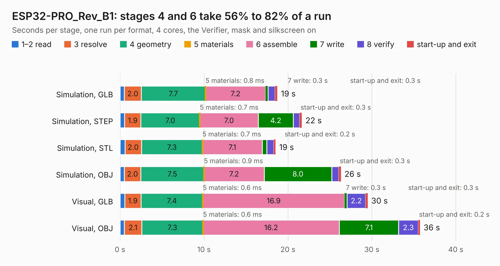

# 1869. ESP32-PRO_Rev_B1

Board 1,869 of the 3,109 of [Corpus Testing](../Corpus-Testing.md), on [Corpus Page 18](../CorpusTestingPages/Corpus-Testing-18.md#1869-esp32-pro_rev_b1).

| Mode and format | 1–2 read | 3 resolve | 4 geometry | 5 materials | 6 assemble | 7 write | 8 verify | start-up and exit | Total |
|---|---:|---:|---:|---:|---:|---:|---:|---:|---:|
| Simulation, GLB | 0.5 | 2.0 | 7.7 | 0.8&nbsp;ms | 7.2 | 0.3 | 0.8 | 0.3 | 18.7 |
| Simulation, STEP | 0.5 | 1.9 | 7.0 | 0.7&nbsp;ms | 7.0 | 4.2 | 0.7 | 0.3 | 21.7 |
| Simulation, STL | 0.6 | 2.0 | 7.3 | 0.7&nbsp;ms | 7.1 | 0.5 | 0.8 | 0.2 | 18.5 |
| Simulation, OBJ | 0.5 | 2.0 | 7.5 | 0.9&nbsp;ms | 7.2 | 8.0 | 0.8 | 0.3 | 26.3 |
| Visual, GLB | 0.6 | 1.9 | 7.4 | 0.6&nbsp;ms | 16.9 | 0.3 | 2.2 | 0.3 | 29.5 |
| Visual, OBJ | 0.5 | 2.1 | 7.3 | 0.6&nbsp;ms | 16.2 | 7.1 | 2.3 | 0.2 | 35.7 |

<table align="center"><tr><td valign="top">

| Board | Repo: [OLIMEX/ESP32-PRO](https://github.com/OLIMEX/ESP32-PRO) Board: `ESP32-PRO_Rev_B1.kicad_pcb` |
|---|---|
| Folder | HARDWARE / REV-B1 |
| Complexity | 308&nbsp;/&nbsp;1000 (size&nbsp;253, features&nbsp;55) |
| KESE&nbsp;features | through vias, slotted holes, filled zones, copper text |
| Tested | 9th November 2026 |
| Copper&nbsp;layers | 2 |
| File&nbsp;format | KiCad 5 (20171130) |
| Parts,&nbsp;tracks,&nbsp;vias | 123, 3,548, 327 |
| Triangles,&nbsp;simulation | 1,641,446 in 123 parts |
| Verifier | PASS in all six runs |

</td><td valign="top">

<table>
<tr><th>File type</th><th>File size</th><th>Peak memory used</th></tr>
<tr><th colspan="3" align="left">Simulation</th></tr>
<tr><td>GLB</td><td align="right">58&nbsp;MB</td><td align="right">699&nbsp;MB</td></tr>
<tr><td>STEP</td><td align="right">307&nbsp;MB</td><td align="right">791&nbsp;MB</td></tr>
<tr><td>STL</td><td align="right">82&nbsp;MB</td><td align="right">701&nbsp;MB</td></tr>
<tr><td>OBJ</td><td align="right">176&nbsp;MB</td><td align="right">1.2&nbsp;GB</td></tr>
<tr><th colspan="3" align="left">Visual</th></tr>
<tr><td>GLB</td><td align="right">50&nbsp;MB</td><td align="right">849&nbsp;MB</td></tr>
<tr><td>OBJ</td><td align="right">151&nbsp;MB</td><td align="right">1.1&nbsp;GB</td></tr>
</table>

</td></tr></table>

| Previous | Next |
|:---|---:|
| [1868. ESP32-PRO_Rev_B](b1868b_ESP32-PRO_ESP32-PRO-Rev-B.md) | [1870. ESP32-S2-DevKit-Lipo_Rev_B1](b1870b_ESP32-S2-DevKit-LiPo_ESP32-S2-DevKit-Lipo-Rev-B1.md) |
