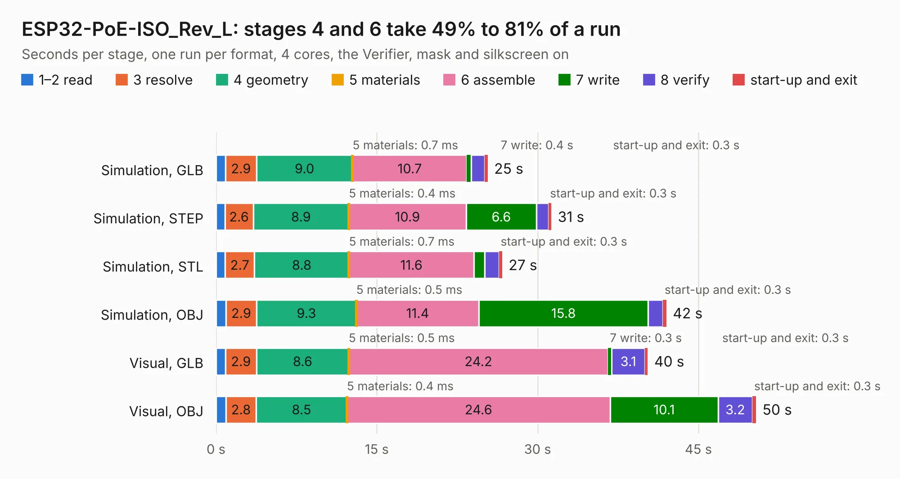

# 1870. ESP32-PoE-ISO_Rev_L

Board 1,870 of the 3,118 of [Corpus Testing](../Corpus-Testing.md), on [Corpus Page 18](../CorpusTestingPages/Corpus-Testing-18.md#1870-esp32-poe-iso_rev_l).

| Mode and format | 1–2 read | 3 resolve | 4 geometry | 5 materials | 6 assemble | 7 write | 8 verify | start-up and exit | Total |
|---|---:|---:|---:|---:|---:|---:|---:|---:|---:|
| Simulation, GLB | 0.9 | 2.9 | 9.0 | 0.7&nbsp;ms | 10.7 | 0.4 | 1.3 | 0.3 | 25.3 |
| Simulation, STEP | 0.8 | 2.6 | 8.9 | 0.4&nbsp;ms | 10.9 | 6.6 | 1.1 | 0.3 | 31.3 |
| Simulation, STL | 0.8 | 2.7 | 8.8 | 0.7&nbsp;ms | 11.6 | 1.0 | 1.3 | 0.3 | 26.7 |
| Simulation, OBJ | 0.9 | 2.9 | 9.3 | 0.5&nbsp;ms | 11.4 | 15.8 | 1.4 | 0.3 | 42.0 |
| Visual, GLB | 0.9 | 2.9 | 8.6 | 0.5&nbsp;ms | 24.2 | 0.3 | 3.1 | 0.3 | 40.3 |
| Visual, OBJ | 0.9 | 2.8 | 8.5 | 0.4&nbsp;ms | 24.6 | 10.1 | 3.2 | 0.3 | 50.4 |

<table align="center"><tr><td valign="top">

| Board | Repo: [OLIMEX/ESP32-POE-ISO](https://github.com/OLIMEX/ESP32-POE-ISO) Board: `ESP32-PoE-ISO_Rev_L.kicad_pcb` |
|---|---|
| Folder | HARDWARE / ESP32-PoE-ISO-Rev.L |
| Complexity | 337&nbsp;/&nbsp;1000 (size&nbsp;262, features&nbsp;75) |
| KESE&nbsp;features | through vias, slotted holes, rounded, trapezoid or chamfered pads, filled zones, copper text, curved board outline |
| Tested | 9th November 2026 |
| Copper&nbsp;layers | 4 |
| File&nbsp;format | KiCad 5 (20171130) |
| Parts,&nbsp;tracks,&nbsp;vias | 128, 3,103, 321 |
| Triangles,&nbsp;simulation | 2,428,460 in 139 parts |
| Verifier | PASS in all six runs |

</td><td valign="top">

<table>
<tr><th>File type</th><th>File size</th><th>Peak memory used</th></tr>
<tr><th colspan="3" align="left">Simulation</th></tr>
<tr><td>GLB</td><td align="right">85&nbsp;MB</td><td align="right">755&nbsp;MB</td></tr>
<tr><td>STEP</td><td align="right">347&nbsp;MB</td><td align="right">987&nbsp;MB</td></tr>
<tr><td>STL</td><td align="right">121&nbsp;MB</td><td align="right">805&nbsp;MB</td></tr>
<tr><td>OBJ</td><td align="right">259&nbsp;MB</td><td align="right">1.7&nbsp;GB</td></tr>
<tr><th colspan="3" align="left">Visual</th></tr>
<tr><td>GLB</td><td align="right">56&nbsp;MB</td><td align="right">994&nbsp;MB</td></tr>
<tr><td>OBJ</td><td align="right">172&nbsp;MB</td><td align="right">1.2&nbsp;GB</td></tr>
</table>

</td></tr></table>

| Previous | Next |
|:---|---:|
| [1869. ESP32-PoE-ISO_Rev_K](b1869b_ESP32-POE-ISO_ESP32-PoE-ISO-Rev-K.md) | [1871. ESP32-PoE-ISO_Rev_M](b1871b_ESP32-POE-ISO_ESP32-PoE-ISO-Rev-M.md) |
