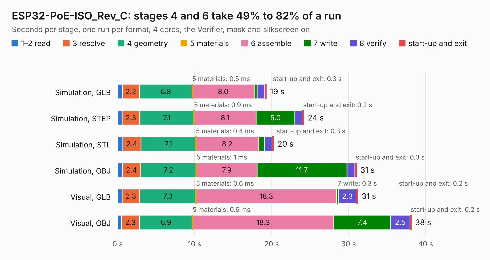

# 1871. ESP32-PoE-ISO_Rev_C

Board 1,871 of the 3,129 of [Corpus Testing](../Corpus-Testing.md), on [Corpus Page 18](../CorpusTestingPages/Corpus-Testing-18.md#1871-esp32-poe-iso_rev_c).

| Mode and format | 1–2 read | 3 resolve | 4 geometry | 5 materials | 6 assemble | 7 write | 8 verify | start-up and exit | Total |
|---|---:|---:|---:|---:|---:|---:|---:|---:|---:|
| Simulation, GLB | 0.6 | 2.2 | 6.8 | 0.5&nbsp;ms | 8.0 | 0.4 | 1.0 | 0.3 | 19.3 |
| Simulation, STEP | 0.6 | 2.3 | 7.1 | 0.9&nbsp;ms | 8.1 | 5.0 | 1.0 | 0.2 | 24.2 |
| Simulation, STL | 0.7 | 2.4 | 7.1 | 0.4&nbsp;ms | 8.2 | 0.8 | 1.0 | 0.3 | 20.3 |
| Simulation, OBJ | 0.6 | 2.4 | 7.2 | 1&nbsp;ms | 7.9 | 11.7 | 1.0 | 0.3 | 31.1 |
| Visual, GLB | 0.6 | 2.3 | 7.3 | 0.6&nbsp;ms | 18.3 | 0.3 | 2.3 | 0.2 | 31.2 |
| Visual, OBJ | 0.5 | 2.3 | 6.9 | 0.6&nbsp;ms | 18.3 | 7.4 | 2.5 | 0.2 | 38.2 |

<table align="center"><tr><td valign="top">

| Board | Repo: [OLIMEX/ESP32-POE-ISO](https://github.com/OLIMEX/ESP32-POE-ISO) Board: `ESP32-PoE-ISO_Rev_C.kicad_pcb` |
|---|---|
| Folder | HARDWARE / ESP32-PoE-ISO-Rev.C |
| Complexity | 336&nbsp;/&nbsp;1000 (size&nbsp;261, features&nbsp;75) |
| KESE&nbsp;features | through vias, slotted holes, rounded, trapezoid or chamfered pads, filled zones, copper text, curved board outline |
| Tested | 9th November 2026 |
| Copper&nbsp;layers | 4 |
| File&nbsp;format | KiCad 6 (20190516) |
| Parts,&nbsp;tracks,&nbsp;vias | 117, 2,943, 326 |
| Triangles,&nbsp;simulation | 2,260,980 in 142 parts |
| Verifier | PASS in all six runs |

</td><td valign="top">

<table>
<tr><th>File type</th><th>File size</th><th>Peak memory used</th></tr>
<tr><th colspan="3" align="left">Simulation</th></tr>
<tr><td>GLB</td><td align="right">79&nbsp;MB</td><td align="right">840&nbsp;MB</td></tr>
<tr><td>STEP</td><td align="right">321&nbsp;MB</td><td align="right">905&nbsp;MB</td></tr>
<tr><td>STL</td><td align="right">113&nbsp;MB</td><td align="right">788&nbsp;MB</td></tr>
<tr><td>OBJ</td><td align="right">240&nbsp;MB</td><td align="right">1.5&nbsp;GB</td></tr>
<tr><th colspan="3" align="left">Visual</th></tr>
<tr><td>GLB</td><td align="right">52&nbsp;MB</td><td align="right">920&nbsp;MB</td></tr>
<tr><td>OBJ</td><td align="right">159&nbsp;MB</td><td align="right">1.1&nbsp;GB</td></tr>
</table>

</td></tr></table>

| Previous | Next |
|:---|---:|
| [1870. ESP32-PoE-ISO_Rev_B](b1870b_ESP32-POE-ISO_ESP32-PoE-ISO-Rev-B.md) | [1872. ESP32-PoE-ISO_Rev_D](b1872b_ESP32-POE-ISO_ESP32-PoE-ISO-Rev-D.md) |
