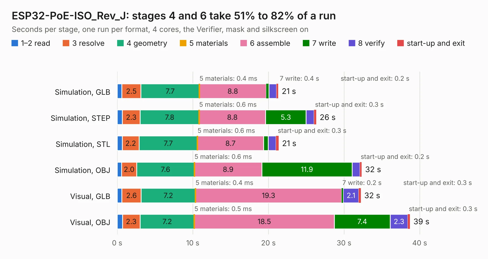

# 1873. ESP32-PoE-ISO_Rev_J

Board 1,873 of the 3,123 of [Corpus Testing](../Corpus-Testing.md), on [Corpus Page 18](../CorpusTestingPages/Corpus-Testing-18.md#1873-esp32-poe-iso_rev_j).

| Mode and format | 1–2 read | 3 resolve | 4 geometry | 5 materials | 6 assemble | 7 write | 8 verify | start-up and exit | Total |
|---|---:|---:|---:|---:|---:|---:|---:|---:|---:|
| Simulation, GLB | 0.6 | 2.5 | 7.7 | 0.4&nbsp;ms | 8.8 | 0.4 | 1.0 | 0.2 | 21.3 |
| Simulation, STEP | 0.7 | 2.3 | 7.8 | 0.6&nbsp;ms | 8.8 | 5.3 | 1.1 | 0.3 | 26.3 |
| Simulation, STL | 0.7 | 2.2 | 7.7 | 0.6&nbsp;ms | 8.7 | 0.6 | 1.0 | 0.3 | 21.3 |
| Simulation, OBJ | 0.6 | 2.0 | 7.6 | 0.6&nbsp;ms | 8.9 | 11.9 | 1.0 | 0.2 | 32.3 |
| Visual, GLB | 0.6 | 2.6 | 7.2 | 0.4&nbsp;ms | 19.3 | 0.2 | 2.1 | 0.3 | 32.2 |
| Visual, OBJ | 0.7 | 2.3 | 7.2 | 0.5&nbsp;ms | 18.5 | 7.4 | 2.3 | 0.3 | 38.7 |

<table align="center"><tr><td valign="top">

| Board | Repo: [OLIMEX/ESP32-POE-ISO](https://github.com/OLIMEX/ESP32-POE-ISO) Board: `ESP32-PoE-ISO_Rev_J.kicad_pcb` |
|---|---|
| Folder | HARDWARE / ESP32-PoE-ISO-Rev.J |
| Complexity | 337&nbsp;/&nbsp;1000 (size&nbsp;262, features&nbsp;75) |
| KESE&nbsp;features | through vias, slotted holes, rounded, trapezoid or chamfered pads, filled zones, copper text, curved board outline |
| Tested | 9th November 2026 |
| Copper&nbsp;layers | 4 |
| File&nbsp;format | KiCad 5 (20171130) |
| Parts,&nbsp;tracks,&nbsp;vias | 126, 3,029, 319 |
| Triangles,&nbsp;simulation | 2,413,834 in 139 parts |
| Verifier | PASS in all six runs |

</td><td valign="top">

<table>
<tr><th>File type</th><th>File size</th><th>Peak memory used</th></tr>
<tr><th colspan="3" align="left">Simulation</th></tr>
<tr><td>GLB</td><td align="right">84&nbsp;MB</td><td align="right">765&nbsp;MB</td></tr>
<tr><td>STEP</td><td align="right">345&nbsp;MB</td><td align="right">965&nbsp;MB</td></tr>
<tr><td>STL</td><td align="right">121&nbsp;MB</td><td align="right">762&nbsp;MB</td></tr>
<tr><td>OBJ</td><td align="right">257&nbsp;MB</td><td align="right">1.6&nbsp;GB</td></tr>
<tr><th colspan="3" align="left">Visual</th></tr>
<tr><td>GLB</td><td align="right">56&nbsp;MB</td><td align="right">1.0&nbsp;GB</td></tr>
<tr><td>OBJ</td><td align="right">171&nbsp;MB</td><td align="right">1.2&nbsp;GB</td></tr>
</table>

</td></tr></table>

| Previous | Next |
|:---|---:|
| [1872. ESP32-PoE-ISO_Rev_I](b1872b_ESP32-POE-ISO_ESP32-PoE-ISO-Rev-I.md) | [1874. ESP32-PoE-ISO_Rev_K](b1874b_ESP32-POE-ISO_ESP32-PoE-ISO-Rev-K.md) |
