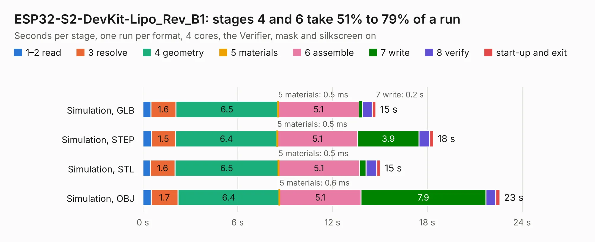

# 1873. ESP32-S2-DevKit-Lipo_Rev_B1

Board 1,873 of the 3,112 of [Corpus Testing](../Corpus-Testing.md), on [Corpus Page 18](../CorpusTestingPages/Corpus-Testing-18.md#1873-esp32-s2-devkit-lipo_rev_b1).

| Mode and format | 1–2 read | 3 resolve | 4 geometry | 5 materials | 6 assemble | 7 write | 8 verify | start-up and exit | Total |
|---|---:|---:|---:|---:|---:|---:|---:|---:|---:|
| Simulation, GLB | 0.5 | 1.6 | 6.5 | 0.5&nbsp;ms | 5.1 | 0.2 | 0.6 | 0.2 | 14.8 |
| Simulation, STEP | 0.5 | 1.5 | 6.4 | 0.5&nbsp;ms | 5.1 | 3.9 | 0.7 | 0.2 | 18.4 |
| Simulation, STL | 0.5 | 1.6 | 6.5 | 0.5&nbsp;ms | 5.1 | 0.4 | 0.7 | 0.2 | 15.0 |
| Simulation, OBJ | 0.5 | 1.7 | 6.4 | 0.6&nbsp;ms | 5.1 | 7.9 | 0.6 | 0.3 | 22.6 |
| Visual, GLB | 0.5 | 1.5 | 6.4 | 0.5&nbsp;ms | 12.7 | 0.2 | 1.3 | 0.2 | 22.8 |
| Visual, OBJ | 0.5 | 1.6 | 6.5 | 0.5&nbsp;ms | 13.0 | 6.5 | 1.6 | 0.2 | 29.8 |

<table align="center"><tr><td valign="top">

| Board | Repo: [OLIMEX/ESP32-S2-DevKit-LiPo](https://github.com/OLIMEX/ESP32-S2-DevKit-LiPo) Board: `ESP32-S2-DevKit-Lipo_Rev_B1.kicad_pcb` |
|---|---|
| Folder | HARDWARE / ESP32-S2-DevKit-Lipo-Rev.B1 |
| Complexity | 253&nbsp;/&nbsp;1000 (size&nbsp;188, features&nbsp;65) |
| KESE&nbsp;features | through vias, slotted holes, rounded, trapezoid or chamfered pads, filled zones, copper text |
| Tested | 9th November 2026 |
| Copper&nbsp;layers | 2 |
| File&nbsp;format | KiCad 5 (20171130) |
| Parts,&nbsp;tracks,&nbsp;vias | 76, 1,472, 164 |
| Triangles,&nbsp;simulation | 1,273,136 in 91 parts |
| Verifier | PASS in all six runs |

</td><td valign="top">

<table>
<tr><th>File type</th><th>File size</th><th>Peak memory used</th></tr>
<tr><th colspan="3" align="left">Simulation</th></tr>
<tr><td>GLB</td><td align="right">45&nbsp;MB</td><td align="right">575&nbsp;MB</td></tr>
<tr><td>STEP</td><td align="right">244&nbsp;MB</td><td align="right">643&nbsp;MB</td></tr>
<tr><td>STL</td><td align="right">64&nbsp;MB</td><td align="right">561&nbsp;MB</td></tr>
<tr><td>OBJ</td><td align="right">135&nbsp;MB</td><td align="right">905&nbsp;MB</td></tr>
<tr><th colspan="3" align="left">Visual</th></tr>
<tr><td>GLB</td><td align="right">39&nbsp;MB</td><td align="right">787&nbsp;MB</td></tr>
<tr><td>OBJ</td><td align="right">115&nbsp;MB</td><td align="right">847&nbsp;MB</td></tr>
</table>

</td></tr></table>

| Previous | Next |
|:---|---:|
| [1872. ESP32-PRO_Rev_B1](b1872b_ESP32-PRO_ESP32-PRO-Rev-B1.md) | [1874. ESP32-S2-DevKit-USB_Rev_B](b1874b_ESP32-S2-DevKit-LiPo-USB_ESP32-S2-DevKit-USB-Rev-B.md) |
