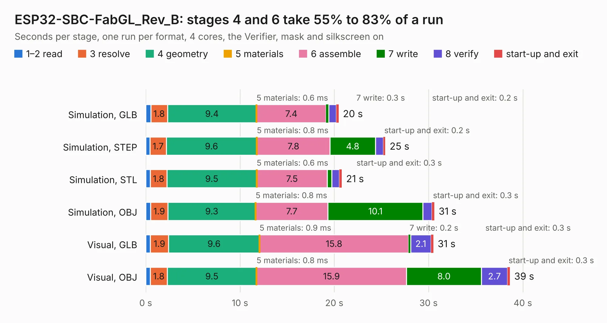

# 1873. ESP32-SBC-FabGL_Rev_B

Board 1,873 of the 3,107 of [Corpus Testing](../Corpus-Testing.md), on [Corpus Page 18](../CorpusTestingPages/Corpus-Testing-18.md#1873-esp32-sbc-fabgl_rev_b).

| Mode and format | 1–2 read | 3 resolve | 4 geometry | 5 materials | 6 assemble | 7 write | 8 verify | start-up and exit | Total |
|---|---:|---:|---:|---:|---:|---:|---:|---:|---:|
| Simulation, GLB | 0.5 | 1.8 | 9.4 | 0.6&nbsp;ms | 7.4 | 0.3 | 0.8 | 0.2 | 20.5 |
| Simulation, STEP | 0.5 | 1.7 | 9.6 | 0.8&nbsp;ms | 7.8 | 4.8 | 0.8 | 0.2 | 25.4 |
| Simulation, STL | 0.5 | 1.8 | 9.5 | 0.6&nbsp;ms | 7.5 | 0.5 | 0.8 | 0.3 | 20.8 |
| Simulation, OBJ | 0.5 | 1.9 | 9.3 | 0.8&nbsp;ms | 7.7 | 10.1 | 0.9 | 0.3 | 30.6 |
| Visual, GLB | 0.5 | 1.9 | 9.6 | 0.9&nbsp;ms | 15.8 | 0.2 | 2.1 | 0.3 | 30.5 |
| Visual, OBJ | 0.5 | 1.8 | 9.5 | 0.8&nbsp;ms | 15.9 | 8.0 | 2.7 | 0.3 | 38.6 |

<table align="center"><tr><td valign="top">

| Board | Repo: [OLIMEX/ESP32-SBC-FabGL](https://github.com/OLIMEX/ESP32-SBC-FabGL) Board: `ESP32-SBC-FabGL_Rev_B.kicad_pcb` |
|---|---|
| Folder | HARDWARE / Hardware-revision-B |
| Complexity | 249&nbsp;/&nbsp;1000 (size&nbsp;194, features&nbsp;55) |
| KESE&nbsp;features | through vias, slotted holes, filled zones, curved board outline |
| Tested | 9th November 2026 |
| Copper&nbsp;layers | 2 |
| File&nbsp;format | KiCad 5 (20171130) |
| Parts,&nbsp;tracks,&nbsp;vias | 107, 1,405, 266 |
| Triangles,&nbsp;simulation | 1,795,894 in 123 parts |
| Verifier | PASS in all six runs |

</td><td valign="top">

<table>
<tr><th>File type</th><th>File size</th><th>Peak memory used</th></tr>
<tr><th colspan="3" align="left">Simulation</th></tr>
<tr><td>GLB</td><td align="right">63&nbsp;MB</td><td align="right">659&nbsp;MB</td></tr>
<tr><td>STEP</td><td align="right">328&nbsp;MB</td><td align="right">860&nbsp;MB</td></tr>
<tr><td>STL</td><td align="right">90&nbsp;MB</td><td align="right">672&nbsp;MB</td></tr>
<tr><td>OBJ</td><td align="right">190&nbsp;MB</td><td align="right">1.2&nbsp;GB</td></tr>
<tr><th colspan="3" align="left">Visual</th></tr>
<tr><td>GLB</td><td align="right">51&nbsp;MB</td><td align="right">857&nbsp;MB</td></tr>
<tr><td>OBJ</td><td align="right">156&nbsp;MB</td><td align="right">1.1&nbsp;GB</td></tr>
</table>

</td></tr></table>

| Previous | Next |
|:---|---:|
| [1872. ESP32-SBC-FabGL_Rev_A](b1872b_ESP32-SBC-FabGL_ESP32-SBC-FabGL-Rev-A.md) | [1874. Flash-e_Rev_C](b1874b_Flash-e_Flash-e-Rev-C.md) |
