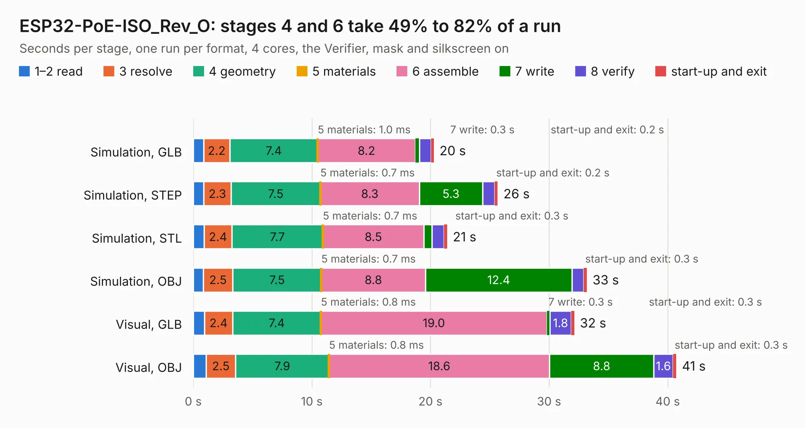

# 1875. ESP32-PoE-ISO_Rev_O

Board 1,875 of the 3,118 of [Corpus Testing](../Corpus-Testing.md), on [Corpus Page 18](../CorpusTestingPages/Corpus-Testing-18.md#1875-esp32-poe-iso_rev_o).

| Mode and format | 1–2 read | 3 resolve | 4 geometry | 5 materials | 6 assemble | 7 write | 8 verify | start-up and exit | Total |
|---|---:|---:|---:|---:|---:|---:|---:|---:|---:|
| Simulation, GLB | 0.9 | 2.2 | 7.4 | 1.0&nbsp;ms | 8.2 | 0.3 | 1.0 | 0.2 | 20.3 |
| Simulation, STEP | 0.9 | 2.3 | 7.5 | 0.7&nbsp;ms | 8.3 | 5.3 | 1.0 | 0.2 | 25.7 |
| Simulation, STL | 0.9 | 2.4 | 7.7 | 0.7&nbsp;ms | 8.5 | 0.7 | 1.0 | 0.3 | 21.4 |
| Simulation, OBJ | 0.8 | 2.5 | 7.5 | 0.7&nbsp;ms | 8.8 | 12.4 | 1.0 | 0.3 | 33.2 |
| Visual, GLB | 1.0 | 2.4 | 7.4 | 0.8&nbsp;ms | 19.0 | 0.3 | 1.8 | 0.3 | 32.1 |
| Visual, OBJ | 1.1 | 2.5 | 7.9 | 0.8&nbsp;ms | 18.6 | 8.8 | 1.6 | 0.3 | 40.7 |

<table align="center"><tr><td valign="top">

| Board | Repo: [OLIMEX/ESP32-POE-ISO](https://github.com/OLIMEX/ESP32-POE-ISO) Board: `ESP32-PoE-ISO_Rev_O.kicad_pcb` |
|---|---|
| Folder | HARDWARE / ESP32-PoE-ISO-Rev.O |
| Complexity | 379&nbsp;/&nbsp;1000 (size&nbsp;264, features&nbsp;115) |
| KESE&nbsp;features | through vias, slotted holes, filled zones, copper text, curved board outline, knockout text, stack-up, dielectric εr and tanδ, mask and silkscreen colours |
| Tested | 9th November 2026 |
| Copper&nbsp;layers | 4 |
| File&nbsp;format | KiCad 7 (20221018) |
| Parts,&nbsp;tracks,&nbsp;vias | 129, 3,704, 322 |
| Triangles,&nbsp;simulation | 2,304,726 in 134 parts |
| Verifier | PASS in all six runs |

</td><td valign="top">

<table>
<tr><th>File type</th><th>File size</th><th>Peak memory used</th></tr>
<tr><th colspan="3" align="left">Simulation</th></tr>
<tr><td>GLB</td><td align="right">81&nbsp;MB</td><td align="right">806&nbsp;MB</td></tr>
<tr><td>STEP</td><td align="right">353&nbsp;MB</td><td align="right">940&nbsp;MB</td></tr>
<tr><td>STL</td><td align="right">115&nbsp;MB</td><td align="right">789&nbsp;MB</td></tr>
<tr><td>OBJ</td><td align="right">247&nbsp;MB</td><td align="right">1.6&nbsp;GB</td></tr>
<tr><th colspan="3" align="left">Visual</th></tr>
<tr><td>GLB</td><td align="right">54&nbsp;MB</td><td align="right">990&nbsp;MB</td></tr>
<tr><td>OBJ</td><td align="right">167&nbsp;MB</td><td align="right">1.2&nbsp;GB</td></tr>
</table>

</td></tr></table>

| Previous | Next |
|:---|---:|
| [1874. ESP32-PoE-ISO_Rev_N1](b1874b_ESP32-POE-ISO_ESP32-PoE-ISO-Rev-N1.md) | [1876. ESP32-PoE2_Rev_B](b1876b_ESP32-POE2_ESP32-PoE2-Rev-B.md) |
