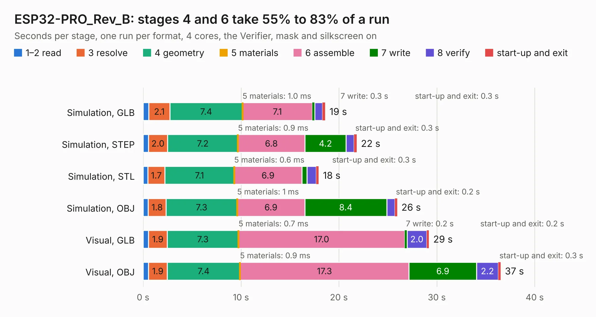

# 1876. ESP32-PRO_Rev_B

Board 1,876 of the 3,117 of [Corpus Testing](../Corpus-Testing.md), on [Corpus Page 18](../CorpusTestingPages/Corpus-Testing-18.md#1876-esp32-pro_rev_b).

| Mode and format | 1–2 read | 3 resolve | 4 geometry | 5 materials | 6 assemble | 7 write | 8 verify | start-up and exit | Total |
|---|---:|---:|---:|---:|---:|---:|---:|---:|---:|
| Simulation, GLB | 0.6 | 2.1 | 7.4 | 1.0&nbsp;ms | 7.1 | 0.3 | 0.8 | 0.3 | 18.6 |
| Simulation, STEP | 0.5 | 2.0 | 7.2 | 0.9&nbsp;ms | 6.8 | 4.2 | 0.8 | 0.3 | 21.8 |
| Simulation, STL | 0.5 | 1.7 | 7.1 | 0.6&nbsp;ms | 6.9 | 0.5 | 0.9 | 0.3 | 17.9 |
| Simulation, OBJ | 0.5 | 1.8 | 7.3 | 1&nbsp;ms | 6.9 | 8.4 | 0.8 | 0.2 | 26.0 |
| Visual, GLB | 0.5 | 1.9 | 7.3 | 0.7&nbsp;ms | 17.0 | 0.2 | 2.0 | 0.2 | 29.2 |
| Visual, OBJ | 0.5 | 1.9 | 7.4 | 0.9&nbsp;ms | 17.3 | 6.9 | 2.2 | 0.3 | 36.5 |

<table align="center"><tr><td valign="top">

| Board | Repo: [OLIMEX/ESP32-PRO](https://github.com/OLIMEX/ESP32-PRO) Board: `ESP32-PRO_Rev_B.kicad_pcb` |
|---|---|
| Folder | HARDWARE / REV-B |
| Complexity | 308&nbsp;/&nbsp;1000 (size&nbsp;253, features&nbsp;55) |
| KESE&nbsp;features | through vias, slotted holes, filled zones, copper text |
| Tested | 9th November 2026 |
| Copper&nbsp;layers | 2 |
| File&nbsp;format | KiCad 5 (20171130) |
| Parts,&nbsp;tracks,&nbsp;vias | 123, 3,549, 327 |
| Triangles,&nbsp;simulation | 1,642,858 in 123 parts |
| Verifier | PASS in all six runs |

</td><td valign="top">

<table>
<tr><th>File type</th><th>File size</th><th>Peak memory used</th></tr>
<tr><th colspan="3" align="left">Simulation</th></tr>
<tr><td>GLB</td><td align="right">59&nbsp;MB</td><td align="right">676&nbsp;MB</td></tr>
<tr><td>STEP</td><td align="right">310&nbsp;MB</td><td align="right">815&nbsp;MB</td></tr>
<tr><td>STL</td><td align="right">82&nbsp;MB</td><td align="right">676&nbsp;MB</td></tr>
<tr><td>OBJ</td><td align="right">176&nbsp;MB</td><td align="right">1.2&nbsp;GB</td></tr>
<tr><th colspan="3" align="left">Visual</th></tr>
<tr><td>GLB</td><td align="right">50&nbsp;MB</td><td align="right">865&nbsp;MB</td></tr>
<tr><td>OBJ</td><td align="right">151&nbsp;MB</td><td align="right">1.0&nbsp;GB</td></tr>
</table>

</td></tr></table>

| Previous | Next |
|:---|---:|
| [1875. ESP32-PoE2_Rev_B](b1875b_ESP32-POE2_ESP32-PoE2-Rev-B.md) | [1877. ESP32-PRO_Rev_B1](b1877b_ESP32-PRO_ESP32-PRO-Rev-B1.md) |
