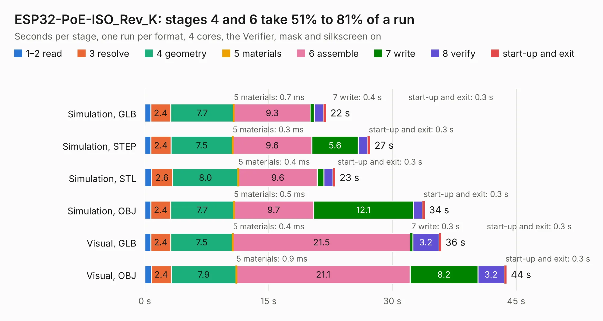

# 1880. ESP32-PoE-ISO_Rev_K

Board 1,880 of the 3,132 of [Corpus Testing](../Corpus-Testing.md), on [Corpus Page 18](../CorpusTestingPages/Corpus-Testing-18.md#1880-esp32-poe-iso_rev_k).

| Mode and format | 1–2 read | 3 resolve | 4 geometry | 5 materials | 6 assemble | 7 write | 8 verify | start-up and exit | Total |
|---|---:|---:|---:|---:|---:|---:|---:|---:|---:|
| Simulation, GLB | 0.7 | 2.4 | 7.7 | 0.7&nbsp;ms | 9.3 | 0.4 | 1.1 | 0.3 | 22.0 |
| Simulation, STEP | 0.7 | 2.4 | 7.5 | 0.3&nbsp;ms | 9.6 | 5.6 | 1.1 | 0.3 | 27.3 |
| Simulation, STL | 0.8 | 2.6 | 8.0 | 0.4&nbsp;ms | 9.6 | 0.8 | 1.1 | 0.3 | 23.1 |
| Simulation, OBJ | 0.7 | 2.4 | 7.7 | 0.5&nbsp;ms | 9.7 | 12.1 | 1.1 | 0.3 | 33.9 |
| Visual, GLB | 0.7 | 2.4 | 7.5 | 0.4&nbsp;ms | 21.5 | 0.3 | 3.2 | 0.3 | 35.9 |
| Visual, OBJ | 0.8 | 2.4 | 7.9 | 0.9&nbsp;ms | 21.1 | 8.2 | 3.2 | 0.3 | 43.8 |

<table align="center"><tr><td valign="top">

| Board | Repo: [OLIMEX/ESP32-POE-ISO](https://github.com/OLIMEX/ESP32-POE-ISO) Board: `ESP32-PoE-ISO_Rev_K.kicad_pcb` |
|---|---|
| Folder | HARDWARE / ESP32-PoE-ISO-Rev.K |
| Complexity | 337&nbsp;/&nbsp;1000 (size&nbsp;262, features&nbsp;75) |
| KESE&nbsp;features | through vias, slotted holes, rounded, trapezoid or chamfered pads, filled zones, copper text, curved board outline |
| Tested | 9th November 2026 |
| Copper&nbsp;layers | 4 |
| File&nbsp;format | KiCad 5 (20171130) |
| Parts,&nbsp;tracks,&nbsp;vias | 128, 3,057, 320 |
| Triangles,&nbsp;simulation | 2,423,136 in 139 parts |
| Verifier | PASS in all six runs |

</td><td valign="top">

<table>
<tr><th>File type</th><th>File size</th><th>Peak memory used</th></tr>
<tr><th colspan="3" align="left">Simulation</th></tr>
<tr><td>GLB</td><td align="right">85&nbsp;MB</td><td align="right">782&nbsp;MB</td></tr>
<tr><td>STEP</td><td align="right">346&nbsp;MB</td><td align="right">978&nbsp;MB</td></tr>
<tr><td>STL</td><td align="right">121&nbsp;MB</td><td align="right">780&nbsp;MB</td></tr>
<tr><td>OBJ</td><td align="right">258&nbsp;MB</td><td align="right">1.6&nbsp;GB</td></tr>
<tr><th colspan="3" align="left">Visual</th></tr>
<tr><td>GLB</td><td align="right">56&nbsp;MB</td><td align="right">982&nbsp;MB</td></tr>
<tr><td>OBJ</td><td align="right">172&nbsp;MB</td><td align="right">1.2&nbsp;GB</td></tr>
</table>

</td></tr></table>

| Previous | Next |
|:---|---:|
| [1879. ESP32-PoE-ISO_Rev_J](b1879b_ESP32-POE-ISO_ESP32-PoE-ISO-Rev-J.md) | [1881. ESP32-PoE-ISO_Rev_L](b1881b_ESP32-POE-ISO_ESP32-PoE-ISO-Rev-L.md) |
