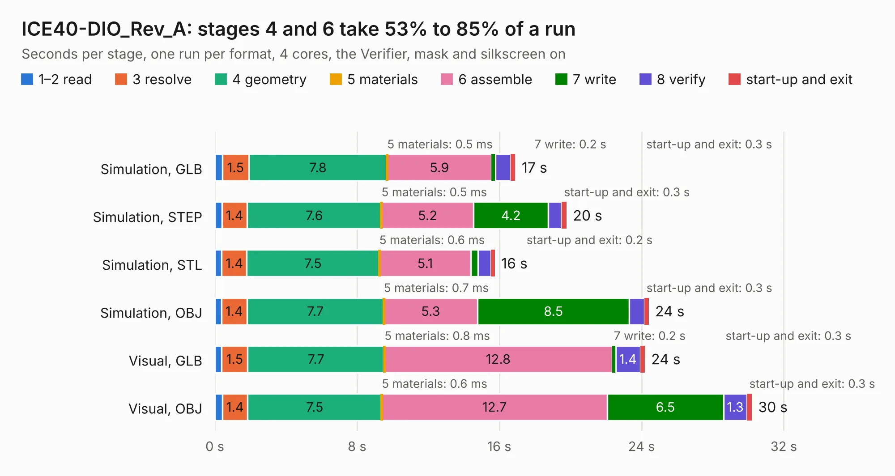

# 1881. ICE40-DIO_Rev_A

Board 1,881 of the 3,106 of [Corpus Testing](../Corpus-Testing.md), on [Corpus Page 18](../CorpusTestingPages/Corpus-Testing-18.md#1881-ice40-dio_rev_a).

| Mode and format | 1–2 read | 3 resolve | 4 geometry | 5 materials | 6 assemble | 7 write | 8 verify | start-up and exit | Total |
|---|---:|---:|---:|---:|---:|---:|---:|---:|---:|
| Simulation, GLB | 0.4 | 1.5 | 7.8 | 0.5&nbsp;ms | 5.9 | 0.2 | 0.9 | 0.3 | 16.9 |
| Simulation, STEP | 0.4 | 1.4 | 7.6 | 0.5&nbsp;ms | 5.2 | 4.2 | 0.8 | 0.3 | 19.8 |
| Simulation, STL | 0.4 | 1.4 | 7.5 | 0.6&nbsp;ms | 5.1 | 0.4 | 0.7 | 0.2 | 15.7 |
| Simulation, OBJ | 0.4 | 1.4 | 7.7 | 0.7&nbsp;ms | 5.3 | 8.5 | 0.8 | 0.3 | 24.4 |
| Visual, GLB | 0.4 | 1.5 | 7.7 | 0.8&nbsp;ms | 12.8 | 0.2 | 1.4 | 0.3 | 24.2 |
| Visual, OBJ | 0.4 | 1.4 | 7.5 | 0.6&nbsp;ms | 12.7 | 6.5 | 1.3 | 0.3 | 30.2 |

<table align="center"><tr><td valign="top">

| Board | Repo: [OLIMEX/iCE40-DIO](https://github.com/OLIMEX/iCE40-DIO) Board: `ICE40-DIO_Rev_A.kicad_pcb` |
|---|---|
| Complexity | 266&nbsp;/&nbsp;1000 (size&nbsp;231, features&nbsp;35) |
| KESE&nbsp;features | through vias, filled zones |
| Tested | 9th November 2026 |
| Copper&nbsp;layers | 2 |
| File&nbsp;format | KiCad 5 (20170123) |
| Parts,&nbsp;tracks,&nbsp;vias | 41, 1,703, 205 |
| Triangles,&nbsp;simulation | 1,473,352 in 89 parts |
| Verifier | PASS in all six runs |

</td><td valign="top">

<table>
<tr><th>File type</th><th>File size</th><th>Peak memory used</th></tr>
<tr><th colspan="3" align="left">Simulation</th></tr>
<tr><td>GLB</td><td align="right">51&nbsp;MB</td><td align="right">580&nbsp;MB</td></tr>
<tr><td>STEP</td><td align="right">258&nbsp;MB</td><td align="right">686&nbsp;MB</td></tr>
<tr><td>STL</td><td align="right">74&nbsp;MB</td><td align="right">587&nbsp;MB</td></tr>
<tr><td>OBJ</td><td align="right">154&nbsp;MB</td><td align="right">984&nbsp;MB</td></tr>
<tr><th colspan="3" align="left">Visual</th></tr>
<tr><td>GLB</td><td align="right">39&nbsp;MB</td><td align="right">726&nbsp;MB</td></tr>
<tr><td>OBJ</td><td align="right">118&nbsp;MB</td><td align="right">880&nbsp;MB</td></tr>
</table>

</td></tr></table>

| Previous | Next |
|:---|---:|
| [1880. ICE40-DAC_Rev_A](b1880b_iCE40-DAC_ICE40-DAC-Rev-A.md) | [1882. ICE40-IO_Rev_A](b1882b_iCE40-IO_ICE40-IO-Rev-A.md) |
