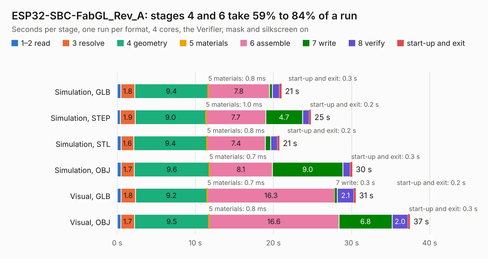

# 1882. ESP32-SBC-FabGL_Rev_A

Board 1,882 of the 3,117 of [Corpus Testing](../Corpus-Testing.md), on [Corpus Page 18](../CorpusTestingPages/Corpus-Testing-18.md#1882-esp32-sbc-fabgl_rev_a).

| Mode and format | 1–2 read | 3 resolve | 4 geometry | 5 materials | 6 assemble | 7 write | 8 verify | start-up and exit | Total |
|---|---:|---:|---:|---:|---:|---:|---:|---:|---:|
| Simulation, GLB | 0.5 | 1.8 | 9.4 | 0.8&nbsp;ms | 7.8 | 0.4 | 0.9 | 0.3 | 21.0 |
| Simulation, STEP | 0.4 | 1.9 | 9.0 | 1.0&nbsp;ms | 7.7 | 4.7 | 0.9 | 0.2 | 24.8 |
| Simulation, STL | 0.5 | 1.6 | 9.4 | 0.8&nbsp;ms | 7.4 | 0.7 | 0.9 | 0.2 | 20.8 |
| Simulation, OBJ | 0.5 | 1.7 | 9.6 | 0.7&nbsp;ms | 8.1 | 9.0 | 0.9 | 0.3 | 30.1 |
| Visual, GLB | 0.5 | 1.8 | 9.2 | 0.7&nbsp;ms | 16.3 | 0.3 | 2.1 | 0.2 | 30.5 |
| Visual, OBJ | 0.5 | 1.7 | 9.5 | 0.8&nbsp;ms | 16.6 | 6.8 | 2.0 | 0.3 | 37.5 |

<table align="center"><tr><td valign="top">

| Board | Repo: [OLIMEX/ESP32-SBC-FabGL](https://github.com/OLIMEX/ESP32-SBC-FabGL) Board: `ESP32-SBC-FabGL_Rev_A.kicad_pcb` |
|---|---|
| Folder | HARDWARE / Hardware-revision-A |
| Complexity | 249&nbsp;/&nbsp;1000 (size&nbsp;194, features&nbsp;55) |
| KESE&nbsp;features | through vias, slotted holes, filled zones, curved board outline |
| Tested | 9th November 2026 |
| Copper&nbsp;layers | 2 |
| File&nbsp;format | KiCad 5 (20171130) |
| Parts,&nbsp;tracks,&nbsp;vias | 107, 1,402, 264 |
| Triangles,&nbsp;simulation | 1,738,592 in 126 parts |
| Verifier | PASS in all six runs |

</td><td valign="top">

<table>
<tr><th>File type</th><th>File size</th><th>Peak memory used</th></tr>
<tr><th colspan="3" align="left">Simulation</th></tr>
<tr><td>GLB</td><td align="right">61&nbsp;MB</td><td align="right">642&nbsp;MB</td></tr>
<tr><td>STEP</td><td align="right">313&nbsp;MB</td><td align="right">847&nbsp;MB</td></tr>
<tr><td>STL</td><td align="right">87&nbsp;MB</td><td align="right">626&nbsp;MB</td></tr>
<tr><td>OBJ</td><td align="right">184&nbsp;MB</td><td align="right">1.2&nbsp;GB</td></tr>
<tr><th colspan="3" align="left">Visual</th></tr>
<tr><td>GLB</td><td align="right">49&nbsp;MB</td><td align="right">830&nbsp;MB</td></tr>
<tr><td>OBJ</td><td align="right">148&nbsp;MB</td><td align="right">1.0&nbsp;GB</td></tr>
</table>

</td></tr></table>

| Previous | Next |
|:---|---:|
| [1881. ESP32-S3-DevKit-LiPo_Rev_B](b1881b_ESP32-S3-DevKit-LiPo_ESP32-S3-DevKit-LiPo-Rev-B.md) | [1883. ESP32-SBC-FabGL_Rev_B](b1883b_ESP32-SBC-FabGL_ESP32-SBC-FabGL-Rev-B.md) |
