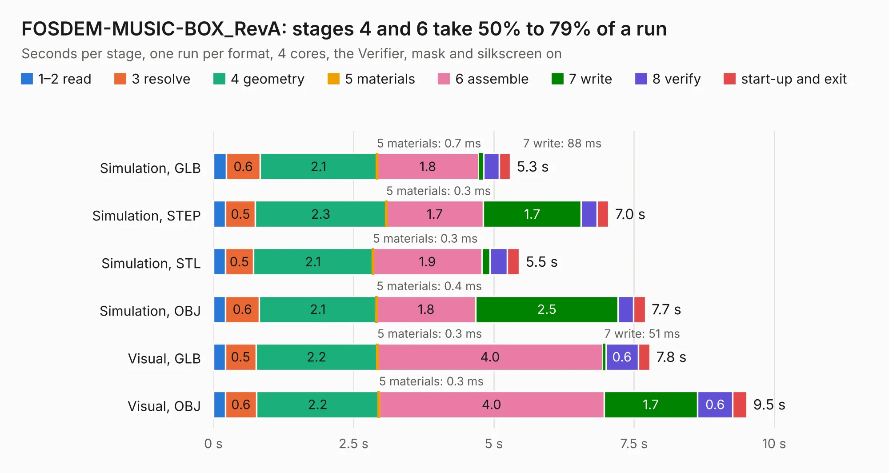

# 1887. FOSDEM-MUSIC-BOX_RevA

Board 1,887 of the 3,119 of [Corpus Testing](../Corpus-Testing.md), on [Corpus Page 18](../CorpusTestingPages/Corpus-Testing-18.md#1887-fosdem-music-box_reva).

| Mode and format | 1–2 read | 3 resolve | 4 geometry | 5 materials | 6 assemble | 7 write | 8 verify | start-up and exit | Total |
|---|---:|---:|---:|---:|---:|---:|---:|---:|---:|
| Simulation, GLB | 0.2 | 0.6 | 2.1 | 0.7&nbsp;ms | 1.8 | 88&nbsp;ms | 0.3 | 0.2 | 5.3 |
| Simulation, STEP | 0.2 | 0.5 | 2.3 | 0.3&nbsp;ms | 1.7 | 1.7 | 0.3 | 0.2 | 7.0 |
| Simulation, STL | 0.2 | 0.5 | 2.1 | 0.3&nbsp;ms | 1.9 | 0.1 | 0.3 | 0.2 | 5.5 |
| Simulation, OBJ | 0.2 | 0.6 | 2.1 | 0.4&nbsp;ms | 1.8 | 2.5 | 0.3 | 0.2 | 7.7 |
| Visual, GLB | 0.2 | 0.5 | 2.2 | 0.3&nbsp;ms | 4.0 | 51&nbsp;ms | 0.6 | 0.2 | 7.8 |
| Visual, OBJ | 0.2 | 0.6 | 2.2 | 0.3&nbsp;ms | 4.0 | 1.7 | 0.6 | 0.3 | 9.5 |

<table align="center"><tr><td valign="top">

| Board | Repo: [OLIMEX/FOSDEM-MUSIC-BOX](https://github.com/OLIMEX/FOSDEM-MUSIC-BOX) Board: `FOSDEM-MUSIC-BOX_RevA.kicad_pcb` |
|---|---|
| Folder | HARDWARE / FOSDEM-MUSIC-BOX_RevA |
| Complexity | 195&nbsp;/&nbsp;1000 (size&nbsp;130, features&nbsp;65) |
| KESE&nbsp;features | filled zones, curved board outline, stack-up, dielectric εr and tanδ, mask and silkscreen colours |
| Tested | 9th November 2026 |
| Copper&nbsp;layers | 2 |
| File&nbsp;format | KiCad 6 (20191123) |
| Parts,&nbsp;tracks,&nbsp;vias | 23, 122, 0 |
| Triangles,&nbsp;simulation | 568,428 in 32 parts |
| Verifier | PASS in all six runs |

</td><td valign="top">

<table>
<tr><th>File type</th><th>File size</th><th>Peak memory used</th></tr>
<tr><th colspan="3" align="left">Simulation</th></tr>
<tr><td>GLB</td><td align="right">20&nbsp;MB</td><td align="right">302&nbsp;MB</td></tr>
<tr><td>STEP</td><td align="right">106&nbsp;MB</td><td align="right">347&nbsp;MB</td></tr>
<tr><td>STL</td><td align="right">28&nbsp;MB</td><td align="right">309&nbsp;MB</td></tr>
<tr><td>OBJ</td><td align="right">58&nbsp;MB</td><td align="right">427&nbsp;MB</td></tr>
<tr><th colspan="3" align="left">Visual</th></tr>
<tr><td>GLB</td><td align="right">14&nbsp;MB</td><td align="right">358&nbsp;MB</td></tr>
<tr><td>OBJ</td><td align="right">40&nbsp;MB</td><td align="right">370&nbsp;MB</td></tr>
</table>

</td></tr></table>

| Previous | Next |
|:---|---:|
| [1886. Flash-e_Rev_C](b1886b_Flash-e_Flash-e-Rev-C.md) | [1888. GateMateA1-EVB_Rev_A](b1888b_GateMateA1-EVB_GateMateA1-EVB-Rev-A.md) |
