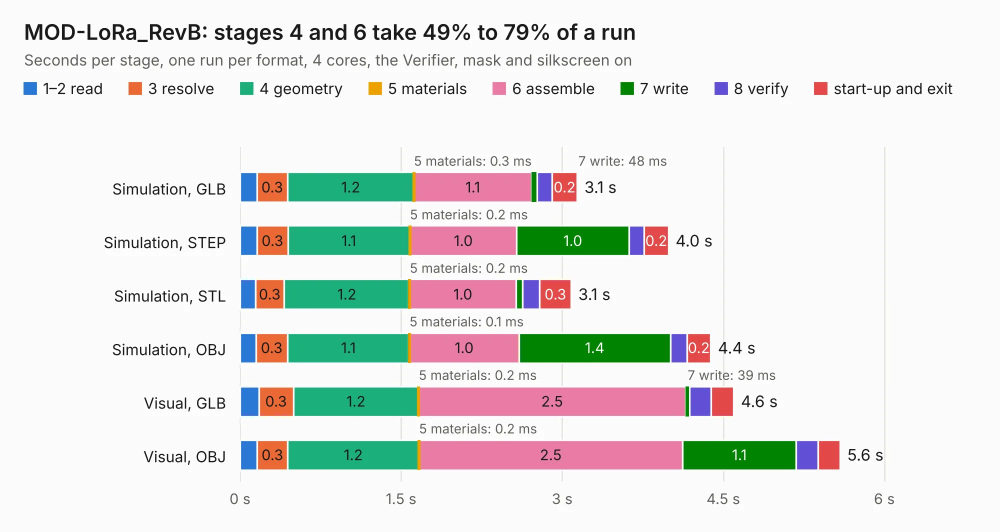

# 1887. MOD-LoRa_RevB

Board 1,887 of the 3,101 of [Corpus Testing](../Corpus-Testing.md), on [Corpus Page 18](../CorpusTestingPages/Corpus-Testing-18.md#1887-mod-lora_revb).

| Mode and format | 1–2 read | 3 resolve | 4 geometry | 5 materials | 6 assemble | 7 write | 8 verify | start-up and exit | Total |
|---|---:|---:|---:|---:|---:|---:|---:|---:|---:|
| Simulation, GLB | 0.2 | 0.3 | 1.2 | 0.3&nbsp;ms | 1.1 | 48&nbsp;ms | 0.1 | 0.2 | 3.1 |
| Simulation, STEP | 0.2 | 0.3 | 1.1 | 0.2&nbsp;ms | 1.0 | 1.0 | 0.1 | 0.2 | 4.0 |
| Simulation, STL | 0.1 | 0.3 | 1.2 | 0.2&nbsp;ms | 1.0 | 63&nbsp;ms | 0.2 | 0.3 | 3.1 |
| Simulation, OBJ | 0.1 | 0.3 | 1.1 | 0.1&nbsp;ms | 1.0 | 1.4 | 0.2 | 0.2 | 4.4 |
| Visual, GLB | 0.2 | 0.3 | 1.2 | 0.2&nbsp;ms | 2.5 | 39&nbsp;ms | 0.2 | 0.2 | 4.6 |
| Visual, OBJ | 0.2 | 0.3 | 1.2 | 0.2&nbsp;ms | 2.5 | 1.1 | 0.2 | 0.2 | 5.6 |

<table align="center"><tr><td valign="top">

| Board | Repo: [OLIMEX/LoRa-868-915](https://github.com/OLIMEX/LoRa-868-915) Board: `MOD-LoRa_RevB.kicad_pcb` |
|---|---|
| Folder | HARDWARE / MOD-LoRa-Rev-B |
| Complexity | 235&nbsp;/&nbsp;1000 (size&nbsp;190, features&nbsp;45) |
| KESE&nbsp;features | through vias, slotted holes, filled zones |
| Tested | 9th November 2026 |
| Copper&nbsp;layers | 2 |
| File&nbsp;format | KiCad 5 (20171130) |
| Parts,&nbsp;tracks,&nbsp;vias | 25, 237, 51 |
| Triangles,&nbsp;simulation | 251,278 in 39 parts |
| Verifier | PASS in all six runs |

</td><td valign="top">

<table>
<tr><th>File type</th><th>File size</th><th>Peak memory used</th></tr>
<tr><th colspan="3" align="left">Simulation</th></tr>
<tr><td>GLB</td><td align="right">9.3&nbsp;MB</td><td align="right">226&nbsp;MB</td></tr>
<tr><td>STEP</td><td align="right">44&nbsp;MB</td><td align="right">256&nbsp;MB</td></tr>
<tr><td>STL</td><td align="right">13&nbsp;MB</td><td align="right">232&nbsp;MB</td></tr>
<tr><td>OBJ</td><td align="right">26&nbsp;MB</td><td align="right">226&nbsp;MB</td></tr>
<tr><th colspan="3" align="left">Visual</th></tr>
<tr><td>GLB</td><td align="right">7.1&nbsp;MB</td><td align="right">215&nbsp;MB</td></tr>
<tr><td>OBJ</td><td align="right">20&nbsp;MB</td><td align="right">213&nbsp;MB</td></tr>
</table>

</td></tr></table>

| Previous | Next |
|:---|---:|
| [1886. LoRa_RevB](b1886b_LoRa-868-915_LoRa-RevB.md) | [1888. STM32WL-DevKit_RevB](b1888b_LoRa-STM32WL-DevKIT_STM32WL-DevKit-RevB.md) |
