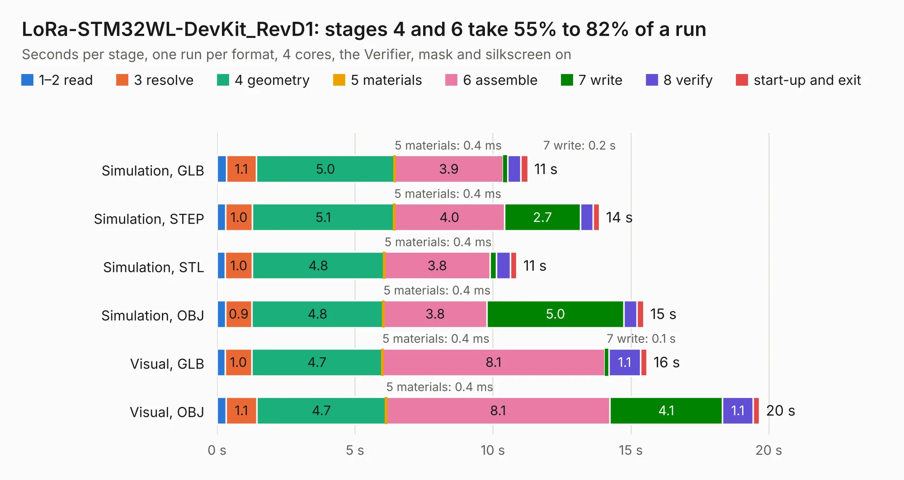

# 1888. LoRa-STM32WL-DevKit_RevD1

Board 1,888 of the 3,100 of [Corpus Testing](../Corpus-Testing.md), on [Corpus Page 18](../CorpusTestingPages/Corpus-Testing-18.md#1888-lora-stm32wl-devkit_revd1).

| Mode and format | 1–2 read | 3 resolve | 4 geometry | 5 materials | 6 assemble | 7 write | 8 verify | start-up and exit | Total |
|---|---:|---:|---:|---:|---:|---:|---:|---:|---:|
| Simulation, GLB | 0.3 | 1.1 | 5.0 | 0.4&nbsp;ms | 3.9 | 0.2 | 0.5 | 0.2 | 11.3 |
| Simulation, STEP | 0.3 | 1.0 | 5.1 | 0.4&nbsp;ms | 4.0 | 2.7 | 0.5 | 0.2 | 13.9 |
| Simulation, STL | 0.3 | 1.0 | 4.8 | 0.4&nbsp;ms | 3.8 | 0.2 | 0.5 | 0.2 | 10.9 |
| Simulation, OBJ | 0.3 | 0.9 | 4.8 | 0.4&nbsp;ms | 3.8 | 5.0 | 0.5 | 0.2 | 15.5 |
| Visual, GLB | 0.3 | 1.0 | 4.7 | 0.4&nbsp;ms | 8.1 | 0.1 | 1.1 | 0.2 | 15.6 |
| Visual, OBJ | 0.3 | 1.1 | 4.7 | 0.4&nbsp;ms | 8.1 | 4.1 | 1.1 | 0.2 | 19.7 |

<table align="center"><tr><td valign="top">

| Board | Repo: [OLIMEX/LoRa-STM32WL-DevKIT](https://github.com/OLIMEX/LoRa-STM32WL-DevKIT) Board: `LoRa-STM32WL-DevKit_RevD1.kicad_pcb` |
|---|---|
| Folder | HARDWARE / LoRa-STM32WL-DevKIT / LoRa-STM32WL-DevKit-RevD1 |
| Complexity | 271&nbsp;/&nbsp;1000 (size&nbsp;216, features&nbsp;55) |
| KESE&nbsp;features | through vias, slotted holes, rounded, trapezoid or chamfered pads, filled zones |
| Tested | 9th November 2026 |
| Copper&nbsp;layers | 2 |
| File&nbsp;format | KiCad 5 (20171130) |
| Parts,&nbsp;tracks,&nbsp;vias | 54, 739, 137 |
| Triangles,&nbsp;simulation | 943,760 in 78 parts |
| Verifier | PASS in all six runs |

</td><td valign="top">

<table>
<tr><th>File type</th><th>File size</th><th>Peak memory used</th></tr>
<tr><th colspan="3" align="left">Simulation</th></tr>
<tr><td>GLB</td><td align="right">33&nbsp;MB</td><td align="right">429&nbsp;MB</td></tr>
<tr><td>STEP</td><td align="right">164&nbsp;MB</td><td align="right">541&nbsp;MB</td></tr>
<tr><td>STL</td><td align="right">47&nbsp;MB</td><td align="right">451&nbsp;MB</td></tr>
<tr><td>OBJ</td><td align="right">97&nbsp;MB</td><td align="right">678&nbsp;MB</td></tr>
<tr><th colspan="3" align="left">Visual</th></tr>
<tr><td>GLB</td><td align="right">27&nbsp;MB</td><td align="right">571&nbsp;MB</td></tr>
<tr><td>OBJ</td><td align="right">80&nbsp;MB</td><td align="right">637&nbsp;MB</td></tr>
</table>

</td></tr></table>

| Previous | Next |
|:---|---:|
| [1887. STM32WL-DevKit_RevB](b1887b_LoRa-STM32WL-DevKIT_STM32WL-DevKit-RevB.md) | [1889. MiniBot_charger_RevA](b1889b_Minibot_MiniBot-charger-RevA.md) |
