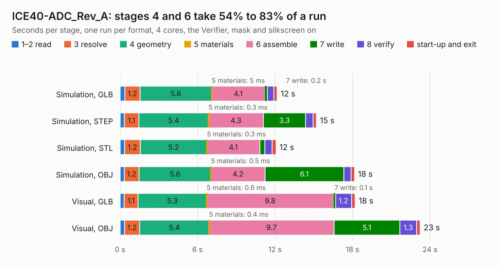

# 1888. ICE40-ADC_Rev_A

Board 1,888 of the 3,116 of [Corpus Testing](../Corpus-Testing.md), on [Corpus Page 18](../CorpusTestingPages/Corpus-Testing-18.md#1888-ice40-adc_rev_a).

| Mode and format | 1–2 read | 3 resolve | 4 geometry | 5 materials | 6 assemble | 7 write | 8 verify | start-up and exit | Total |
|---|---:|---:|---:|---:|---:|---:|---:|---:|---:|
| Simulation, GLB | 0.4 | 1.2 | 5.6 | 5&nbsp;ms | 4.1 | 0.2 | 0.5 | 0.3 | 12.2 |
| Simulation, STEP | 0.3 | 1.1 | 5.4 | 0.3&nbsp;ms | 4.3 | 3.3 | 0.6 | 0.3 | 15.2 |
| Simulation, STL | 0.3 | 1.2 | 5.2 | 0.3&nbsp;ms | 4.1 | 0.4 | 0.6 | 0.3 | 12.1 |
| Simulation, OBJ | 0.3 | 1.2 | 5.6 | 0.5&nbsp;ms | 4.2 | 6.1 | 0.6 | 0.3 | 18.1 |
| Visual, GLB | 0.3 | 1.1 | 5.3 | 0.6&nbsp;ms | 9.8 | 0.1 | 1.2 | 0.3 | 18.2 |
| Visual, OBJ | 0.3 | 1.2 | 5.4 | 0.4&nbsp;ms | 9.7 | 5.1 | 1.3 | 0.3 | 23.2 |

<table align="center"><tr><td valign="top">

| Board | Repo: [OLIMEX/iCE40-ADC](https://github.com/OLIMEX/iCE40-ADC) Board: `ICE40-ADC_Rev_A.kicad_pcb` |
|---|---|
| Complexity | 216&nbsp;/&nbsp;1000 (size&nbsp;181, features&nbsp;35) |
| KESE&nbsp;features | through vias, filled zones |
| Tested | 9th November 2026 |
| Copper&nbsp;layers | 2 |
| File&nbsp;format | KiCad 5 (20170123) |
| Parts,&nbsp;tracks,&nbsp;vias | 43, 1,220, 192 |
| Triangles,&nbsp;simulation | 1,044,008 in 65 parts |
| Verifier | PASS in all six runs |

</td><td valign="top">

<table>
<tr><th>File type</th><th>File size</th><th>Peak memory used</th></tr>
<tr><th colspan="3" align="left">Simulation</th></tr>
<tr><td>GLB</td><td align="right">36&nbsp;MB</td><td align="right">433&nbsp;MB</td></tr>
<tr><td>STEP</td><td align="right">187&nbsp;MB</td><td align="right">507&nbsp;MB</td></tr>
<tr><td>STL</td><td align="right">52&nbsp;MB</td><td align="right">440&nbsp;MB</td></tr>
<tr><td>OBJ</td><td align="right">108&nbsp;MB</td><td align="right">743&nbsp;MB</td></tr>
<tr><th colspan="3" align="left">Visual</th></tr>
<tr><td>GLB</td><td align="right">28&nbsp;MB</td><td align="right">595&nbsp;MB</td></tr>
<tr><td>OBJ</td><td align="right">83&nbsp;MB</td><td align="right">640&nbsp;MB</td></tr>
</table>

</td></tr></table>

| Previous | Next |
|:---|---:|
| [1887. GateMateA1-EVB_Rev_C](b1887b_GateMateA1-EVB_GateMateA1-EVB-Rev-C.md) | [1889. ICE40-DAC_Rev_A1](b1889b_iCE40-DAC_ICE40-DAC-Rev-A1.md) |
