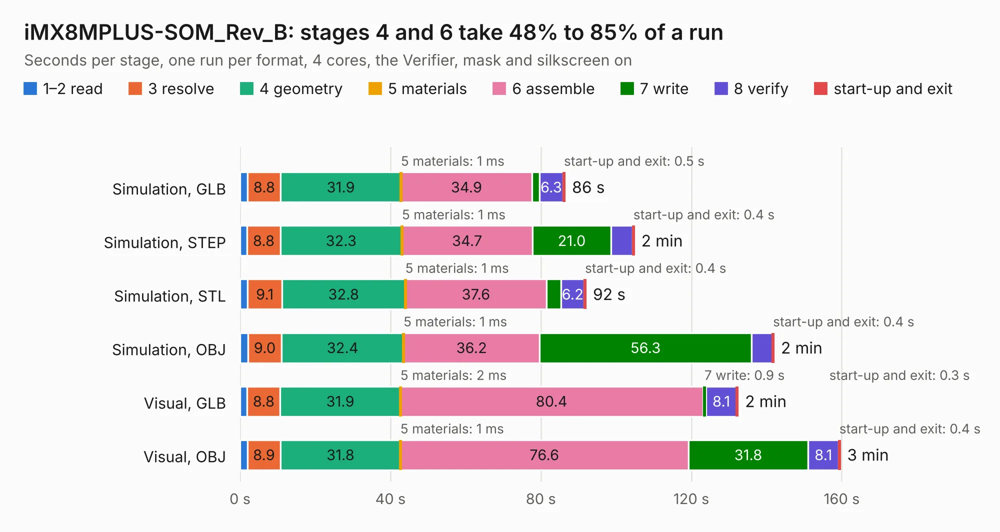

# 1888. iMX8MPLUS-SOM_Rev_B

Board 1,888 of the 3,107 of [Corpus Testing](../Corpus-Testing.md), on [Corpus Page 18](../CorpusTestingPages/Corpus-Testing-18.md#1888-imx8mplus-som_rev_b).

| Mode and format | 1–2 read | 3 resolve | 4 geometry | 5 materials | 6 assemble | 7 write | 8 verify | start-up and exit | Total |
|---|---:|---:|---:|---:|---:|---:|---:|---:|---:|
| Simulation, GLB | 2.1 | 8.8 | 31.9 | 1&nbsp;ms | 34.9 | 1.9 | 6.3 | 0.5 | 86.4 |
| Simulation, STEP | 1.9 | 8.8 | 32.3 | 1&nbsp;ms | 34.7 | 21.0 | 5.7 | 0.4 | 104.8 |
| Simulation, STL | 2.0 | 9.1 | 32.8 | 1&nbsp;ms | 37.6 | 3.8 | 6.2 | 0.4 | 91.9 |
| Simulation, OBJ | 2.1 | 9.0 | 32.4 | 1&nbsp;ms | 36.2 | 56.3 | 5.6 | 0.4 | 141.9 |
| Visual, GLB | 1.9 | 8.8 | 31.9 | 2&nbsp;ms | 80.4 | 0.9 | 8.1 | 0.3 | 132.4 |
| Visual, OBJ | 1.9 | 8.9 | 31.8 | 1&nbsp;ms | 76.6 | 31.8 | 8.1 | 0.4 | 159.5 |

<table align="center"><tr><td valign="top">

| Board | Repo: [OLIMEX/iMX8MP-SOM](https://github.com/OLIMEX/iMX8MP-SOM) Board: `iMX8MPLUS-SOM_Rev_B.kicad_pcb` |
|---|---|
| Folder | HARDWARE / iMX8MP-SOM-xGB-IND |
| Complexity | 363&nbsp;/&nbsp;1000 (size&nbsp;318, features&nbsp;45) |
| KESE&nbsp;features | through vias, filled zones, copper text |
| Tested | 9th November 2026 |
| Copper&nbsp;layers | 6 |
| File&nbsp;format | KiCad 5 (20171130) |
| Parts,&nbsp;tracks,&nbsp;vias | 203, 11,532, 988 |
| Triangles,&nbsp;simulation | 8,457,830 in 438 parts |
| Verifier | PASS in all six runs |

</td><td valign="top">

<table>
<tr><th>File type</th><th>File size</th><th>Peak memory used</th></tr>
<tr><th colspan="3" align="left">Simulation</th></tr>
<tr><td>GLB</td><td align="right">294&nbsp;MB</td><td align="right">2.2&nbsp;GB</td></tr>
<tr><td>STEP</td><td align="right">1.2&nbsp;GB</td><td align="right">2.8&nbsp;GB</td></tr>
<tr><td>STL</td><td align="right">423&nbsp;MB</td><td align="right">2.3&nbsp;GB</td></tr>
<tr><td>OBJ</td><td align="right">916&nbsp;MB</td><td align="right">5.4&nbsp;GB</td></tr>
<tr><th colspan="3" align="left">Visual</th></tr>
<tr><td>GLB</td><td align="right">163&nbsp;MB</td><td align="right">2.6&nbsp;GB</td></tr>
<tr><td>OBJ</td><td align="right">535&nbsp;MB</td><td align="right">3.4&nbsp;GB</td></tr>
</table>

</td></tr></table>

| Previous | Next |
|:---|---:|
| [1887. iCE40HX8K-EVB_Rev_B1](b1887b_iCE40HX8K-EVB_iCE40HX8K-EVB-Rev-B1.md) | [1889. iMX8MPLUS-SOM-EVB_Rev_B](b1889b_iMX8MP-SOM-EVB_iMX8MPLUS-SOM-EVB-Rev-B.md) |
