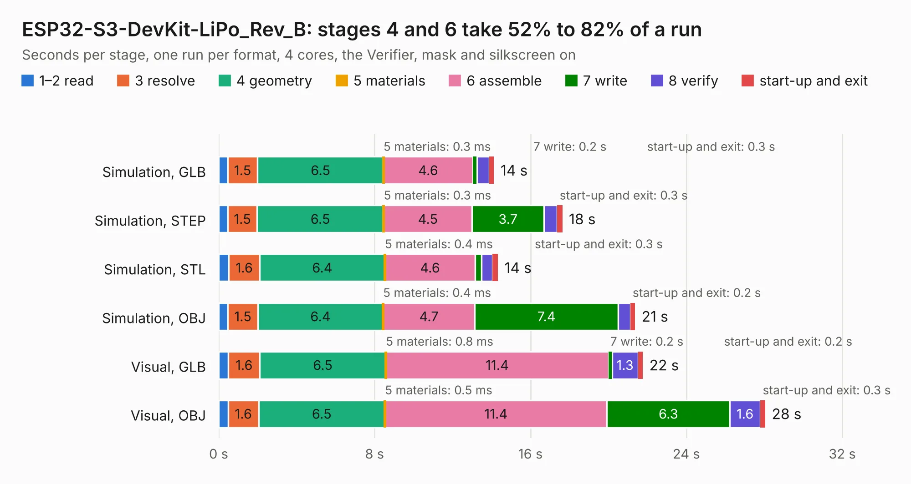

# 1889. ESP32-S3-DevKit-LiPo_Rev_B

Board 1,889 of the 3,127 of [Corpus Testing](../Corpus-Testing.md), on [Corpus Page 18](../CorpusTestingPages/Corpus-Testing-18.md#1889-esp32-s3-devkit-lipo_rev_b).

| Mode and format | 1–2 read | 3 resolve | 4 geometry | 5 materials | 6 assemble | 7 write | 8 verify | start-up and exit | Total |
|---|---:|---:|---:|---:|---:|---:|---:|---:|---:|
| Simulation, GLB | 0.5 | 1.5 | 6.5 | 0.3&nbsp;ms | 4.6 | 0.2 | 0.6 | 0.3 | 14.1 |
| Simulation, STEP | 0.5 | 1.5 | 6.5 | 0.3&nbsp;ms | 4.5 | 3.7 | 0.7 | 0.3 | 17.6 |
| Simulation, STL | 0.5 | 1.6 | 6.4 | 0.4&nbsp;ms | 4.6 | 0.3 | 0.6 | 0.3 | 14.3 |
| Simulation, OBJ | 0.5 | 1.5 | 6.4 | 0.4&nbsp;ms | 4.7 | 7.4 | 0.6 | 0.2 | 21.4 |
| Visual, GLB | 0.5 | 1.6 | 6.5 | 0.8&nbsp;ms | 11.4 | 0.2 | 1.3 | 0.2 | 21.8 |
| Visual, OBJ | 0.5 | 1.6 | 6.5 | 0.5&nbsp;ms | 11.4 | 6.3 | 1.6 | 0.3 | 28.0 |

<table align="center"><tr><td valign="top">

| Board | Repo: [OLIMEX/ESP32-S3-DevKit-LiPo](https://github.com/OLIMEX/ESP32-S3-DevKit-LiPo) Board: `ESP32-S3-DevKit-LiPo_Rev_B.kicad_pcb` |
|---|---|
| Folder | HARDWARE / ESP32-S3-DevKit-LiPo_Rev_B |
| Complexity | 227&nbsp;/&nbsp;1000 (size&nbsp;182, features&nbsp;45) |
| KESE&nbsp;features | through vias, slotted holes, filled zones |
| Tested | 9th November 2026 |
| Copper&nbsp;layers | 2 |
| File&nbsp;format | KiCad 5 (20171130) |
| Parts,&nbsp;tracks,&nbsp;vias | 54, 1,324, 128 |
| Triangles,&nbsp;simulation | 1,241,654 in 82 parts |
| Verifier | PASS in all six runs |

</td><td valign="top">

<table>
<tr><th>File type</th><th>File size</th><th>Peak memory used</th></tr>
<tr><th colspan="3" align="left">Simulation</th></tr>
<tr><td>GLB</td><td align="right">44&nbsp;MB</td><td align="right">551&nbsp;MB</td></tr>
<tr><td>STEP</td><td align="right">244&nbsp;MB</td><td align="right">654&nbsp;MB</td></tr>
<tr><td>STL</td><td align="right">62&nbsp;MB</td><td align="right">609&nbsp;MB</td></tr>
<tr><td>OBJ</td><td align="right">131&nbsp;MB</td><td align="right">859&nbsp;MB</td></tr>
<tr><th colspan="3" align="left">Visual</th></tr>
<tr><td>GLB</td><td align="right">37&nbsp;MB</td><td align="right">710&nbsp;MB</td></tr>
<tr><td>OBJ</td><td align="right">111&nbsp;MB</td><td align="right">852&nbsp;MB</td></tr>
</table>

</td></tr></table>

| Previous | Next |
|:---|---:|
| [1888. ESP32-S3-DevKit-LiPo_Rev_B_DIMM](b1888b_ESP32-S3-DevKit-LiPo_ESP32-S3-DevKit-LiPo-Rev-B-DIMM.md) | [1890. ESP32-SBC-FabGL_Rev_A](b1890b_ESP32-SBC-FabGL_ESP32-SBC-FabGL-Rev-A.md) |
