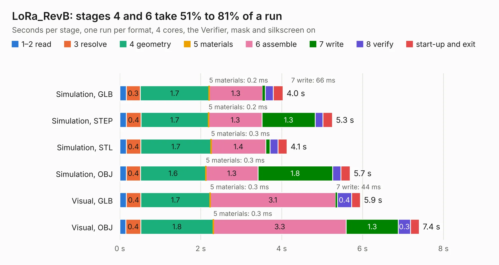

# 1889. LoRa_RevB

Board 1,889 of the 3,104 of [Corpus Testing](../Corpus-Testing.md), on [Corpus Page 18](../CorpusTestingPages/Corpus-Testing-18.md#1889-lora_revb).

| Mode and format | 1–2 read | 3 resolve | 4 geometry | 5 materials | 6 assemble | 7 write | 8 verify | start-up and exit | Total |
|---|---:|---:|---:|---:|---:|---:|---:|---:|---:|
| Simulation, GLB | 0.2 | 0.3 | 1.7 | 0.2&nbsp;ms | 1.3 | 66&nbsp;ms | 0.2 | 0.2 | 4.0 |
| Simulation, STEP | 0.2 | 0.4 | 1.7 | 0.2&nbsp;ms | 1.3 | 1.3 | 0.2 | 0.2 | 5.3 |
| Simulation, STL | 0.2 | 0.4 | 1.7 | 0.3&nbsp;ms | 1.4 | 0.1 | 0.2 | 0.2 | 4.1 |
| Simulation, OBJ | 0.2 | 0.4 | 1.6 | 0.3&nbsp;ms | 1.3 | 1.8 | 0.2 | 0.2 | 5.7 |
| Visual, GLB | 0.2 | 0.4 | 1.7 | 0.3&nbsp;ms | 3.1 | 44&nbsp;ms | 0.4 | 0.2 | 5.9 |
| Visual, OBJ | 0.1 | 0.4 | 1.8 | 0.3&nbsp;ms | 3.3 | 1.3 | 0.3 | 0.2 | 7.4 |

<table align="center"><tr><td valign="top">

| Board | Repo: [OLIMEX/LoRa-868-915](https://github.com/OLIMEX/LoRa-868-915) Board: `LoRa_RevB.kicad_pcb` |
|---|---|
| Folder | HARDWARE / LoRa-Rev-B |
| Complexity | 261&nbsp;/&nbsp;1000 (size&nbsp;191, features&nbsp;70) |
| KESE&nbsp;features | through vias, slotted holes, custom pads, filled zones, copper drawings |
| Tested | 9th November 2026 |
| Copper&nbsp;layers | 2 |
| File&nbsp;format | KiCad 5 (20171130) |
| Parts,&nbsp;tracks,&nbsp;vias | 26, 270, 45 |
| Triangles,&nbsp;simulation | 371,904 in 41 parts |
| Verifier | PASS in all six runs |

</td><td valign="top">

<table>
<tr><th>File type</th><th>File size</th><th>Peak memory used</th></tr>
<tr><th colspan="3" align="left">Simulation</th></tr>
<tr><td>GLB</td><td align="right">13&nbsp;MB</td><td align="right">265&nbsp;MB</td></tr>
<tr><td>STEP</td><td align="right">67&nbsp;MB</td><td align="right">275&nbsp;MB</td></tr>
<tr><td>STL</td><td align="right">19&nbsp;MB</td><td align="right">261&nbsp;MB</td></tr>
<tr><td>OBJ</td><td align="right">39&nbsp;MB</td><td align="right">304&nbsp;MB</td></tr>
<tr><th colspan="3" align="left">Visual</th></tr>
<tr><td>GLB</td><td align="right">9.1&nbsp;MB</td><td align="right">249&nbsp;MB</td></tr>
<tr><td>OBJ</td><td align="right">27&nbsp;MB</td><td align="right">266&nbsp;MB</td></tr>
</table>

</td></tr></table>

| Previous | Next |
|:---|---:|
| [1888. LoRa_RevA](b1888b_LoRa-868-915_LoRa-RevA.md) | [1890. MOD-LoRa_RevB](b1890b_LoRa-868-915_MOD-LoRa-RevB.md) |
