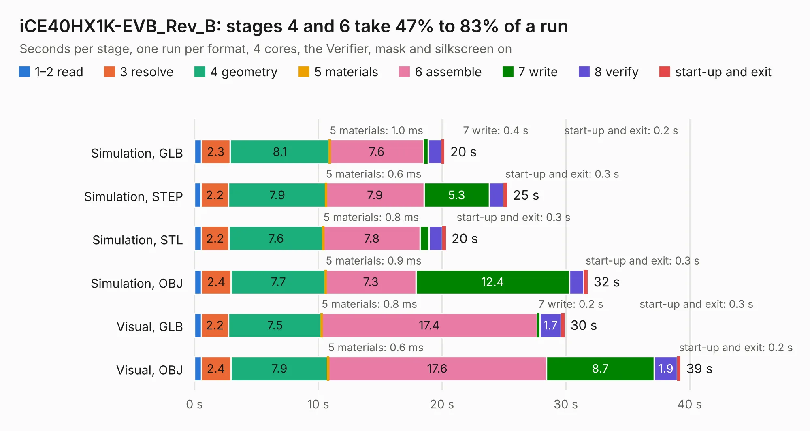

# 1889. iCE40HX1K-EVB_Rev_B

Board 1,889 of the 3,111 of [Corpus Testing](../Corpus-Testing.md), on [Corpus Page 18](../CorpusTestingPages/Corpus-Testing-18.md#1889-ice40hx1k-evb_rev_b).

| Mode and format | 1–2 read | 3 resolve | 4 geometry | 5 materials | 6 assemble | 7 write | 8 verify | start-up and exit | Total |
|---|---:|---:|---:|---:|---:|---:|---:|---:|---:|
| Simulation, GLB | 0.6 | 2.3 | 8.1 | 1.0&nbsp;ms | 7.6 | 0.4 | 1.1 | 0.2 | 20.2 |
| Simulation, STEP | 0.5 | 2.2 | 7.9 | 0.6&nbsp;ms | 7.9 | 5.3 | 1.2 | 0.3 | 25.3 |
| Simulation, STL | 0.6 | 2.2 | 7.6 | 0.8&nbsp;ms | 7.8 | 0.7 | 1.1 | 0.3 | 20.3 |
| Simulation, OBJ | 0.6 | 2.4 | 7.7 | 0.9&nbsp;ms | 7.3 | 12.4 | 1.2 | 0.3 | 31.8 |
| Visual, GLB | 0.5 | 2.2 | 7.5 | 0.8&nbsp;ms | 17.4 | 0.2 | 1.7 | 0.3 | 29.9 |
| Visual, OBJ | 0.5 | 2.4 | 7.9 | 0.6&nbsp;ms | 17.6 | 8.7 | 1.9 | 0.2 | 39.3 |

<table align="center"><tr><td valign="top">

| Board | Repo: [OLIMEX/iCE40HX1K-EVB](https://github.com/OLIMEX/iCE40HX1K-EVB) Board: `iCE40HX1K-EVB_Rev_B.kicad_pcb` |
|---|---|
| Complexity | 281&nbsp;/&nbsp;1000 (size&nbsp;236, features&nbsp;45) |
| KESE&nbsp;features | through vias, slotted holes, filled zones |
| Tested | 9th November 2026 |
| Copper&nbsp;layers | 2 |
| File&nbsp;format | KiCad 4 (4) |
| Parts,&nbsp;tracks,&nbsp;vias | 71, 2,527, 279 |
| Triangles,&nbsp;simulation | 1,966,590 in 110 parts |
| Verifier | PASS in all six runs |

</td><td valign="top">

<table>
<tr><th>File type</th><th>File size</th><th>Peak memory used</th></tr>
<tr><th colspan="3" align="left">Simulation</th></tr>
<tr><td>GLB</td><td align="right">68&nbsp;MB</td><td align="right">678&nbsp;MB</td></tr>
<tr><td>STEP</td><td align="right">295&nbsp;MB</td><td align="right">808&nbsp;MB</td></tr>
<tr><td>STL</td><td align="right">98&nbsp;MB</td><td align="right">716&nbsp;MB</td></tr>
<tr><td>OBJ</td><td align="right">210&nbsp;MB</td><td align="right">1.3&nbsp;GB</td></tr>
<tr><th colspan="3" align="left">Visual</th></tr>
<tr><td>GLB</td><td align="right">46&nbsp;MB</td><td align="right">886&nbsp;MB</td></tr>
<tr><td>OBJ</td><td align="right">142&nbsp;MB</td><td align="right">1.0&nbsp;GB</td></tr>
</table>

</td></tr></table>

| Previous | Next |
|:---|---:|
| [1888. ICE40-1KEVB_Rev_A](b1888b_iCE40HX1K-EVB_ICE40-1KEVB-Rev-A.md) | [1890. iCE40HX8K-EVB_Rev_B](b1890b_iCE40HX8K-EVB_iCE40HX8K-EVB-Rev-B.md) |
