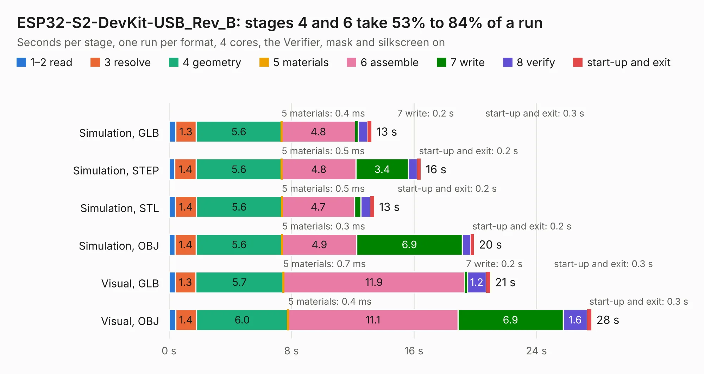

# 1891. ESP32-S2-DevKit-USB_Rev_B

Board 1,891 of the 3,132 of [Corpus Testing](../Corpus-Testing.md), on [Corpus Page 18](../CorpusTestingPages/Corpus-Testing-18.md#1891-esp32-s2-devkit-usb_rev_b).

| Mode and format | 1–2 read | 3 resolve | 4 geometry | 5 materials | 6 assemble | 7 write | 8 verify | start-up and exit | Total |
|---|---:|---:|---:|---:|---:|---:|---:|---:|---:|
| Simulation, GLB | 0.4 | 1.3 | 5.6 | 0.4&nbsp;ms | 4.8 | 0.2 | 0.6 | 0.3 | 13.2 |
| Simulation, STEP | 0.4 | 1.4 | 5.6 | 0.5&nbsp;ms | 4.8 | 3.4 | 0.6 | 0.2 | 16.4 |
| Simulation, STL | 0.4 | 1.4 | 5.6 | 0.5&nbsp;ms | 4.7 | 0.4 | 0.6 | 0.2 | 13.4 |
| Simulation, OBJ | 0.4 | 1.4 | 5.6 | 0.3&nbsp;ms | 4.9 | 6.9 | 0.6 | 0.2 | 19.9 |
| Visual, GLB | 0.4 | 1.3 | 5.7 | 0.7&nbsp;ms | 11.9 | 0.2 | 1.2 | 0.3 | 21.0 |
| Visual, OBJ | 0.4 | 1.4 | 6.0 | 0.4&nbsp;ms | 11.1 | 6.9 | 1.6 | 0.3 | 27.6 |

<table align="center"><tr><td valign="top">

| Board | Repo: [OLIMEX/ESP32-S2-DevKit-LiPo-USB](https://github.com/OLIMEX/ESP32-S2-DevKit-LiPo-USB) Board: `ESP32-S2-DevKit-USB_Rev_B.kicad_pcb` |
|---|---|
| Folder | HARDWARE / ESP32-S2-DevKit-USB-Rev-B |
| Complexity | 250&nbsp;/&nbsp;1000 (size&nbsp;185, features&nbsp;65) |
| KESE&nbsp;features | through vias, slotted holes, rounded, trapezoid or chamfered pads, filled zones, copper text |
| Tested | 9th November 2026 |
| Copper&nbsp;layers | 2 |
| File&nbsp;format | KiCad 5 (20171130) |
| Parts,&nbsp;tracks,&nbsp;vias | 66, 1,299, 156 |
| Triangles,&nbsp;simulation | 1,257,842 in 78 parts |
| Verifier | PASS in all six runs |

</td><td valign="top">

<table>
<tr><th>File type</th><th>File size</th><th>Peak memory used</th></tr>
<tr><th colspan="3" align="left">Simulation</th></tr>
<tr><td>GLB</td><td align="right">45&nbsp;MB</td><td align="right">605&nbsp;MB</td></tr>
<tr><td>STEP</td><td align="right">241&nbsp;MB</td><td align="right">667&nbsp;MB</td></tr>
<tr><td>STL</td><td align="right">63&nbsp;MB</td><td align="right">589&nbsp;MB</td></tr>
<tr><td>OBJ</td><td align="right">133&nbsp;MB</td><td align="right">868&nbsp;MB</td></tr>
<tr><th colspan="3" align="left">Visual</th></tr>
<tr><td>GLB</td><td align="right">38&nbsp;MB</td><td align="right">772&nbsp;MB</td></tr>
<tr><td>OBJ</td><td align="right">113&nbsp;MB</td><td align="right">840&nbsp;MB</td></tr>
</table>

</td></tr></table>

| Previous | Next |
|:---|---:|
| [1890. ESP32-S2-DevKit-Lipo_Rev_B1](b1890b_ESP32-S2-DevKit-LiPo_ESP32-S2-DevKit-Lipo-Rev-B1.md) | [1892. ESP32-S3-DevKit-LiPo_Rev_B_DIMM](b1892b_ESP32-S3-DevKit-LiPo_ESP32-S3-DevKit-LiPo-Rev-B-DIMM.md) |
