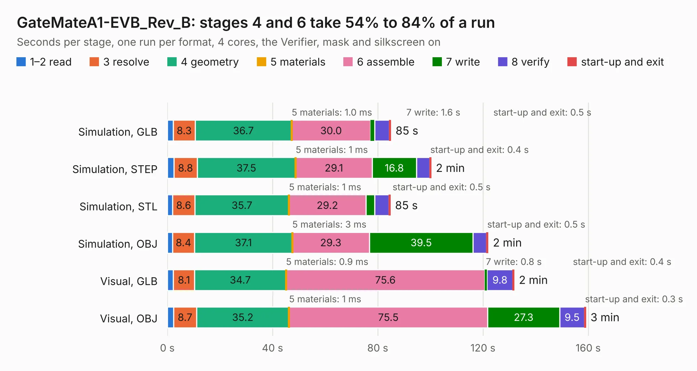

# 1891. GateMateA1-EVB_Rev_B

Board 1,891 of the 3,121 of [Corpus Testing](../Corpus-Testing.md), on [Corpus Page 18](../CorpusTestingPages/Corpus-Testing-18.md#1891-gatematea1-evb_rev_b).

| Mode and format | 1–2 read | 3 resolve | 4 geometry | 5 materials | 6 assemble | 7 write | 8 verify | start-up and exit | Total |
|---|---:|---:|---:|---:|---:|---:|---:|---:|---:|
| Simulation, GLB | 2.2 | 8.3 | 36.7 | 1.0&nbsp;ms | 30.0 | 1.6 | 5.6 | 0.5 | 84.9 |
| Simulation, STEP | 2.5 | 8.8 | 37.5 | 1&nbsp;ms | 29.1 | 16.8 | 5.1 | 0.4 | 100.2 |
| Simulation, STL | 1.9 | 8.6 | 35.7 | 1&nbsp;ms | 29.2 | 3.4 | 5.4 | 0.5 | 84.7 |
| Simulation, OBJ | 1.9 | 8.4 | 37.1 | 3&nbsp;ms | 29.3 | 39.5 | 5.1 | 0.5 | 121.9 |
| Visual, GLB | 2.3 | 8.1 | 34.7 | 0.9&nbsp;ms | 75.6 | 0.8 | 9.8 | 0.4 | 131.8 |
| Visual, OBJ | 2.4 | 8.7 | 35.2 | 1&nbsp;ms | 75.5 | 27.3 | 9.5 | 0.3 | 159.0 |

<table align="center"><tr><td valign="top">

| Board | Repo: [OLIMEX/GateMateA1-EVB](https://github.com/OLIMEX/GateMateA1-EVB) Board: `GateMateA1-EVB_Rev_B.kicad_pcb` |
|---|---|
| Folder | HARDWARE / GateMateA1-EVB-Rev.B |
| Complexity | 428&nbsp;/&nbsp;1000 (size&nbsp;303, features&nbsp;125) |
| KESE&nbsp;features | through vias, slotted holes, rounded, trapezoid or chamfered pads, arc tracks, filled zones, copper text, knockout text, stack-up, dielectric εr and tanδ |
| Tested | 9th November 2026 |
| Copper&nbsp;layers | 4 |
| File&nbsp;format | KiCad 7 (20221018) |
| Parts,&nbsp;tracks,&nbsp;vias | 268, 9,050, 1,267 |
| Triangles,&nbsp;simulation | 7,178,598 in 302 parts |
| Verifier | PASS in all six runs |

</td><td valign="top">

<table>
<tr><th>File type</th><th>File size</th><th>Peak memory used</th></tr>
<tr><th colspan="3" align="left">Simulation</th></tr>
<tr><td>GLB</td><td align="right">250&nbsp;MB</td><td align="right">2.0&nbsp;GB</td></tr>
<tr><td>STEP</td><td align="right">1.2&nbsp;GB</td><td align="right">2.6&nbsp;GB</td></tr>
<tr><td>STL</td><td align="right">359&nbsp;MB</td><td align="right">2.1&nbsp;GB</td></tr>
<tr><td>OBJ</td><td align="right">780&nbsp;MB</td><td align="right">4.7&nbsp;GB</td></tr>
<tr><th colspan="3" align="left">Visual</th></tr>
<tr><td>GLB</td><td align="right">171&nbsp;MB</td><td align="right">2.6&nbsp;GB</td></tr>
<tr><td>OBJ</td><td align="right">549&nbsp;MB</td><td align="right">3.6&nbsp;GB</td></tr>
</table>

</td></tr></table>

| Previous | Next |
|:---|---:|
| [1890. GateMateA1-EVB_Rev_A](b1890b_GateMateA1-EVB_GateMateA1-EVB-Rev-A.md) | [1892. GateMateA1-EVB_Rev_C](b1892b_GateMateA1-EVB_GateMateA1-EVB-Rev-C.md) |
