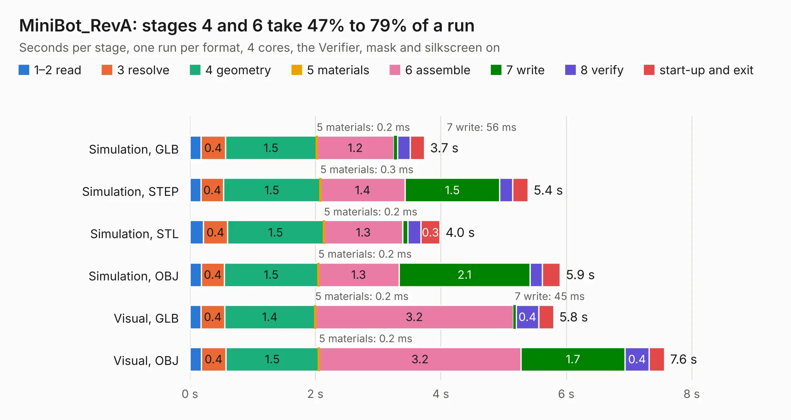

# 1891. MiniBot_RevA

Board 1,891 of the 3,101 of [Corpus Testing](../Corpus-Testing.md), on [Corpus Page 18](../CorpusTestingPages/Corpus-Testing-18.md#1891-minibot_reva).

| Mode and format | 1–2 read | 3 resolve | 4 geometry | 5 materials | 6 assemble | 7 write | 8 verify | start-up and exit | Total |
|---|---:|---:|---:|---:|---:|---:|---:|---:|---:|
| Simulation, GLB | 0.2 | 0.4 | 1.5 | 0.2&nbsp;ms | 1.2 | 56&nbsp;ms | 0.2 | 0.2 | 3.7 |
| Simulation, STEP | 0.2 | 0.4 | 1.5 | 0.3&nbsp;ms | 1.4 | 1.5 | 0.2 | 0.2 | 5.4 |
| Simulation, STL | 0.2 | 0.4 | 1.5 | 0.2&nbsp;ms | 1.3 | 82&nbsp;ms | 0.2 | 0.3 | 4.0 |
| Simulation, OBJ | 0.2 | 0.4 | 1.5 | 0.2&nbsp;ms | 1.3 | 2.1 | 0.2 | 0.3 | 5.9 |
| Visual, GLB | 0.2 | 0.4 | 1.4 | 0.2&nbsp;ms | 3.2 | 45&nbsp;ms | 0.4 | 0.2 | 5.8 |
| Visual, OBJ | 0.2 | 0.4 | 1.5 | 0.2&nbsp;ms | 3.2 | 1.7 | 0.4 | 0.2 | 7.6 |

<table align="center"><tr><td valign="top">

| Board | Repo: [OLIMEX/Minibot](https://github.com/OLIMEX/Minibot) Board: `MiniBot_RevA.kicad_pcb` |
|---|---|
| Folder | HARDWARE |
| Complexity | 202&nbsp;/&nbsp;1000 (size&nbsp;147, features&nbsp;55) |
| KESE&nbsp;features | through vias, slotted holes, filled zones, curved board outline |
| Tested | 9th November 2026 |
| Copper&nbsp;layers | 2 |
| File&nbsp;format | KiCad 5 (20171130) |
| Parts,&nbsp;tracks,&nbsp;vias | 27, 251, 19 |
| Triangles,&nbsp;simulation | 312,404 in 29 parts |
| Verifier | PASS in all six runs |

</td><td valign="top">

<table>
<tr><th>File type</th><th>File size</th><th>Peak memory used</th></tr>
<tr><th colspan="3" align="left">Simulation</th></tr>
<tr><td>GLB</td><td align="right">11&nbsp;MB</td><td align="right">243&nbsp;MB</td></tr>
<tr><td>STEP</td><td align="right">60&nbsp;MB</td><td align="right">262&nbsp;MB</td></tr>
<tr><td>STL</td><td align="right">16&nbsp;MB</td><td align="right">244&nbsp;MB</td></tr>
<tr><td>OBJ</td><td align="right">32&nbsp;MB</td><td align="right">263&nbsp;MB</td></tr>
<tr><th colspan="3" align="left">Visual</th></tr>
<tr><td>GLB</td><td align="right">8.8&nbsp;MB</td><td align="right">244&nbsp;MB</td></tr>
<tr><td>OBJ</td><td align="right">26&nbsp;MB</td><td align="right">256&nbsp;MB</td></tr>
</table>

</td></tr></table>

| Previous | Next |
|:---|---:|
| [1890. MiniBot_charger_RevA](b1890b_Minibot_MiniBot-charger-RevA.md) | [1892. MIPI-HDMI_Rev_B](b1892b_MIPI-HDMI_MIPI-HDMI-Rev-B.md) |
